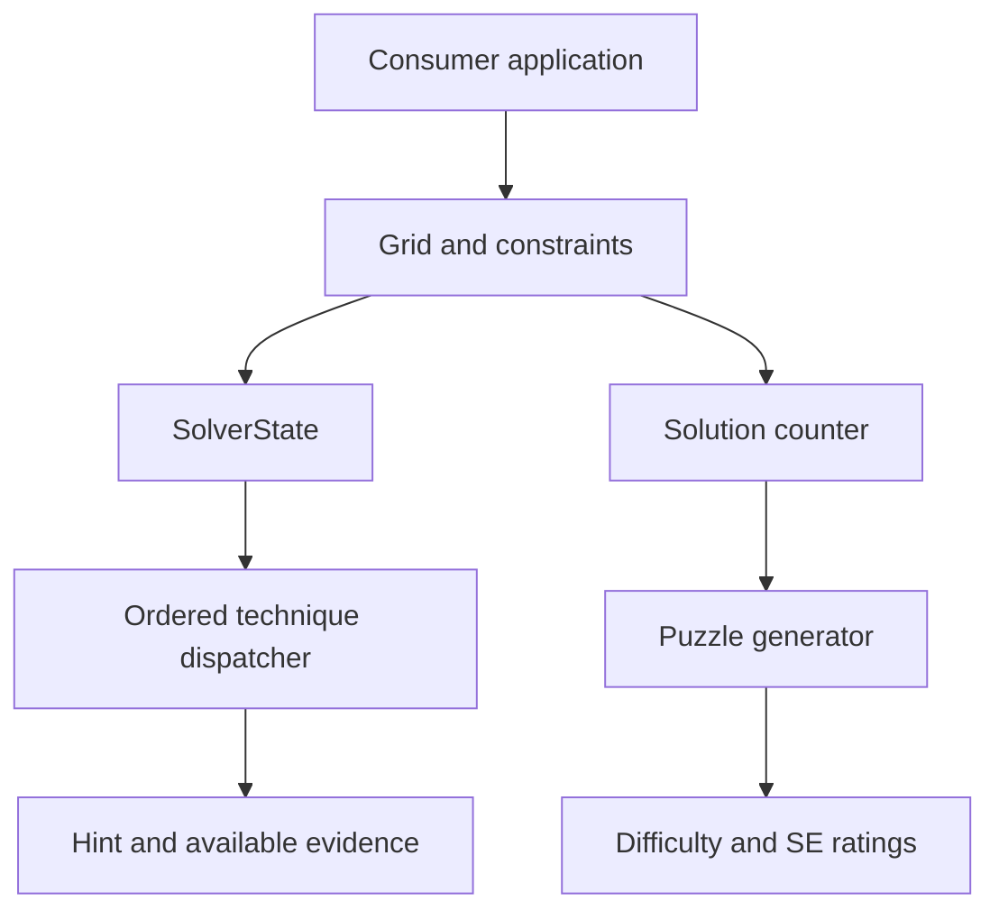
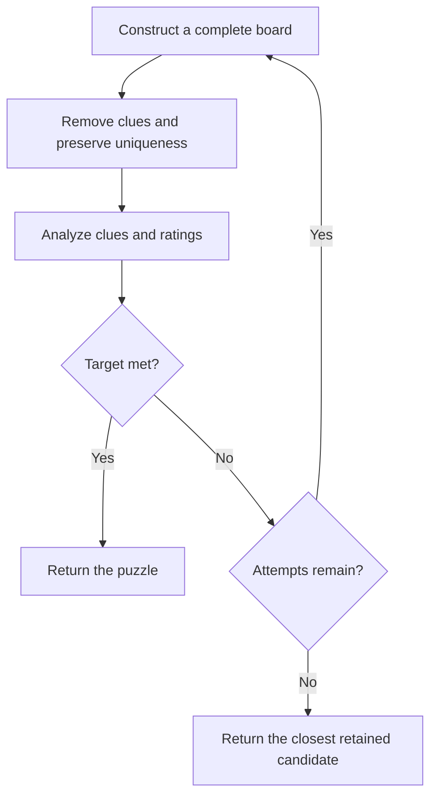

# sudoku-core

`sudoku-core` is the Rust Sudoku engine for terminal, WebAssembly, and mobile consumers.
The engine contains the board model, constraints, solver, hint APIs, ratings, and puzzle generator.

The [technical terms](docs/technical-terms.md) define the project vocabulary.
The [writing guide](docs/writing-guide.md) defines the documentation rules.



## Board model and constraints

`Grid` stores 81 `Cell` values in a 9×9 array.
Each cell stores an optional value, a given flag, and a candidate `BitSet`.
`Grid::recalculate_candidates()` starts from the placed values and rebuilds candidates for each empty cell.
This operation discards earlier candidate eliminations.

The constraint interface supports these board types:

- Classic Sudoku uses row, column, and box constraints.
- X-Sudoku adds the two diagonal constraints.
- Killer Sudoku adds cage-sum constraints.
- Other installed constraints use the same validation interface.

`Grid::constraints()` exposes the active constraints.
Candidate updates, validation, and general search use those constraints.

## Solving and hints

The ordered dispatcher implements 47 logical techniques plus a backtracking fallback.
The technique families include singles, subsets, fish, Almost Locked Sets, chains, uniqueness, matching, arithmetic, coloring, and forcing.
`Technique` in `src/solver/types.rs` defines the exact list and order.
The [solver specification](src/solver/SPECIFICATION.md) states the proof conditions.

`Solver::get_hint()` rebuilds candidates from placed values before it searches for a step.
A hint contains an explanation, affected cells, a technique, and related evidence.
If no logical technique returns a step, the Full policy can use a solved completion for a backtracking hint.

`SolverState` retains deductions between steps.
`Solver::get_hint_with_candidates()` searches validated candidate masks without rebuilding them.
Solver placements and assumptions remove candidates without restoring earlier eliminations.
Edits and undo have explicit rules for candidate masks and retained guardian relations.
The [solver-state API](docs/solver-state.md) describes those rules and the forcing proof format.

Backtracking selects an empty cell with the fewest candidates.
Each branch places a candidate and checks the constraints.
`count_solutions(limit)` stops at the requested solution cap.
Built-in classic boards use a counter with row, column, and box occupancy masks.
Variants and custom constraints use the general constraint-aware counter.

## Checked proof methods

| Method | Position in the dispatcher | Documentation |
| --- | --- | --- |
| Three-House Matching | After Death Blossom | [Theorem, API, and replay](docs/three-house-matching.md) |
| Arithmetic Counting | After Three-House Matching | [Equations, certificates, and limits](docs/arithmetic-counting.md) |
| Global Coloring | After Arithmetic Counting | [Graph proof, API, and evidence](docs/global-coloring.md) |
| Checked forcing | After Global Coloring | [Native proof trees and retained state](docs/solver-state.md) |

The three direct method APIs preserve supplied candidate masks.
Each accepted certificate binds its deduction to exact premises.
The checker does not establish the correctness of earlier imported eliminations.
A finite search limit can prevent discovery of a valid certificate.
An absent hint is an inconclusive search result.

The research uses established mathematical principles.
The [research index](research/global_obstructions/README.md) separates exact deductions, comparison results, and historical novelty claims.

## Difficulty ratings

`Solver::rate_difficulty()` copies the puzzle and starts from its placed values.
It applies the shared retained-step path and records the hardest technique used.
A logical stall gives the Extreme tier.
The rating concerns this solving path; it does not prove that every easier proof is impossible.

| Tier | Techniques Required |
|---|---|
| **Beginner** | Naked Singles only, <= 35 empties |
| **Easy** | Naked Singles only, > 35 empties |
| **Medium** | Hidden Singles |
| **Intermediate** | Naked/Hidden Pairs/Triples |
| **Hard** | Pointing Pair / Box-Line Reduction |
| **Expert** | Fish (X-Wing, Swordfish, Jellyfish, Finned variants), Naked/Hidden Quads, Empty Rectangle, Avoidable Rectangle, Unique Rectangle, Hidden Rectangle |
| **Master** | Wings (XY-Wing, XYZ-Wing, WXYZ-Wing, W-Wing), Chains (X-Chain, AIC), 3D Medusa, Sue de Coq, Franken/Siamese Fish, ALS-XZ, Extended UR, BUG+1 |
| **Extreme** | ALS (XY-Wing, Chain), Mutant Fish, Aligned Pair/Triplet Exclusion, Death Blossom, Three-House Matching, Arithmetic Counting, Global Coloring, Forcing Chains (Nishio, Kraken, Region, Cell, Dynamic), Backtracking |

The technique tier and Sudoku Explainer (SE) value measure different properties.
The tier follows the engine's teaching order.
`Solver::rate_se()` uses the largest configured `Technique::se_rating()` value encountered by the solver.

| Technique | SE |
|---|---:|
| Hidden Single | 1.5 |
| Naked Single | 2.3 |
| Pointing Pair | 2.6 |
| Box-Line Reduction | 2.8 |
| Naked Pair | 3.0 |
| X-Wing | 3.2 |
| Finned X-Wing / Hidden Pair | 3.4 |
| Naked Triple | 3.6 |
| Swordfish / Hidden Triple | 3.8 |
| Finned Swordfish | 4.0 |
| XY-Wing | 4.2 |
| XYZ-Wing / W-Wing | 4.4 |
| X-Chain | 4.5 |
| Empty Rectangle / Avoidable Rectangle / Unique Rectangle / WXYZ-Wing | 4.6 |
| Hidden Rectangle | 4.7 |
| Naked Quad / 3D Medusa / Sue de Coq | 5.0 |
| Jellyfish | 5.2 |
| Finned Jellyfish / Hidden Quad | 5.4 |
| ALS-XZ / Franken Fish / Siamese Fish / Extended UR | 5.5 |
| BUG+1 | 5.6 |
| AIC | 6.0 |
| Aligned Pair Exclusion | 6.2 |
| Mutant Fish | 6.5 |
| ALS-XY-Wing | 7.0 |
| ALS Chain / Aligned Triplet Exclusion / Nishio Forcing Chain | 7.5 |
| Kraken Fish | 8.0 |
| Cell Forcing Chain | 8.3 |
| Death Blossom / Region Forcing Chain | 8.5 |
| Arithmetic Counting / Three-House Matching / Global Coloring (engine-local estimates) | 8.5 |
| Dynamic Forcing Chain | 9.3 |
| Backtracking | 11.0 |

Arithmetic Counting, Three-House Matching, and Global Coloring use an uncalibrated engine value of 8.5.
These values are not official Sudoku Explainer ratings.
Hidden Single has SE 1.5; Naked Single has SE 2.3.
The engine's Beginner/Easy and Medium tiers use a different order.
Changes to deductions can change puzzle ratings and generated results.

## Puzzle generation

`src/generator.rs` implements generation and rating filters.



The generator first fills the three diagonal boxes with random values.
The solver completes the board.
The generator then removes values in the configured symmetry groups.
Each accepted removal preserves exactly one solution, checked with a solution cap of two.

`Solver::analyze()` computes the difficulty and SE ratings in one call.
An accepted candidate meets the clue bounds, configured SE bounds, and requested difficulty or the immediately easier tier.
The generator retains the closest candidate when the attempt budget expires without a target match.

| Target | Symmetry | Givens | Attempts | Min SE |
|---|---|---:|---:|---:|
| Beginner | 180 deg | 45-55 | 30 | — |
| Easy | 180 deg | 36-45 | 50 | — |
| Medium | 180 deg | 32-38 | 100 | — |
| Intermediate | 180 deg | 28-34 | 150 | — |
| Hard | 180 deg | 24-30 | 200 | — |
| Expert | 180 deg | 22-26 | 500 | 3.0 |
| Master | 180 deg | 20-24 | 1000 | 4.5 |
| Extreme | none | 17-22 | 2000 | 6.0 |

The upper-tier SE floors separate the requested generation targets.
The technique-tier filter also limits the accepted techniques.
The source configuration defines the exact bounds.

The FFI consumers expose both requested and measured difficulty:

- `get_difficulty()` returns the requested target.
- `get_rated_difficulty()` returns the measured difficulty.

Both values are stored during serialization.
Consumer applications choose the displayed label.
The iOS consumer uses the requested difficulty and the numerical SE value.

`PuzzleId` encodes the seed, difficulty, and variant in a short alphanumeric identifier.
`Generator::with_seed(seed)` produces deterministic sequences for a fixed implementation.
A seed-only identifier does not record the generator version.

## Performance and tests

Run the fixed-workload performance example:

```sh
cargo run --release --locked --example performance
```

The [performance report](docs/performance.md) records the workloads, measurements, and comparison limits.

Run the complete test and coverage checks:

```sh
./scripts/test-coverage.sh
```

The [coverage guide](docs/coverage-goals.md) defines the tools, thresholds, and report files.
The complete soundness suite remains part of acceptance.

## Formal verification

The `verification/` directory contains [Verus](https://github.com/verus-lang/verus) proofs.

| File | Proved property |
| --- | --- |
| `verification/bitset.rs` | Bitset contracts, cardinality, and `single_value` behavior against a set model. |
| `verification/grid.rs` | Native validity, exact duplicate detection, and sound backtracking that preserves givens. |
| `verification/arithmetic.rs` | Interval, gcd, and residue contradiction theorems for the weighted equation. |
| `verification/three_house.rs` | Abstract Hall and complete-signature-coverage theorems. |
| `verification/global_coloring.rs` | Abstract branch preservation, empty-domain rejection, and exhaustive-split soundness. |

The abstract proofs do not verify all production reconstruction, masks, hashing, serialization, or replay code.
The [method documentation](docs/global-coloring.md) states the scope for each method.

Run the formal checks with the required Verus release and pinned Rust toolchain:

```sh
./scripts/verify.sh
```

The script header gives the setup details.
The `.github/workflows/verify.yml` workflow runs the proofs in CI.

## Research documentation

[Non-modular experiments](research/nonmodular/README.md) cover three-house classification, real puzzles, and comparisons with named methods.
[Global obstruction experiments](research/global_obstructions/README.md) cover exact LP witnesses, graph certificates, trades, and joint digit placements.
The reports retain rejected candidates and known-method controls.
A valid certificate does not establish historical novelty.

## Basic example

```rust
use sudoku_core::{Difficulty, Generator, Solver};

let mut gen = Generator::with_seed(42);
let puzzle = gen.generate(Difficulty::Expert);

let solver = Solver::new();
assert!(solver.has_unique_solution(&puzzle));

let rated = solver.rate_difficulty(&puzzle);
let se = solver.rate_se(&puzzle);
println!("Requested: Expert, Rated: {rated}, SE: {se}");
```
