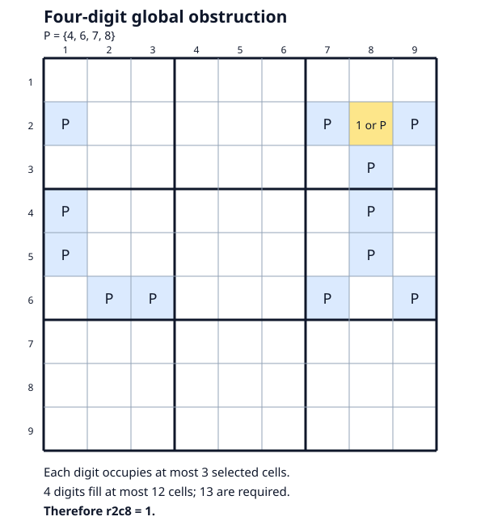

# Global Coloring obstructions

`Technique::GlobalColoring` adds checked native graph/list-coloring deductions
before forcing in the hint and rating ladders, after Arithmetic Counting. It
also has direct APIs that preserve stored candidates. No uniqueness assumption
or modular arithmetic is used. The Extreme tier and numerical value 8.5 are
uncalibrated engine estimates.

The verified examples survive complete single-house Hall propagation and all
81 crossing three-house support checks, including after the opposite target
assumption. Every one of the 2,925 arbitrary triples of native houses also
admits an assignment in the recorded opposite states. That last check tests
feasibility, not generalized arc consistency for all arbitrary triples.
Exact rational points establish feasibility of all 324 native continuous
exactly-one equations after local closure. These comparisons concern specified
relaxations; stronger integer cuts, AIC, forcing, or known impossible-pattern
methods can still explain the deductions.

Graph coloring, exhaustive refutation, guardian patterns and stable-set rank
inequalities have substantial prior art. **Historical mathematical novelty is
not established.** See the [independent prior-art audit](../research/global_obstructions/audit_prior_art.md).
The [expanded motif audit](../research/global_obstructions/prior_art_13_report.md)
identifies an exact spanning seven-hyperhole and a grouped-loop derivation of
the thirteen-cell example; its mathematical obstruction is an established one.

## A four-digit obstruction with a short proof

The [13-cell fixture](../research/global_obstructions/structural_four_digit_13.json)
uses the following cells, grouped by box:

| Box | Selected cells |
| --- | --- |
| 1 | r2c1 |
| 3 | r2c7, **r2c8**, r2c9, r3c8 |
| 4 | r4c1, r5c1, r6c2, r6c3 |
| 6 | r4c8, r5c8, r6c7, r6c9 |



The cells allow digits {4,6,7,8}; r2c8 additionally allows 1. Suppose r2c8 is
not 1. We show that no digit can occupy four of these cells:

1. At most one occurrence is possible in each box, so four occurrences must
   include r2c1 and one cell in each other selected box.
2. r2c1 rules out the three row-2 cells in box 3, forcing that occurrence to
   r3c8. It rules out the two column-1 cells in box 4, leaving r6c2 or r6c3.
3. r3c8 rules out the two column-8 cells in box 6, leaving r6c7 or r6c9.
4. The remaining choices in boxes 4 and 6 share row 6, a contradiction.

Each of four digits can therefore occupy at most three selected cells. They
can fill at most 12 cells, fewer than 13. Consequently **r2c8=1**.

This is a stable-set rank/counting proof: the selected peer graph has
independence number 3 and chromatic number 5. Independent checks enumerate all
715 four-cell subsets, confirm that each contains a peer pair, and find 32
independent triples. A valid full Sudoku completion respects the original
state, and each vertex deletion admits a four-coloring. No claim is made that
13 is a globally minimum support.

The native continuous relaxation nevertheless has an exact feasible point
using only 0, 1/4 and 1/5. For a recorded binary role vector t, each palette
indicator is t/4 and each of the five other digit indicators is (1-t)/5.
All cell and house/digit equalities and recorded domains are checked exactly.
The missing global rank inequalities explain this particular integrality gap.

The original fixture is synthetic. Separate generated givens-only boards
reach the same support by verified local deductions; published unique tridagon
puzzles supply additional real-game controls. Their distinctions matter below.

## Production search and certificate theorem

The automatic search enumerates three- and four-digit palettes P. It selects
unplaced cells whose domains lie inside P and a guardian cell with exactly one
extra digit g. For the connected component containing that guardian, it tests
whether removing g prevents every candidate-respecting coloring. Components
larger than 24 cells are skipped. This is a bounded guardian search, not a
complete search of all global obstructions.

`GlobalColoringProof::from_cells` additionally accepts an explicit selected cell
set of up to 32 cells and can certify either a placement or an elimination.
It permits up to 32,768 proof nodes within 50,000 total refutation/witness visits.
These larger bounds are opt-in through supplying the support; automatic hint
searches still skip components above 24 cells and cap each search at 8,192 visits.
The generic proof
format uses no supplied graph edges, template identity, symmetry shortcut, or
assumed chromatic number. It includes:

- Version 1 and a SHA-256 digest of all 81 placed values and effective domains.
- Sorted, distinct selected board indices, including the live, unplaced target.
- The target digit and result polarity (true for placement, false for elimination).
- A proper coloring of the unforced selected graph supporting the result endpoint.
- A flat postorder refutation tree, rooted at the last node, with at most 32,768 nodes.

The checker reconstructs native peers from board positions and restricts the
target to the **opposite** endpoint. A `Split` must name an unassigned cell and
have exactly one child for every digit currently in that cell's domain. Each
child pins that digit and removes it from native peers. A `Conflict` leaf must
name a cell whose domain has become empty. Child indices strictly precede their
parent; every node is used exactly once. Depth is bounded by the selected cell
count, independent of untrusted node indices.

**Soundness.** Every respecting full Sudoku completion restricts to a proper
coloring of the selected graph. Its pivot digit selects one of each split's
exhaustive branches, and pinning that digit and excluding it from neighbors
preserve the coloring. An empty-domain leaf cannot preserve it. Induction on
the finite tree therefore refutes every coloring under the opposite target
assumption and proves the advertised deduction. The base coloring rejects an
already contradictory selected graph; it does not prove global satisfiability.

The checker does not call the search DFS, choose search pivots, or trust its
cached adjacency. The [independent Python checker](../research/global_obstructions/audit_global_certificates.py)
verifies actual Rust exports and rejects malformed evidence. Three abstract
[Verus lemmas](../verification/global_coloring.rs) prove branch preservation,
empty-domain rejection, and the exhaustive-split induction step. Production
Rust, tree representation, Sudoku reconstruction, masks, hashing, serialization
and replay remain outside that formal proof.

## API and portable replay

```rust
use sudoku_core::{GlobalColoringReplay, GlobalColoringSearchOptions, Grid,
                  ProofCertificate, Solver};

let grid = Grid::new_classic();
let result = Solver::new().search_global_coloring(
    &grid, &GlobalColoringSearchOptions::default());
if let Some(hint) = result.hint {
    if let Some(ProofCertificate::GlobalColoring(proof)) = &hint.proof {
        assert!(proof.verify(&grid));
        let replay = GlobalColoringReplay::capture(&grid, proof).unwrap();
        let mut next = grid.deep_clone();
        replay.apply(&mut next).unwrap();
    }
}
```

`get_global_coloring_hint` uses the default budget of 512 patterns and 50,000
visited search states shared between refutations and base-witness construction.
Options allow at most 16,384 patterns and 1,000,000 search states; each automatic
pattern search is also capped at 8,192 states. Cutoffs produce no certificate from an
incomplete tree. Results report patterns tested, nodes visited, budget exhaustion,
oversized components, and errors. A missing hint is never a completeness result.

Direct APIs preserve supplied candidates and require installed standard-rule
provenance. Additional variant constraints can restrict the solution set safely.
Recursive forcing propagation omits this search to avoid multiplying its cost.
General hint/rating APIs rebuild or chain candidates as before; their proof
belongs to the internal candidate state at discovery. Use a direct API and its
exact stored state when exporting a replay.

`GlobalColoringReplay` serializes the shared `CandidateState` and certificate.
Application independently checks both, requires identical current native
premises, and applies to a clone. Placement updates peers without rebuilding
candidates; elimination removes only the certified digit. Installed constraints
and local domain validity are checked before committing the clone. Stale,
malformed or contradictory applications leave the grid unchanged. Variant
constraints and given/user flags are not serialized in this native projection.

The domains are premises. These certificates do not authenticate earlier
candidate removals. Separate fixture verifiers replay those earlier steps from
givens, and full completion witnesses establish the examples' satisfiability.

A runnable export example accepts a `CandidateState` JSON file:

```sh
cargo run --release --example global_coloring -- candidate-state.json
```

An explicit proof request supplies `state`, `cells`, `cell`, `digit` and result
polarity `value`. This can certify larger supports without increasing automatic
hint-search limits:

```sh
cargo run --release --locked --example global_coloring -- --explicit research/global_obstructions/realization27_proof_request.json
```

The [27-cell production replay](../research/global_obstructions/replay_native27.json)
places r5c6=1 with a 16,745-node tree. It is a conditional synthetic example.
An exhaustive trade classification proves that this exact support cannot occur
with all its cells unclued in a unique compatible givens puzzle; see the
[realization audit](../research/global_obstructions/realization27_report.md).
The engine's certificate does not depend on uniqueness or historical novelty.

See the [actual four-digit replay](../research/global_obstructions/replay_four_digit.json)
and [published-puzzle replay](../research/global_obstructions/replay_Loki.json).

## Known-method and game-state comparisons

Three published unique puzzles (#4662, #4401 and Loki) have established
tridagon cores. After one recorded Finned Swordfish step in #4662, the tested
older structural baseline, default arithmetic and crossing-three-house search
all return no finding on the retained unforced states. Existing forcing methods
do find other steps, so there is no claim that every old method is exhausted.

The synthetic four-digit base state also yields no finding from the 34 explicitly
checked, uniqueness-independent older structural detectors, default arithmetic,
or the three-house API. In its opposite state, Franken Fish and Mutant Fish
find further steps. Failure of bounded arithmetic search does not replace the
independent exact LP witness.

The generated 19-given four-digit board has multiple completions and a forced
guardian; the checked older non-forcing baseline stalls. The generated 34-given
board has a unique completion but is already solvable by existing fish and
singles methods. It is retained as a negative control for additional engine
benefit. All these recorded states satisfy the specified local and exact LP
filters, and the certificates do not rely on uniqueness. Neither generated
board is presented as a published author-source puzzle.

A later [29-given generated puzzle](../research/global_obstructions/expanded_unique_nonforcing.json)
has an independently checked unique solution and retains r2c8=1 beyond the
older nonforcing fixed point and default Arithmetic Counting. Its opposite
branch passes the same local filters, all 2,925 triple feasibility checks, and
an exact half-integral native LP witness. The existing Global Coloring search
certifies the placement with a 74-node tree. The full older dispatcher finds
Nishio r4c6!=4, so this is a unique **nonforcing gap**, not a full-old-method
stall. The [expanded search report](../research/global_obstructions/expanded_search_report.md)
records the broader experiment and stronger target separately.

A subsequent [forcing-inclusive benchmark](../research/global_obstructions/nonrank_report.md)
meets that stronger target: the unique 28-given Monhard T&E3 source-line-1
puzzle reaches a retained state with 50 cells unplaced where two fresh full
older logical-dispatcher calls return no hint. The current full ladder and
default direct Global Coloring search certify **r4c9=9** with a 169-node,
16-cell certificate. Backtracking is outside this logical comparison.

Its opposite branch also has an independently checked 33-term rational mixture
of full single-digit templates. This satisfies every valid single-digit linear
inequality, including weighted rank and hyperhole capacity bounds, throughout
the actual board domains. It does not test every multidigit cut. Exact graph
maps explain the contradiction as an established twelve-cell tridagon with
guardian forcing, so it establishes additional engine coverage without a
historical novelty claim. Use the retained CandidateState and direct API or
portable replay; importing only the derived placed grid loses prior removals.

The [research index](../research/global_obstructions/README.md) lists exact
verifiers, primary sources, rejected examples, discovery counts and limits.
