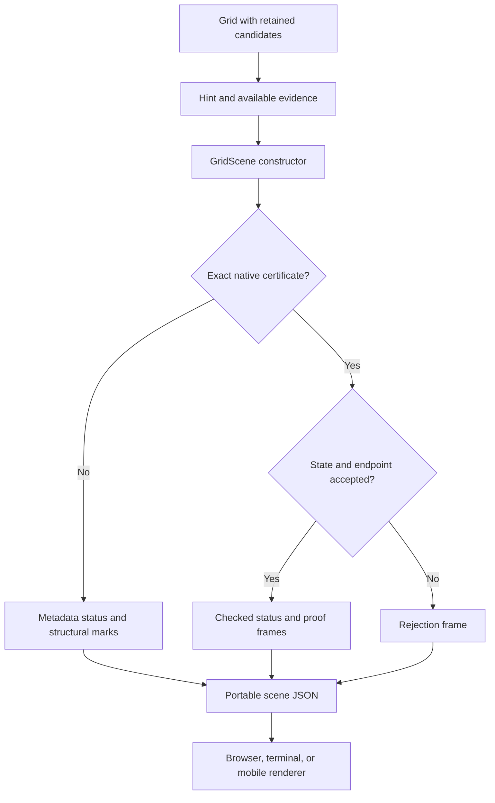

# Grid explanations and proof display

`GridScene` converts an engine hint into a portable grid explanation.
Every `Technique` uses the same board, pattern, and endpoint format.
Fish, ALS, AIC, and uniqueness metadata add their available structural marks.
Checked native certificates add assumption and contradiction frames.

The browser example displays the exported scenes without a network connection.
The library includes real Norvig and Mith515 states, a synthetic arithmetic fixture, and deliberate rejection examples.
The library contains a frozen real-puzzle example for every registered technique.
Independent certificates establish all 48 named patterns, deductions, and original setup premises.
The [independent validation guide](independent-validation.md) defines the proof, scope, and source records.



## Run the browser example

1. Run the example from the repository root.

```sh
cargo run --release --locked --example grid_viewer
```

2. Open `target/grid-viewer.html` in a browser.
3. Select an example from the library.
4. Select **Next** to follow the frames.
5. Select a cell to inspect its candidates and display roles.
6. Select **Show original givens** to compare the premise state with its source puzzle.

The example writes one HTML file with embedded data, styles, and JavaScript.
It does not need a server, an account, or external fonts.
The source link opens only when the reader selects the link.

The command below exports the logical steps of a specified unique puzzle.
The example checks uniqueness and compares each endpoint with the unique completion.
It retains candidate eliminations between steps.
It stops after 256 steps, a completed board, or a logical stall.
This example path uses `PropagationPolicy::Logical`; it does not search the full advanced ladder.
The default library also contains retained advanced certificates.

```sh
cargo run --release --locked --example grid_viewer -- \
  --puzzle 530070000600195000098000060800060003400803001700020006060000280000419005000080079 \
  --output target/my-puzzle.html
```

## Use the engine format

```rust
use sudoku_core::{Grid, GridScene, Solver};

let grid = Grid::from_string(
    "530070000600195000098000060800060003400803001700020006060000280000419005000080079"
).unwrap();
let hint = Solver::new().get_hint(&grid).unwrap();
let scene = GridScene::from_hint(&grid, &hint).unwrap();
let json = serde_json::to_string(&scene).unwrap();
assert_eq!(scene.version, 1);
```

The constructor reads the supplied candidates without rebuilding them.
It checks endpoint coordinates, digit ranges, and candidate availability.
It leaves the input grid unchanged.
Each frame contains exactly 81 cells in row-major order.
Cell indices and candidate digits follow the [technical terms](technical-terms.md).

`GridScene::from_validation(&grid)` displays the result of `Grid::validate()`.
Conflict highlights identify the cells reported by the installed rules.
A successful board check concerns placed values.
It does not check pencil marks, solvability, or uniqueness.

## Read the scene fields

| Field or type | Meaning |
| --- | --- |
| `GridScene::version` | Format version, currently 1. |
| `GridScene::technique` | Technique identifier; absent for board validation. |
| `SceneEvidence` | Engine check status and its scope. |
| `SceneFrame` | Board snapshot, description, highlights, and links for one frame. |
| `SceneCell::value` | Optional placed digit. |
| `SceneCell::given` | Original given flag from the source grid. |
| `SceneCell::candidates` | Explicit allowed digits; placed cells use a singleton domain. |
| `SceneHighlight::cell` | Cell index from 0 through 80. |
| `SceneHighlight::digit` | Candidate digit; `None` selects the whole cell. |
| `SceneHighlight::role` | Pattern, base, cover, fin, floor, roof, polarity, assumption, removal, placement, or conflict. |
| `SceneLink` | AIC candidate endpoints and supplied strong or weak link type. |
| `GridScene::trace_truncated` | The complete certificate passed, but the display trace reached its frame limit. |

Renderers must display a marked candidate even when the frame has removed it.
This rule makes an elimination visible at its grid position.
Use a strike mark for a removal and a separate mark for a conflict.
Use text or symbols with color to identify each role.
The browser example also provides cell inspection, keyboard controls, and a text view.

The renderer checks displayed chain links against the supplied candidates.
It reconstructs Medusa's actual strong edges from its unordered component members.
Unsupported link metadata is omitted.

## Interpret the evidence status

| Status | Meaning |
| --- | --- |
| `checked_certificate` | A native checker accepted the certificate and the hint's exact endpoint. |
| `checked_pattern_and_deduction` | Separate checkers accepted the named structural witness and exact deduction. |
| `checked_deduction` | An independent exact-cover certificate establishes the endpoint; the named pattern remains detector metadata. |
| `metadata_only` | The scene shows detector evidence without independent deduction verification. |
| `rejected` | Evidence failed, the endpoint differed, or the proposed result violated a checked input or application condition. |
| `rules_satisfied` | Installed rules accept the placed values in a board-validation scene. |
| `rule_violation` | Installed rules report conflicting placed values. |

Exact checkers cover Arithmetic, Three-House, Global Coloring, native forcing, and retained guardian propagation.
These proofs remain conditional on the supplied candidate premises.
They do not authenticate earlier imported eliminations or establish historical novelty.
A separate `NamedPatternProof` verifies the supported technique variant and binds its exact conclusion.
The [named pattern guide](named-pattern-proofs.md) specifies those rules.
The constructor checks the proposed result against installed rules before it displays an applied conclusion.

Legacy Basic, Fish, ALS, AIC, Uniqueness, Forcing, and Backtracking descriptions remain metadata without a named certificate.
`ExactCoverProof::certify_hint()` adds independent deduction validation while retaining those descriptions.
Ordinary `Hint` serialization omits the original proof object.
A hint restored from that JSON cannot recover the missing certificate through its technique name.

Scene JSON records a display result; it is not a portable proof certificate.
A received status field is not authenticated evidence.
Use the original [Arithmetic](arithmetic-counting.md), [Three-House](three-house-matching.md), [Coloring](global-coloring.md), or [forcing](solver-state.md) certificate for verification.
The browser does not repeat the Rust checks in JavaScript.
The primary technique examples include downloadable proof bundles with their original-puzzle uniqueness proofs.
Select **Export proof JSON** to save a bundle for independent replay.

## Follow the frames

Pattern frames show premises and the proposed endpoint.
An assumption frame restricts the endpoint to the opposite conclusion.
Native forcing frames apply recorded edits in each branch.
Graph-coloring frames remove assigned digits from selected peers.
Each sibling branch starts from its parent's candidate state.

Contradiction frames identify an empty domain, a Hall obstruction, an exhausted signature cover, or an arithmetic failure.
Three-House frames also display the checked Hall subsets for their specified boundary cases.
An arithmetic frame states the reconstructed interval, divisibility, or remainder failure.
A rejected certificate never produces an applied-conclusion frame.

The display contains at most 256 frames, including the pattern and conclusion.
The proof checker always checks the entire certificate before display truncation.
The final checked conclusion remains visible when the trace is truncated.

## Check the implementation

The regression suite covers every technique identifier and each checked certificate family.
It also checks malformed endpoints, missing branches, variant conflicts, branch counts, and large-tree truncation.

```sh
cargo test --release --locked --test presentation
node scripts/check_grid_viewer.mjs
```

The DOM check uses the JSDOM dependency installed by the [documentation procedure](writing-guide.md).
The Grid viewer workflow checks every generated frame and uploads the offline HTML file.

The example generator checks the unique puzzle examples before it writes the viewer.
The synthetic arithmetic fixture has a separate provenance label.
The altered Mith515 certificate omits one branch to demonstrate rejection.
The invalid-move example places a duplicate 5 in the classic puzzle.
