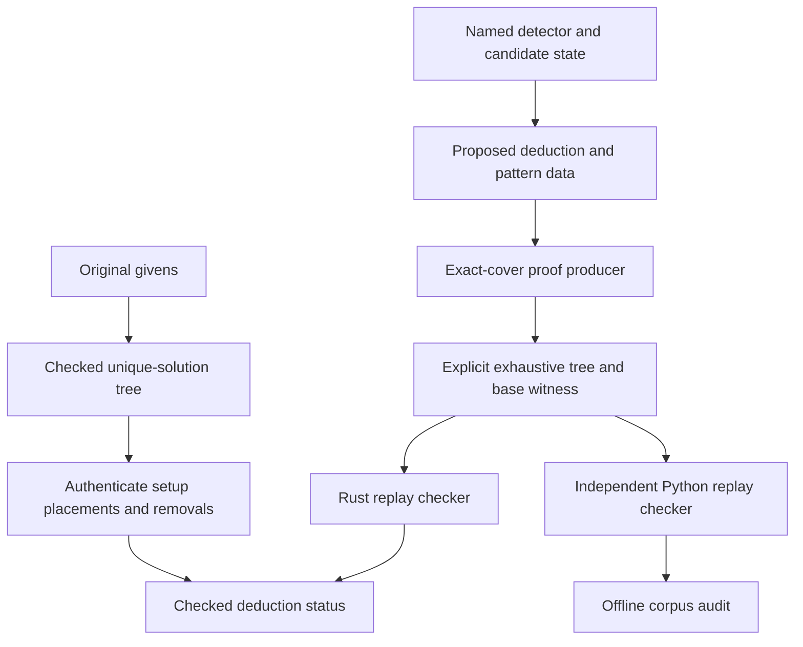

# Independent validation for all techniques

The engine can certify a deduction from any named detector with a separate exact-cover proof.
The proof producer and replay checker use different implementations.
Neither implementation calls the named detector.
The checker verifies the supplied tree without searching for a replacement proof.
A separate Python checker replays the same stored evidence.

The default gallery contains one frozen real-puzzle example for each of the 48 technique IDs.
These IDs include three retired compatibility labels and the Backtracking fallback.
They do not represent 48 distinct mathematical principles.
The examples use 11 different original puzzles.



## What the proof establishes

Let a Boolean candidate denote a digit in a specified cell.
Classic Sudoku has 324 exactly-one requirements:

- Each of the 81 cells contains one digit.
- Each row contains each digit once.
- Each column contains each digit once.
- Each box contains each digit once.

Each of the 729 possible candidates satisfies four of these requirements.
A complete Sudoku solution selects candidates that cover every requirement exactly once.

At each proof split, the selected requirement is still unfulfilled.
The checker reconstructs every candidate that can satisfy that requirement under the current assignments.
The proof must contain exactly one child for each candidate.
A conflict leaf names an unfulfilled requirement with no possible candidate.
A solution leaf must equal the checked complete witness.
Postorder indices, unique node use, and full branch coverage prevent missing or repeated cases.

For a deduction, the tree starts with the opposite conclusion.
A placement proof forbids the proposed digit at its cell.
A multiple-candidate elimination proof restricts the target cell to the proposed removed digits.
Every branch must end in a conflict.
The base witness establishes that the original candidate premises have a solution.
Thus the proof does not accept a deduction through vacuous truth from an inconsistent state.

A uniqueness proof starts without an endpoint assumption.
Its candidate masks remain premises.
Its exhaustive tree must contain exactly one solution leaf.
The corpus checks this proof against a fresh board built from the original givens.
It does not use imported candidate deletions to establish original-puzzle uniqueness.

## Authenticate the setup state

Let the checked original puzzle have the sole solution `S`.
Each setup placement must equal the corresponding digit of `S`.
Each setup domain must contain the corresponding digit of `S`.
Every original given must remain fixed.
The setup cannot add candidates outside the original legal domains.

These conditions establish all recorded setup deductions from the original givens.
The independent endpoint proof is then checked against that exact setup state.
Standalone deduction certificates remain conditional on supplied candidate masks.
Corpus bundles add the separate original-givens authentication.
The verifier rejects a correct endpoint when its setup authentication fails.

## Interpret the technique label

Every default example has a separate named structural witness and an exact-cover deduction proof.
The Rust and Python checkers verify both against the same state and conclusion.
The browser displays **Pattern and deduction verified** only when both checks pass.
The [named pattern guide](named-pattern-proofs.md) defines every supported rule and its proof argument.

The pattern frame uses the checked named witness.
The independent proof frames show the separate exact-cover validation argument.
Earlier techniques can also apply in a selected state.
A certificate does not establish minimum difficulty, technique necessity, or historical novelty.
The source library's original test label can differ from the requested engine technique.

## Use the Rust API

```rust
use sudoku_core::{ExactCoverProof, ExactCoverSearchOptions, GridScene};

// grid and hint come from the current solver state.
let checked = ExactCoverProof::certify_hint(
    &grid, &hint, &ExactCoverSearchOptions::default()
)?;
let scene = GridScene::from_hint(&grid, &checked)?;
```

`ProofCertificate::Certified` retains optional named evidence beside the legacy description and independent deduction proof.
Pattern certificates support serialization and deserialization.
`Basic` stores its `kind` label as `String`.
Use `.into()` for literal labels in manual constructors.

`ExactCoverProof::check()` replays the proof against exact values and candidate masks.
`matches_hint()` also checks the cell, digits, and action.
The certificate does not accept an additional elimination that its tree does not prove.

`Solver::get_hint_for_technique()` requests one named method with explicit forcing limits.
It does not change the normal dispatcher order.
`Technique::all()` lists every registered method, including retired labels and Backtracking.
Direct detector output can still contain metadata; certification is an explicit step.

## Limits and failure results

The exact-cover format currently requires built-in classic Sudoku rules.
It does not encode diagonal, cage, or custom requirements.
The default search budget is 100,000 visits.
The maximum supported budget is 2,000,000 visits, including witness search.
The tree has at most 81 assignment levels.

A budget cutoff does not establish a contradiction.
The search reports cutoffs, invalid input, and found counterexamples separately.
No proof is returned for inconsistent premises without a base witness.
A placement from one possible completion of a nonunique puzzle can fail certification.
The normal solving ladder retains its existing behavior.

## Replay the stored examples

The frozen [corpus](../tests/fixtures/technique_examples.json) stores the givens, setup states, detector evidence, and proof trees.
The Rust corpus verifier requires all 48 distinct registered techniques.
It checks every original-puzzle uniqueness proof, named pattern witness, and deduction proof.

```sh
cargo run --release --locked --example verify_examples
python3 scripts/verify_technique_examples.py
```

Select **Export proof JSON** in a primary technique example to download its self-contained evidence.
Use subset mode to check this one-example bundle.
Subset mode validates the supplied examples without claiming complete technique coverage.

```sh
cargo run --release --locked --example verify_examples -- sudoku-proof.json --subset
python3 scripts/verify_technique_examples.py sudoku-proof.json --subset
```

## Sources and reproduction

Forty-seven examples use states from Bernhard Hobiger's [HoDoKu regression library](https://hodoku.sourceforge.net/en/libs.php).
Ten distinct original puzzles supply those states.
Source line numbers and the complete source-file SHA-256 are recorded in the corpus.
The [library file](https://hodoku.sourceforge.net/libraries/reglib-1.3.txt) records givens, earlier placements, and candidate removals.
The importer preserves those distinctions.

The Extended Unique Rectangle example uses [Andrew Stuart's published Type 1 example](https://www.sudokuwiki.org/Extended_Unique_Rectangles).
Its original givens and published setup are recorded separately.
Its three-digit structural witness replaces the earlier constructed pair-based example.

The implementations use newly written Rust and Python.
The corpus stores factual puzzle and candidate data with source attribution.
The initial search admitted only unique original puzzles with solution-preserving setup states.
The final replay checks use proof certificates rather than trusting that initial solution comparison.

After obtaining the source file, check its recorded states or run a fresh offline search.

```sh
python3 scripts/import_technique_sources.py target/hodoku-reglib-1.3.txt --check tests/fixtures/technique_examples.json
python3 scripts/import_technique_sources.py target/hodoku-reglib-1.3.txt --output target/hodoku-states.json --include-constructed
cargo run --release --locked --example mine_techniques -- target/hodoku-states.json target/technique-mining
python3 scripts/certify_named_patterns.py
cargo run --release --locked --example certify_examples -- target/named-patterns target/technique-examples.json
```

The search can select different valid endpoints because some existing detectors use unordered collections.
The committed corpus remains fixed.
The legacy import option also adds the frozen external rectangle source and its setup state.
The named witness producer uses the frozen corpus as its reproducible input.
A fresh detector search requires separate named witness discovery before version-two certification.
The replay commands require no source download or discovery run.
