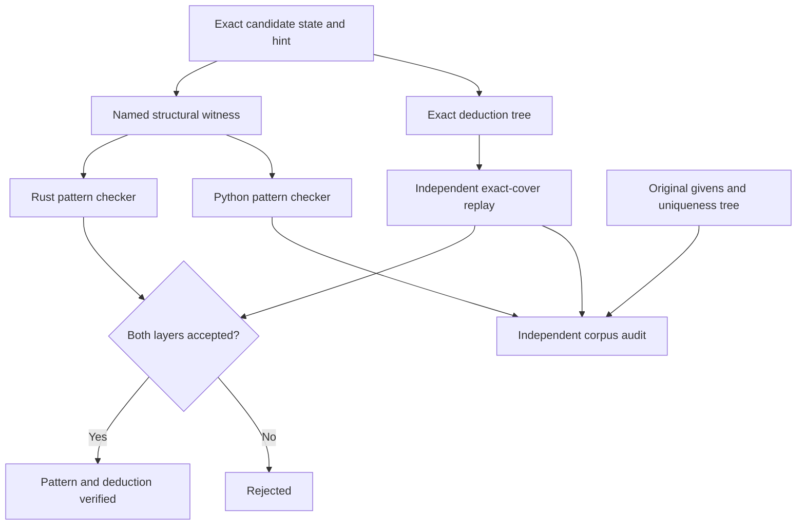

# Named pattern certificates

Every default technique example has two independent proof checks.
The named checker verifies a specific structural theorem and its exact conclusion.
The exact-cover checker separately verifies the conclusion against the complete candidate state.
Both checks must pass before the viewer displays **Pattern and deduction verified**.

The Rust checker is in [`named_patterns.rs`](../src/named_patterns.rs).
The separate [Python checker](../scripts/verify_named_patterns.py) uses no Rust code or technique detector.
Neither checker calls the witness producer.
The [offline producer](../scripts/certify_named_patterns.py) can search for witnesses, but its results have no authority without replay.

## Certificate contract

`NamedPatternProof` binds its version, technique ID, state hash, conclusion, witness, and required uniqueness premise.
The conclusion records the exact cell, digits, and action.
The state hash includes all values and candidate masks.
The checker rejects candidates that conflict with placed peers.
Unknown fields in the named Rust proof format cause deserialization to fail.

`ProofCertificate::Certified` stores `named`, `pattern`, and `deduction`.
The optional `pattern` member preserves legacy detector descriptions.
The `named` member contains the independently checked witness.
The checker does not use the legacy description to establish the named theorem.

Version-two example bundles require a named certificate for every entry.
Full-corpus mode also requires all 48 distinct technique IDs.
Version-one subset bundles can still contain deduction-only evidence.
They cannot claim complete named-pattern coverage.
Ordinary detector hints do not acquire a named certificate automatically.

## Supported structural rules

The following rules define the supported variants in the frozen examples.
They do not claim coverage of every published variant with the same name.
A state can satisfy several named rules at once.
A certificate does not establish the minimum difficulty or the necessity of its technique.

| Technique IDs | Checked structural premises and conclusion |
| --- | --- |
| NakedSingle | The target cell has exactly one candidate. |
| HiddenSingle | The target is the sole position for the digit in a native house. |
| NakedPair, NakedTriple, NakedQuad | Two, three, or four cells share one house and the same number of union digits. Other cells lose those digits. |
| HiddenPair, HiddenTriple, HiddenQuad | The selected digits are confined to the same number of cells in one house. Those cells lose other digits. |
| PointingPair | Two or three box positions lie in one row or column. Outside positions in that line lose the digit. |
| BoxLineReduction | All positions in a line lie in one box. Outside positions in that box lose the digit. |
| XWing, Swordfish, Jellyfish | Two, three, or four independent line bases have the same number of opposite line covers. |
| FinnedXWing, FinnedSwordfish, FinnedJellyfish | The corresponding basic fish has a nonempty fin set in one box. The target sees every fin. |
| FrankenFish | Independent bases and covers include a box. Neither side mixes rows with columns. |
| MutantFish | A base or cover group mixes rows with columns. The independent rank conditions still hold. |
| SiameseFish | Two finned fish share their bases and differ by one cover house. Both constituents and their eliminations are checked. |
| EmptyRectangle | A box's positions occupy a row arm and a column arm. A crossing line completes the checked fish implication. |
| XYWing | A bivalue pivot sees two bivalue pincers. The target sees both locations of their shared third digit. |
| XYZWing | A trivalue pivot sees two bivalue pincers. The target sees the shared digit in all three cells. |
| WXYZWing | Four cells use four digits. Each digit except the elimination digit has mutually visible locations. |
| WWing | Two equal bivalue cells have a conjugate bridge. Their alternating links force one endpoint digit. |
| XChain | A single-digit chain alternates strong and weak links. The target conflicts with both strong endpoints. |
| AIC | A mixed-digit chain has the same checked alternating inference and endpoint conditions. |
| ThreeDMedusa | A connected strong-link component has two colors. Every viable color proves the conclusion through native conflicts. |
| AlsXz, AlsXyWing, AlsChain | Disjoint almost locked sets have checked restricted common candidates. The endpoint counting contradiction forces the elimination. |
| SueDeCoq | Two intersection cells use four digits. Disjoint line and box almost locked sets partition those digits. |
| DeathBlossom | Every stem digit activates a different almost locked petal. Each activated petal forces the shared elimination digit. |
| UniqueRectangle, HiddenRectangle | A two-box rectangle has the checked core pair. Every opposite local case permits a second solution through a house-preserving swap. |
| AvoidableRectangle | Three rectangle corners are placed after the givens. The forbidden fourth value would permit the same swap. |
| ExtendedUniqueRectangle | Six cells form a three-box rectangle with a three-digit core and one extra-candidate cell. Every opposite case permits a swap. |
| BivalueUniversalGrave | Removing the proposed extra leaves bivalue cells. Each missing house digit then has exactly two positions. |
| AlignedPairExclusion, AlignedTripletExclusion | Every opposing assignment to two or three aligned base cells leaves an excluder with too few digits. |
| NishioForcingChain | One assumed candidate causes a contradiction using only its digit's house and peer implications. |
| CellForcingChain | Every candidate of a source cell has a replayed implication trace proving the conclusion or a contradiction. |
| RegionForcingChain | Every position for a source house digit has such a trace. |
| DynamicForcingChain | A cell split or contradiction assumption uses implications checked after each preceding candidate assignment. |
| KrakenFish | A checked fish supplies the ordinary case. Every fin assumption has a replayed trace proving the same elimination. |
| ThreeHouseMatching | The existing checker validates complete boundary coverage by explicit Hall obstructions. |
| ArithmeticCounting | The existing checker reconstructs the weighted native equations and their contradiction. |
| GlobalColoring | The existing checker replays every branch of the selected peer-graph refutation. |
| Backtracking | An explicit native exact-cover search tree verifies the conclusion. The name does not claim that easier methods failed. |

## Why the rules imply their deductions

A subset reserves one digit for each selected cell.
A fish reserves one occurrence for each independent base house.
Without a fin, equal cover capacity leaves no occurrence for an outside target.
A target that sees every fin excludes the fin case as well.
The Siamese certificate retains both complete constituent witnesses.

A three-cell wing checks every pivot value through its pincers.
For WXYZ-Wing, omitting the shared digit leaves four cells with only three distinct usable digits.
Each other digit can occur at most once because its locations are mutually visible.
An almost locked set can omit at most one union digit.
Restricted common candidates pass that constraint through the checked ALS chain.

An alternating chain states that at least one strong endpoint is true.
A target that conflicts with both endpoints is therefore false.
A connected strong-link component has two possible color assignments.
The Medusa checker rejects contradictory colors and checks the conclusion in every surviving color.

Rectangle checks enumerate only the four or six specified cells.
They retain native house requirements whose support lies entirely inside the pattern.
For each opposite case, a swap must change the assignment and preserve every house's digit multiset.
No swapped cell can be an original given.
Thus any full solution containing that case would produce a second solution of the original givens.
The attached original-givens uniqueness tree excludes that possibility.

A BUG remainder cannot have exactly one completion.
Every candidate in a bivalue cell conflicts with only the opposite candidate of another such cell for each incident house digit.
Any completion therefore permits the complementary choice in each cell.
The checked uniqueness premise requires the extra candidate to remain true.

Aligned exclusions enumerate the complete base-cell Cartesian product under native peer conflicts.
An excluder is a mutually visible cell set.
After the assumed base values remove candidates, fewer union digits than cells give a Hall contradiction.
Every opposing base assignment must have an excluder.
Sue de Coq uses a separate bounded local enumeration after checking its intersection and partition geometry.

Forcing traces use two primitive implications.
A true candidate removes every incompatible candidate.
An exactly-one requirement with all but one candidate false forces its remaining candidate true.
Each step names its reason in the preceding trace state.
A conflict must identify a requirement whose entire support is false.
Complete source coverage prevents a missing assumption branch from authorizing a result.

## Sources and corrections

The named definitions follow the authors' descriptions for [wings](https://hodoku.sourceforge.net/en/tech_wings.php), [complex fish](https://hodoku.sourceforge.net/en/tech_fishc.php), and [extended rectangles](https://www.sudokuwiki.org/Extended_Unique_Rectangles).
The aligned exclusion rule follows [Andrew Stuart's explanation](https://www.sudokuwiki.org/Aligned_Pair_Exclusion).
The implementations and proof schemas are newly written.
These sources support classification; they do not establish historical novelty.

The audit replaced the old two-cell XY-Wing example and its size-based detector classification.
It also replaced the old XYZ-Wing, repeated Franken/Mutant classification, and overlapping-base Siamese definition.
The extended rectangle now uses a published three-digit example with verified original givens.
Three retired technique IDs remain available for compatibility.
Their certificates still require the stated structures.
