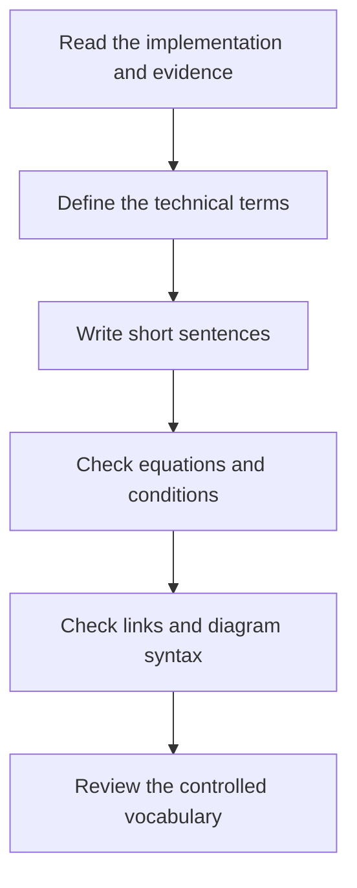

# Documentation writing rules

The documentation uses [ASD-STE100, Issue 9](https://www.asd-ste100.org/) as its writing reference.
The [official standard](https://www.asd-ste100.org/assets/files/ASD-STE100_ISSUE9.pdf) contains the writing rules and the controlled dictionary.

## Write and review a document

1. Identify the reader and the purpose of the document.
2. Use the approved dictionary words and the project technical terms.
3. Use the same term for the same item throughout the document.
4. Use active voice when the subject is known.
5. Write one instruction in each procedure sentence.
6. Start an instruction with a command verb.
7. Limit procedure sentences to 20 words.
8. Limit descriptive sentences to 25 words.
9. Keep one topic in each paragraph.
10. Limit each paragraph to six sentences.
11. Write contractions in full.
12. Use American English spelling in new prose.
13. Keep API identifiers, filenames, equations, source titles, and quotations exact.
14. Define a necessary technical term before its first unexplained use.
15. Check each claim against the implementation or the recorded evidence.

The [project glossary](technical-terms.md) defines the Sudoku and software terms.
Technical terms supplement the controlled dictionary.
They do not change the meanings of ordinary words.

## Separate instructions from descriptions

Procedures tell the reader what to do.
Descriptions explain a system, theorem, result, or limit.
The command below is a procedure step.

```sh
cargo run --release --example arithmetic_counting
```

The Arithmetic Counting example constructs a proof and checks the proof.
This sentence describes the example.

## Keep mathematical meaning

A shorter sentence must retain every necessary condition.
An exact certificate, a search result, and a historical claim need separate descriptions.
A search cutoff is an inconclusive result.
A successful local check does not establish a complete Sudoku solution.
These distinctions apply to diagram labels as well as prose.



## Add a Mermaid diagram

1. Select a diagram that explains a relationship, procedure, or decision.
2. Use short labels with the glossary terms.
3. Put the diagram in a fenced `mermaid` block.
4. Include every branch that changes the result.
5. State resource limits in the related prose.
6. Check the diagram with the Mermaid parser.

Diagrams support the text.
The theorem, API contract, or recorded evidence defines the exact behavior.

## Check documentation

Run the repository documentation checks from the repository root.
The checks cover Markdown structure, local links, sentence length, and Mermaid syntax.
A full vocabulary review also uses the official dictionary and the project glossary.

```sh
python3 scripts/check_docs.py
npm install --prefix target/docs-tools --ignore-scripts --no-audit --no-fund --no-save --package-lock=false mermaid@12.2.0 jsdom@26.1.0
node scripts/check_mermaid.mjs
```

The diagram checker requires Node.js 22.12 or newer.
It stores its dependencies under the ignored `target/` directory.
The Documentation workflow uses Node.js 24 and checks every authored Markdown file.
Code fences, tables, mathematical displays, and source titles use their own syntax.
The prose checker excludes those structures from its sentence counts.
