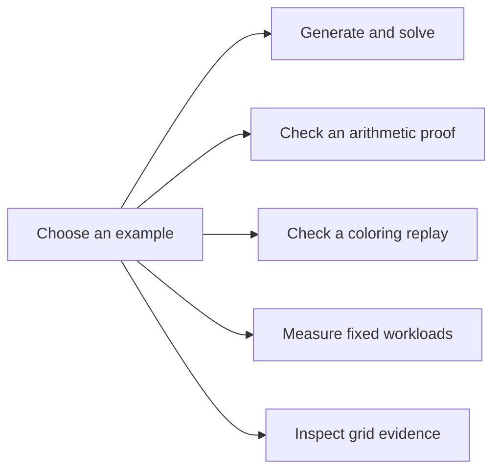

# Engine examples

This repository contains eight runnable Rust examples.
The terminal and mobile user interfaces belong to consumer projects.

## Inspect technique evidence on the grid

Run the browser example from the repository root.

```sh
cargo run --release --locked --example grid_viewer
```

Open `target/grid-viewer.html` in a browser.
The library contains real puzzle states, exact proof traces, a synthetic fixture, and deliberate invalidation examples.
The [grid explanation guide](../docs/grid-scenes.md) defines the API, controls, provenance, and verification limits.
Every technique has a frozen real-puzzle example with independent deduction and setup validation.
The [validation guide](../docs/independent-validation.md) describes the replay, search, and certificate-generation tools.



## Generate and solve a puzzle

Run the basic example from the repository root:

```sh
cargo run --example basic
```

## Check Arithmetic Counting

Run the arithmetic example:

```sh
cargo run --release --example arithmetic_counting
```

The example constructs a Guardian candidate state and checks its five-equation parity proof.
It also runs the bounded arithmetic search.
The [arithmetic guide](../docs/arithmetic-counting.md) describes the proof and API.

## Check Global Coloring

Run the coloring example with a candidate-state file:

```sh
cargo run --release --example global_coloring -- candidate-state.json
```

Run an explicit proof request for a selected cell set:

```sh
cargo run --release --locked --example global_coloring -- --explicit research/global_obstructions/realization27_proof_request.json
```

The [coloring guide](../docs/global-coloring.md) defines the input and proof limits.

## Measure generation and solution counting

Run both fixed workloads:

```sh
cargo run --release --locked --example performance
```

Run one workload:

```sh
cargo run --release --locked --example performance -- count
cargo run --release --locked --example performance -- generate
```

Generation uses seeds 42, 99, and 314.
The example prints puzzle fingerprints for comparisons across revisions.
The [performance report](../docs/performance.md) gives the measurement method and validation checks.
