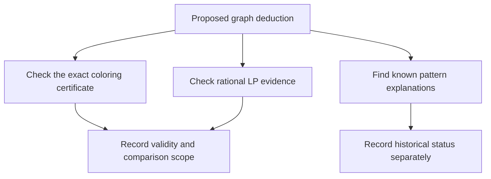

# Global obstruction audit: exact linear separation and prior art

No historical novelty is established. Native Sudoku graph/list coloring,
failed-literal refutation, impossible patterns with guardians, and nonlinear
graph certificates are established methods. The purpose here is to preserve
precise, independently checked evidence about specified finite relaxations.

The [exact 13-cell motif audit](prior_art_13_report.md) maps a 29-edge spanning subgraph to an established seven-hyperhole.
It also checks a grouped discontinuous-loop derivation after the guardian-false assumption.
See the [expanded search report](expanded_search_report.md) for the later unique
nonforcing-gap puzzle and the separate, stronger full-old-engine target.




## Exact LP acceptance criterion

[`linear_witness.py`](linear_witness.py) checks a rational value for every
candidate indicator, with omitted entries interpreted as zero. It reconstructs
and checks **all 324 native exactly-one equalities**: 81 cells and 243
row/column/box-digit requirements. It also checks nonnegativity, the implied
upper bound 1, every recorded effective domain, placed values, and the exact
advertised target assumption. A SHA-256 binding includes the full 81 values,
81 domains, and target assumption.

Search may use SciPy/HiGHS to propose a point. Acceptance uses only Python
`Fraction` arithmetic; it accepts neither a floating solver status nor a
tolerance. A fallback solves the proposed nonzero basis over the rationals.
Verification and the recorded-witness audit require no numerical libraries.

If this exact point exists, no contradiction follows solely from linear
combinations of these equalities and nonnegativity. The separation applies only to **this native continuous relaxation**.
It does not cover all LP encodings, local-marginal hierarchies, cutting planes, SDP, integer reasoning, or rank/MSLS methods.

## Published-puzzle positive controls

The three real-puzzle fixtures have recorded original givens, independently
checked completions, and replayable candidate-reduction traces. The separate
real-state checker establishes closure under complete individual-house GAC and
all **81 crossing row/column/box** checks, also after the false-guardian
assumption. A separate feasibility check also constructs a valid assignment for all
2,925 arbitrary triples of the 27 houses. It does not establish full support
filtering for those arbitrary triples.

The LP points below are checked against the **post-assumption fixed-point
`assumed_state`**, including its values and domains, not merely the original
unclosed candidate masks.

| Published fixture | Opposite assumption tested | Nonzero LP entries | Only denominators used |
| --- | --- | ---: | --- |
| [#4662](real_4662.json) | `r5c4 != 2` | 148 | 1, 17 |
| [#4401](real_4401.json) | `r4c4 != 9` | 121 | 1, 3 |
| [Loki](real_Loki.json) | `r8c8 != 1` | 137 | 1, 13 |

These are **established tridagon examples**, used as positive controls for
stronger reasoning and exact certification. Their immutable primary sources
are [#4662](https://github.com/denis-berthier/CSP-Rules-Examples/blob/fd9207f8dc1eb6e2e655048ba3b327d423900e1b/Sudoku-a/Tridagons/%234662-SFin%2BTrid.clp),
[#4401](https://github.com/denis-berthier/CSP-Rules-Examples/blob/fd9207f8dc1eb6e2e655048ba3b327d423900e1b/Sudoku-a/Tridagons/%234401-Trid%2BW8.clp), and
[Loki](https://github.com/denis-berthier/CSP-Rules-Examples/blob/fd9207f8dc1eb6e2e655048ba3b327d423900e1b/Sudoku-a/Tridagons/Loki-11.9.clp).
Attribution and source hashes are retained in the fixtures. Their success does
not establish a previously unknown Sudoku rule.

Run the exact, standard-library-only check and malformed-evidence tests:

```sh
python3 research/global_obstructions/audit_linear_witnesses.py
```

To check one point independently of the numerical search:

```sh
python3 research/global_obstructions/linear_witness.py verify \
  research/global_obstructions/real_4662.json \
  research/global_obstructions/linear_real_4662.json
```

## Negative controls and stronger synthetic candidate

The earlier three-house trial 847 is rejected as a nonlinear-separation example:
an exact eleven-source native integer counting identity proves its assumed LP
infeasible. The audit checks that fixed identity without an LP solver.

A mined 21-cell four-digit, five-chromatic support was also rejected. Its exact
[35-source integer Farkas certificate](linear_rejected_q4_farkas.json), checked
against the [preserved rejected input](linear_rejected_q4_input.json), has
right-hand side -1 and nonnegative coefficients on every available candidate.
Thus non-four-colorability alone did not meet the stronger LP-survival filter.

A later, different [13-cell four-digit candidate](structural_four_digit_13.json) passed the post-assumption
closed-domain LP test. The recorded point uses only 0, 1/4, and 1/5.
A binary vector `t` assigns `t/4` to the four palette digits.
It assigns `(1-t)/5` to the other five digits.

The [recorded exact point](linear_four_digit_candidate.json) satisfies
all 324 equalities, recorded closed domains, and the guardian-false
assumption. This is an independently mined synthetic pattern; historical
priority does not follow. The structural experiment separately owns its graph criticality and
local-filter tests. A smaller support is not, by itself, a global-minimum proof.

There is also a short global capacity proof: every four-cell subset of the
13-cell support contains a native peer edge. The independent audit checks all
715 such subsets and finds 32 independent triples, establishing independence
number exactly 3. Each digit can occupy at most three support cells, so four
digits can fill at most 12 cells, fewer than 13. This is an established
stable-set counting argument, not a new mathematical principle. The exact
native LP point nevertheless permits 3.25 selected occurrences per palette
digit, demonstrating the specified integrality gap.

The [generated 19-given four-digit fixture](real_four_digit_candidate.json) starts from a known completion.
It records the generated puzzle, candidate-reduction traces, and a respecting completion.
The traces reach the same type of obstruction. Its
[post-assumption exact LP point](linear_real_four_digit_candidate.json) has
161 nonzero entries and satisfies all recorded domains and native equalities.
It has multiple completions. The recorded existing non-forcing baseline stalls;
that is neither a uniqueness claim nor a comparison with every known method.

The separate [generated 34-given puzzle](real_four_digit_unique.json) has an
independently checked unique completion and survives the same specified local
filters under its opposite target assumption. Its
[exact LP witness](linear_real_four_digit_unique.json) has only 92 nonzero
entries, all equal to 1 or 1/2. The existing engine solves it with Finned X-Wing, Pointing, and singles.
Thus it is a **negative control for additional solver benefit**.

It remains a positive control for the specified local/LP gap. Both generated fixtures come from this search and a known completion;
they are not published author-source puzzles. The proof does not use
uniqueness, and neither example establishes a separation from all established
AIC, forcing, rank, or impossible-pattern methods.

## Independent nonlinear certificate acceptance

[`audit_global_certificates.py`](audit_global_certificates.py) independently
checks exported native graph list-coloring refutation trees. It reconstructs
all row/column/box peer edges from board indices. It verifies:

- a complete effective candidate snapshot and its hash;
- sorted, distinct selected native cells, the available target, and the exact
  opposite target restriction;
- an explicit proper local coloring witnessing the conclusion endpoint;
- every split on an unassigned cell, with **every current candidate exactly
  once**, and native peer candidate removal on each branch;
- only reconstructed empty-domain conflict leaves, postorder child references,
  no reused evidence, and complete reachability of the bounded proof tree.

No externally supplied graph edges, color-permutation normalization, solver
cache, or numerical result is trusted. Finite case exhaustion proves correctness.
Each respecting completion restricts to a proper selected-cell coloring.
One branch of every exhaustive split preserves that coloring.

A final empty domain cannot preserve it. The base witness rejects vacuity only for this
local coloring relaxation. The real fixtures additionally carry full
completions, checked separately. Recorded domains remain premises, so replaying
their derivation from givens is a separate obligation.

Independent checks accepted the original four Rust replay exports:

- #4401 uses 14 selected cells and 190 proof nodes.
- #4662 uses 12 selected cells and 142 nodes.
- Loki uses 13 selected cells and 178 nodes.
- The synthetic four-digit case uses 13 selected cells and 1,121 nodes. Two additional generated-board exports also verify. The checker rejects ten evidence mutations per replay, for 60 mutations across the six initial exports.
Mutations include missing or duplicate branches, invalid or reused children, false conflicts, reversed endpoints, stale hashes, and malformed witnesses. Running the checker without arguments checks
every recorded `replay_*.json` export.

The expanded search adds a seventh export for a unique 29-given nonforcing-gap
puzzle, with 21 selected cells and 74 proof nodes. It and ten further mutations
are checked by the same independent script. The subsequent
[forcing-inclusive benchmark](nonrank_report.md) adds an eighth export, with
16 cells and 169 nodes, bringing that stage's audit to 80 rejected mutations.
It also has an independent exact full-board digit-template primal, which
satisfies every per-digit-valid linear inequality. Exact graph maps identify
its branch obstruction as an established tridagon composition; this does not
create a historical novelty claim.

The subsequent [27-cell realization audit](realization27_report.md) adds a ninth
production export and brings the current generic audit to 90 rejected
mutations. Its conditional synthetic deduction uses the larger explicit
32-cell/32,768-node bounds; automatic search keeps its earlier limits. An
exhaustive unavoidable-trade certificate rules out unique outside-clue
realization of the exact live support. Independent unique anchored controls
are solved by the older engine and are retained as negative controls.

The abstract mathematical core in
[`verification/global_coloring.rs`](../../verification/global_coloring.rs)
was checked by pinned Verus: three verified theorems and zero errors. It proves
preservation under a proper assignment's own branch, rejection by an empty
domain, and the exhaustive-split induction step. It does not formally verify
the production flat-tree representation, checker, topology, masks, or replay.

## Primary prior art and limits

- [Berthier's author-maintained examples](https://github.com/denis-berthier/CSP-Rules-Examples)
  already contain automated proofs of non-degenerate and degenerate tridagons,
  guardian-based chains, and analyses of 630 impossible three-digit patterns.
  Therefore a generic impossible-pattern finder or a second proof of tridagon
  is not new Sudoku mathematics.
- [The sudokUI author's implementation](https://github.com/AImenes/sudokUI)
  describes per-position exhaustive tridagon and Exocet checks. A portable
  independent proof checker is useful engineering but not a new principle.
- [De Loera et al., 2008](https://arxiv.org/abs/0801.3788) studies low-degree
  Nullstellensatz infeasibility certificates, including graph non-three-colorability.
  [Graph-coloring ideals, 2014](https://arxiv.org/abs/1410.6806) studies structural
  properties and certificate lower bounds. Polynomial graph refutation is
  substantial prior art; a new encoding or proof transcript does not establish
  novelty.
- [Ó Conghaile, MFCS 2022](https://arxiv.org/abs/2206.15253) treats CSP solutions
  as global sections and derives cohomological extensions of local consistency.
  This is a plausible research vocabulary for local/global obstructions, not
  proof that the current engine implements cohomology or beats that hierarchy.
- [Lichter and Pago, revised 2026](https://arxiv.org/abs/2407.09097) proves limits
  for affine/integer and cohomological CSP relaxations. Consequently local/global
  terminology does not imply a complete or universally stronger solver.

Search queries included `"sudoku" "5-chromatic"`, `"sudoku" "4-digit" "impossible patterns"`,
`"sudoku" "four" "oddagons"`, `"sudoku" "13" "impossible pattern"`,
`"cohomological" "constraint satisfaction" obstruction`, and
`"trivalue oddagon" "linear programming"`. Sparse results are absence of
evidence, not evidence of originality.
