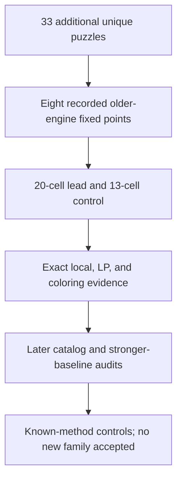

# Search for a different obstruction in a unique puzzle

**Follow-up: the known EL12c38 tridagon plus one cell split explains the
20-cell deduction.** The [expanded novelty audit](novelty20_report.md) verifies
that complete chain and a separate seven-node local-only forcing tree. The
85-node engine certificate and recorded older-baseline comparison remain valid; this case
does not demonstrate a new solving principle. The earlier one-pivot no-hit
below remains a precisely scoped result without the additional catalog lemma.

**This historical discovery report retains a certified 20-cell list obstruction in a unique puzzle.**
Its 85-node proof establishes r1c8≠3 at a recorded forcing-inclusive older-engine fixed point.
The known-method screen below was bounded.
Later audits explain the deduction with established methods.
The [candidate-preserving baseline](joint_research_report.md) also solves this host.
No new mathematical family is claimed.




## Verified mixed-digit lead

The independently unique 26-given Mith source-line-515 puzzle is:

```text
12...6..9
.57..9...
6.92.....
2.5....67
...5.....
......34.
....95...
....1.6..
97.6.2.1.
```

The [full premise fixture](different_lead.json) binds its immutable author source,
sole independently enumerated solution, 37 exact derivation events and the
retained state with 43 unplaced cells. Two complete forcing-inclusive frozen
dispatcher calls return no hint, no trace and no arithmetic cutoff; all 81
crossing centers are exhausted. The opposite r1c8=3 survives exact Hall/all-81
closure, with ten branch events, and all 2,925 arbitrary house triples are
separately feasible.

An [18-term exact full-board template primal](different_lead_template_primal.json)
survives the native continuous LP and every valid per-digit placement-polytope
inequality, including per-digit weighted rank. The actual production
[20-cell, 85-node replay](replay_different_lead.json) exhaustively refutes that
opposite assumption and proves **r1c8≠3**. It uses no uniqueness premise. The
independent checker reconstructs all branches and rejects ten corruptions.

The selected native graph has 51 edges, ordinary chromatic number four and no
embedded published Loki12 geometry. Its actual opposite lists use seven digit
labels, {1,2,3,4,7,8,9}. It is a **list-coloring obstruction**, not a uniform
four-color graph requiring five colors. Both observations matter when comparing
it with the earlier 13- and 27-cell examples.

The bounded known-method audit finds no one-pivot full-board reduction using
exact local contradictions, the published Loki12 tridagon, or uniform two-color
odd cycles. It tests every eligible unplaced pivot, with all its candidates,
without timing out. Other tridagon/oddagon variants, other named methods,
hyperholes inside conditional branches, longer forcing compositions and
historical priority remain unresolved. A no-hit is not evidence of originality.
See the [independent prior-art report](different_prior_art_report.md).

The explicit engine API already admits the certificate, so no new production
search rule or dependency is needed. The current full logical ladder also
advances this retained state, finding r8c6=7 with a 16-cell, 172-node certificate.
Regressions check that full-ladder behavior and atomic replay of the new
elimination. CI independently accepts both the lead and the known-composition
control, and freshly rebuilds the historical engine for both comparisons.

## What was searched

The [public corpus manifest](different_corpus_results.json) records **33 additional
independently unique puzzles**: 15 Monhard and 18 Mith puzzles from the pinned
author-maintained corpus. The full older dispatcher alternated with exact Hall
and all 81 crossing-three-house support checks. **25 solved and eight reached
live fixed points**. All 33 completion counts and premise traces were independently
rechecked. One interrupted next Monhard case is excluded. Timeouts, incomplete
searches and bookkeeping errors were not counted as stalls.

The frozen baseline is `0532d63d9241a69c1fb57e9c34a1533effe1981d`.
This is a comparison with its actual logical dispatcher, excluding the public
hint API's backtracking fallback. Its arithmetic beam and forcing bounds remain
relevant; a fixed point does not establish impossibility of every known method
or every longer forcing argument.

The opposite targets first survived local closure and a direct three-digit contradiction screen.
Optional SAT discovery then extracted **327 small native list-coloring cores from six Monhard fixed points**. Exact full-board single-digit-template
primals were recovered for 170 of the first 172 cores. This was not sufficient
evidence of a different family:

- All 327 selected supports contain the geometry of the published Loki
  12-cell tridagon.
- 316 have complete checked explanations using one additional cell case split,
  exact local propagation, and established tridagon/odd-cycle contradictions.
- Eleven have no checked reduction in that bounded screen. Geometric overlap
  alone does not prove equivalence; failure of the recognizer does not prove
  novelty.

The [audit manifest](different_audit_manifest.json) preserves this distinction.
The [prior-art report](different_prior_art_report.md) gives primary sources and
the precise limit of the known-method screen.

The final Mith arm added 135 SAT cores from the two new Mith fixed points;
129 have exact template primals. The 20-cell lead above was selected from this
arm after the full-board follow-up. Unclassified cases remain separate from
the Monhard reductions and from certified historical novelty.

A second SAT search deliberately omitted cells from recognized tridagon
geometries. It found thousands of alternative selected supports without that
literal 12-cell subgraph. Of 21 distinct opposite targets locally screened, one
failed closure and 20 survived. Seventeen of those 20 have independently checked
exact full-board template primals.

**All 20 still have known full-board
explanations**: 18 already expose a published tridagon in the closed opposite
state, and two require the extra case split. Omitting known geometry from a
selected proof support does not remove the known explanation elsewhere on the
board. This is a useful rejected novelty control, not a different family.

The complementary [geometry search](different_structural_summary.json) examined
1,317,403 omitted-box support presentations from 17 completed grids, plus 18
seeded presentations. It made 1,722 critical extractions and retained 177 new
graph fingerprints. Every retained fingerprint has an exact weighted
independence bound excluding four colors. The independent checker maximizes
each rational weight over **all native independent sets**; all 177 bounds pass.
These are established weighted-rank explanations. Fingerprint deduplication,
random construction and resource bounds make this a bounded negative search,
not a classification of all Sudoku graphs.

## A valid deduction retained as an engine control

The 25-given Monhard source-line-113 puzzle is independently unique:

```text
98765....
6...4....
...3.....
86..92...
.23.789..
.........
29....86.
.7......3
......2.7
```

Its [retained state and exact givens trace](different_control.json) have 45
unplaced cells. Two complete calls to the frozen forcing-inclusive dispatcher
return no hint. The accepted deduction is **r9c2=5**, with a production
certificate of **13 cells and 137 nodes** in
[replay_different_control.json](replay_different_control.json).

The opposite assumption survives exact Hall/all-81 closure, all 2,925 arbitrary
three-house feasibility checks, and a **12-term exact rational full-board
digit-template mixture**. The latter implies the native 324-equation LP and
every valid linear inequality for each digit's separate placement polytope,
including per-digit weighted rank. It does not cover arbitrary joint multidigit
cuts or full POM.

The novelty audit finds a complete known explanation. Under r9c2≠5, split
r8c8={5,9}. The value 5 gives an exact three-house contradiction; value 9 closes
to a published Loki tridagon with a checked native graph isomorphism. Therefore
this is an exact **negative novelty control**, despite its strong relaxation
separation and short production proof.

The existing engine already exports this explicit proof. Its current full
logical ladder also finds r9c8=9 on the same state with a checked certificate.
Regression coverage now includes both the live full-ladder behavior and atomic
replay of the new exported proof. No additional production search rule is
justified by this campaign. Exact acceptance runs in CI, and a separate job
rebuilds the historical engine and rechecks the control twice.

## Reproduce

Acceptance requires only Python's standard library and the existing Rust tools:

```sh
python3 -S research/global_obstructions/different_verify.py
python3 -S research/global_obstructions/different_audit_verify.py
python3 -S research/global_obstructions/different_structural_verify.py
python3 -S research/global_obstructions/different_corpus_manifest.py verify --count
cargo test --locked --test global_coloring
```

`different_corpus_close.py` records complete historical-engine/premise traces;
the public compact manifest binds source puzzles, solutions and trace hashes.
Full discovery traces remain under `target`. The corpus manifest's `--bulk`
option replays them when present. The fresh-build comparison command is
`nonrank_puzzles_audit.py --fixture research/global_obstructions/different_control.json`
with a new `--fresh-folder` and chosen `--output` path.

Optional discovery uses SciPy, NetworkX and PySAT; it is excluded from acceptance
dependencies. This run used `python-sat==1.9.dev17` in an isolated environment.
[`different_sat_search.py`](different_sat_search.py) extracts native candidate
cores, [`different_structural_alternatives.py`](different_structural_alternatives.py)
breaks recognized geometry, and `nonrank_templates.py` proposes rational primal
witnesses. SAT/optimizer answers alone never promote a deduction.

The open question is whether the certified mixed-digit lead has an established
named explanation or an earlier equivalent pattern. The other unclassified
cases and broader mixed-digit correlations also require further work.

The follow-up resolves the first part with the established forcing composition
above; it does not establish the historical first appearance of this exact
20-cell incidence.
