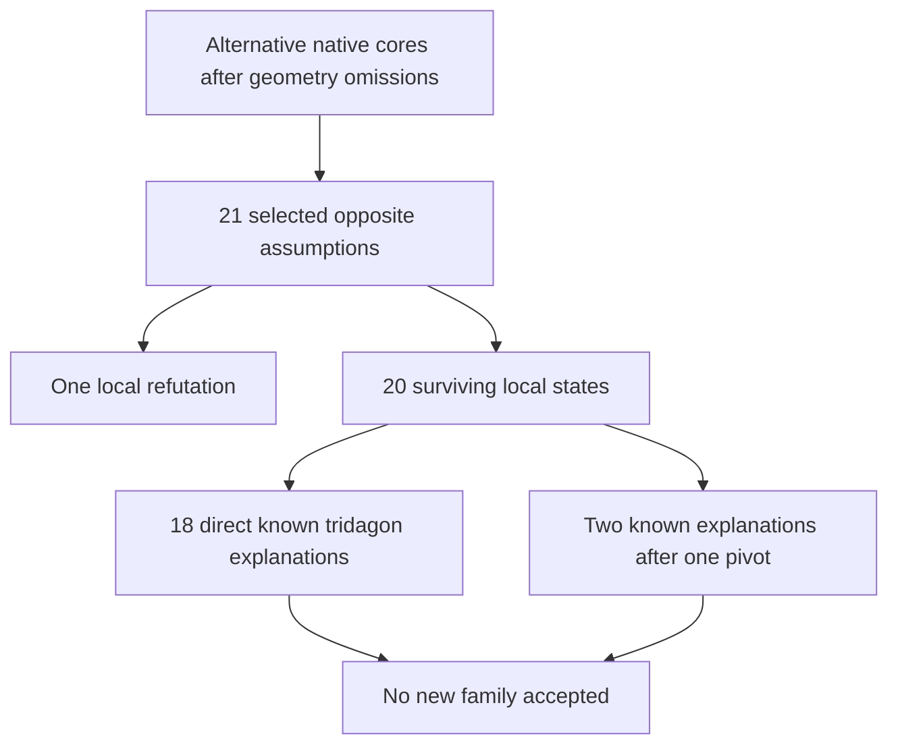

# Bounded search for a different obstruction

The omitted-box geometry campaign found **no new obstruction beyond weighted independence capacity**. A subsequent geometry-hitting SAT campaign produced small mixed-list proof candidates on real full-old-engine stalls. These candidates require separate certificate, relaxation, and known-pattern audits.
A missing recognized 12-cell geometry does not establish historical novelty.
The [later audit](novelty20_report.md) explains the 20-cell lead through established methods.




## Geometry campaign

Command (optional SciPy and NetworkX discovery dependencies):

```sh
python research/global_obstructions/different_structural_search.py --seconds 420 --orders 6 --seed 220640 --require-native-lp --output target/different-structural-search-results.json
```

The observed 420.015-second run covered 18 previously retained large supports and **1,317,403 support presentations across 17 independently completed Norvig source grids**. A presentation chooses four digits and one nonpalette guardian, removes palette occurrences from the guardian's three houses, and forcibly omits a whole nonguardian box. Thus every tested support misses at least one box. It tries six randomized vertex-deletion orders when a support is not four-colorable.

There were 287 non-four-colorable supports, 1,722 critical extractions, and 177 first-seen `(order, size, five-round WL hash)` fingerprints. All 177 had exact rational weighted-independence bounds exceeding four; 1,545 extractions repeated a fingerprint. There were zero fractional-four-colorable hits and consequently no surviving local/template/givens candidate from this campaign. The retained orders range from 13 to 28.

These are sampled presentations and hash fingerprints, **not an exhaustive classification of native embeddings, graph isomorphism classes, candidate lists or puzzles**. The stopping rule is elapsed time, so another machine can reach a different prefix and different counts with the same seed. The full observed raw result remains under `target/`; its SHA-256, command and counts are retained in `different_structural_summary.json`.

The exact rejection certificate is elementary. For each support, retained nonnegative rational weights satisfy

\[
\sum_{v\in I}w_v\leq1\quad\text{for every native independent set }I,
\qquad \sum_{v\in S}w_v>4.
\]

Four digit classes would be four independent sets and would give total weight at most four, a contradiction. This is established weighted coloring/rank mathematics, not a new Sudoku rule. The independent checker maximizes each weight function over **all** independent sets with an integer dynamic program.
It does not trust the search's floating-point LP or maximal-independent-set enumeration. All 177 rejections pass, using 57,270 memoized states in approximately 0.2 seconds.

A separate finite coordinate check permutes the four ternary coordinates `(band, row within band, stack, column within stack)` of the old 27-cell support. Of the 24 images, eight miss a box. Every one of these eight has five selected cells in one native house, so they fail the requested relaxation filter immediately. The retained five-cliques and coordinate transformations are reconstructed by the standard-library checker. This only rejects these 24 transformations; it does not rule out another embedding of the abstract graph.

## Early trade screen

`different_structural_avoidability.py` implements a necessary pre-clue-search check for a support, palette and respecting full completion. It keeps every nonpalette support value fixed. For each of the 27 houses, it records the source palette set.
It intersects the relevant house masks at each palette-valued support cell.
It then searches for two proper native colorings. A second coloring is pasted into the source board and independently checked as a full alternate Sudoku solution agreeing at every outside cell.

Why this is sound: a house contains exactly as many changed cells as its source palette-set size. Proper coloring makes their colors distinct; restricting all of them to that palette set therefore preserves the entire set. Every house keeps all nine values. Hence no collection of outside clues can uniquely determine this source completion if a second coloring is found. Sound deductions from those clues cannot remove the second solution either.

A one-coloring result is merely a necessary screen for **this source completion and this restricted palette trade**. It is not a universal avoidability theorem and does not establish a uniquely realizable puzzle. Node exhaustion gives no conclusion. The old native27 fixture is rejected with an explicit alternate full completion after 31 DFS nodes; a one-cell rigid control passes the necessary screen.

## Mixed-list alternative campaign

`different_structural_alternatives.py` uses the root's optional PySAT `GraphOracle` as an untrusted discovery oracle. The inputs are six frozen unique real-puzzle states where the configured older engine finds no step.
The search extracts a target-opposite UNSAT core and recognizes the published four-box 12-cell tridagon geometry.
It omits one selected cell from that geometry before testing another core. At most two successive recognized geometries are hit. Omissions weaken the selected constraints; they do not modify the actual puzzle or candidate state.

Command:

```sh
target/different-sat-env/bin/python research/global_obstructions/different_structural_alternatives.py target/different-corpus/modern-monhard-te3-001132.json target/different-corpus/modern-monhard-te3-001244.json target/different-corpus/modern-monhard-te3-001468.json target/different-corpus/modern-monhard-te3-002283.json target/different-corpus/modern-monhard-te3-002506.json target/different-corpus/modern-monhard-te3-003066.json --seconds 180 --depth 2 --seed 221641
python research/global_obstructions/different_structural_triage.py --limit 20
```

The run completed all six inputs in 70.586 seconds.
Its recorded counts are:

- 960 target endpoints.
- 558 initial cores with the recognized geometry.
- 402 initial cores without it, reserved for the complementary direct search.
- 8,644 omission queries.
- 7,698 alternative cores without the recognized geometry. Of these alternatives, 6,297 have at most 32 cells. There were 666 satisfiable weakened selections, 7,978 unsatisfiable selections, and 93 branches stopped at the two-geometry depth bound. These are repeated endpoint/proof discoveries, not distinct logical rules or puzzles.

The bounded smallest-core, distinct-target sample checked 21 opposite assumptions against full Hall plus all 81 crossing-three-house fixed-point propagation: one was refuted locally and 20 survived. **Independent final triage rejected all 20 as known compositions.**
Eighteen full opposite states already contain the published tridagon.
The other two reduce to it with one additional pivot.

Standard fixtures of size 15–18, including exact closure traces and candidate states, are in `target/different-structural-screened/candidate-00.json` through `candidate-19.json`. **The selected supports' geometry check does not exclude a conditional tridagon explanation using the full state.** Template feasibility, actual Rust proof replay and conditional prior-art screening are separate acceptance gates; no new-family or integration claim is made here.

Bulk raw cores and exploratory files deliberately remain under `target/`. The public deliverable is the bounded search method, exact negative controls and trade screen. `different_structural_alternative_summary.json` retains the exact counts, selected raw-file mapping and independent audit hashes. There is zero new-family acceptance from either campaign.

## Verification

```sh
python research/global_obstructions/different_structural_verify.py
```

Expected output: 177 exact rank controls, eight native five-clique controls, two source-signature trade/rigidity controls, and rejection of a malformed rank witness. Only the Python standard library is required. These checks concern the retained mathematical controls; they do not re-establish every full-old-engine stall or assert a new discovery.

For the prior-art context, see the existing [weighted hyperhole audit](prior_art_13_report.md), [independent known-pattern recognizer](different_audit_known_patterns.py), and [unavoidable-support theorem](realization27_structure_report.md). The general trade/unavoidable-set principle is established in McGuire, Tugemann and Civario, [*There is no 16-clue Sudoku*](https://arxiv.org/abs/1201.0749), Section 5.
