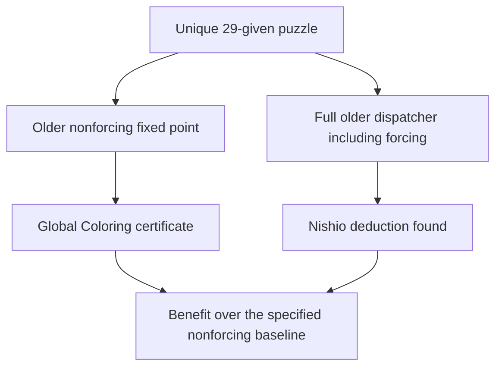

# Expanded unique four-digit search and motif provenance

The expanded search found a **unique, generated 29-given puzzle** that passes the specified local/native-LP filters.
The frozen older nonforcing handlers and default Arithmetic Counting find no step. This improves on the previous
nonunique example. It does **not** stall the full older engine: Nishio finds
r4c6!=4.

No unique case meeting the stronger forcing-inclusive target was found
in that experiment. The later [full-old-engine benchmark](nonrank_report.md) meets that recorded target.
It uses an established tridagon composition and an exact full-board template witness beyond all single-digit weighted-rank bounds.

The motif investigation also found a positive prior-art correspondence. The
thirteen-cell obstruction has an explicitly mapped spanning **7-hyperhole**,
with clique sizes `(1,3,1,2,2,2,2)`, and an ordinary grouped Nice Loop derivation
under the guardian-false assumption. Its mathematical mechanism is established.
The first appearance of the exact 35-edge native graph or Sudoku drawing is
still unresolved; an unsuccessful keyword search cannot establish priority.




## Certified unique nonforcing gap

The generated givens are:

```text
....7.2..
...359...
..38.1...
.95...3.1
.32..7..5
1..935.2.
....6.1..
.5.7...9.
2......56
```

This is a new clue selection from the known completion anchored to Norvig
top95 #20. It is not attributed as a puzzle authored or published by Norvig.
The fixture preserves the completion's original source separately.

The [complete fixture](expanded_unique_nonforcing.json),
[rational LP point](linear_real_expanded_unique_nonforcing.json), and
[actual Rust replay export](replay_expanded_unique_nonforcing.json) establish:

- Independent exact-cover enumeration from givens finds exactly one solution.
- Eighteen recorded base trace events reach the retained state; the guardian
  r2c8 is unplaced with candidates `{1,4,6,7,8}`.
- Both base and guardian-false states reach complete single-house Hall and all
  81 crossing-three-house support fixed points. The opposite trace has 31 events.
- Every one of the 2,925 triples of native houses admits an assignment on the
  opposite branch, under those three selected constraints. This is a feasibility
  test, not support filtering for all arbitrary triples.
- An exact rational point with 94 nonzero entries, all `1` or `1/2`, satisfies
  every one of the 324 native equations, effective domains and r2c8!=1.
- The retained thirteen-cell native core is not four-colorable. The existing
  production search certifies **r2c8=1**, selecting 21 cells and emitting a
  74-node explicit refutation tree with a result-support witness.
- The old nonforcing closure reports no step. Default Arithmetic tests 7,634
  combinations, with beam pruning but without exhausting its combination budget,
  and returns no hint. Its bounded failure is not a completeness theorem.
- The full frozen old dispatcher does find Nishio r4c6!=4. This example must
  not be described as stronger than all older methods.

The [complete defeating old-forcing trace](expanded_cover_old_forcing_trace_29.json)
starts from the same givens and retained state. Five Nishio eliminations,
with complete local propagation between them, place the guardian: r4c6!=4,
r5c1!=6, r1c3!=1, r2c1!=7 and r1c2!=8. Every endpoint is checked against the
independently counted sole completion; the local trace is independently replayed.
This does not independently reconstruct each named old technique's inner proof.

The standard-library acceptance script replays the givens and traces and independently counts solutions.
It checks both local fixed points, all arbitrary triples, the exact LP point, and the production certificate.
The command is:

```sh
python3 research/global_obstructions/expanded_unique_verify.py
python3 research/global_obstructions/audit_global_certificates.py
```

The Rust integration case constructs the direct thirteen-cell proof and checks automatic search.
It checks replay serialization, atomic application, and rejection of a stale second application. No new trusted template or production
algorithm was needed; the generic Global Coloring implementation already covers
this state. The seven committed exports now reject seventy evidence mutations.

## Broader experiments and what a stall means

The old engine is frozen at `0532d63d9241a69c1fb57e9c34a1533effe1981d`.
Before each older-engine call, the search applies singleton peer exclusions.
It alternates older nonforcing methods with complete Hall/crossing closure to a joint fixed point.
Earlier candidate removals remain in force.

Uniqueness handlers are enabled
only after an independent uniqueness check. A solved board or a placed guardian
is never classified as a stall. Existing forcing is tested on unique finalists
and its unrelated hints are not suppressed.

Three complementary searches broadened the earlier thirty greedy restarts:

1. [Counterexample-guided clue replacement](expanded_cover_notes.md) jointly chooses clues and a guardian-false continuous LP point.
   It learns constraints from alternate solutions, changes earlier clues, and minimizes unique endpoints.
   It then follows the complete configured older forcing search to its endpoint.

   The exact
   per-run bounds and deduplicated outcomes are in
   [expanded_cover_summary.json](expanded_cover_summary.json).
   Excluding the preliminary pilot, 767 distinct raw clue sets include 438
   unique raw selections. Minimization and qualification produced 611 distinct
   evaluated unique endpoints. Of these, 91 retained a nonforcing-plus-arithmetic
   gap; full older forcing placed the guardian in all 91.

   The other endpoint
   categories are 425 old-target-placed, 15 joint-target-placed, 16 initial-local
   and 64 post-old-local rejections. These are discovery classifications, not
   611 independently exported proof certificates.
   Public [raw-trial](expanded_cover_trials.jsonl) and
   [endpoint](expanded_cover_endpoints.jsonl) manifests allow the deduplication
   and category totals to be recounted without private logs. Their hashes and
   schemas are bound in the summary.

   The lightweight verifier audits those
   counts and a separate two-completion negative control; it does not recertify
   every discovery classification.
2. [Different completions and motifs](expanded_motif_report.md) explores native
   supports anchored to twelve different completed Norvig grids, with per-digit
   clue covers and three clue-order strategies. Eighteen retained embeddings in
   fourteen abstract graph classes have exactly verified five-chromaticity and
   synthetic native-LP witnesses. These are not accepted unique game examples.
   Four need weighted stable-set bounds rather than uniform counting; their
   exact fractional chromatic number is `25/6`, another established rank argument.
   The corrected normalized clue run tested 2,153 presentations: 729 survived
   local/LP/old-nonforcing checks but were nonunique. There were zero unique
   finalists, and no corrected probe failures or invalid old steps.
3. [Published corpus screen](expanded_corpus_results.json) independently counted
   all 106 original Norvig inputs as unique. Joint old/local closure solved 76
   and stalled on 30. All 4,943 eligible component presentations were uniformly
   four-colorable, so none reached the later LP/full-forcing finalist checks.

   There were no execution or validation failures in this normalized run.
   A separate [modern 200-puzzle screen](expanded_modern_results.json) used a
   [pinned author-maintained corpus](expanded_modern_corpus_meta.json), with no
   literal overlap with those 106 inputs. All 200 were independently unique and
   stalled under joint old/local closure. All 22,855 eligible component
   presentations were uniformly four-colorable; there were no candidates or
   execution failures.

   The sample includes 150 Monhard entries with source
   SER>=11.7 and 50 Mith minimal reconstructions; those source ratings were not
   independently recalibrated here.

The corpus screen enumerates all four-digit palettes and single-extra guardians,
but tests only entire connected components of 5–24 unplaced cells. It rejects
uniformly four-colorable graphs before considering their lists. Its negative
result is consequently not a census of all list-coloring deductions, subsets,
larger supports, multiple guardians or all unique Sudoku puzzles.

All numerical LP/MILP screens are discovery tools. Floating rejection does not
certify infeasibility. Time-bounded optimization can change its trajectory on
another machine. The fixed accepted game, exact mathematical witnesses and
portable replay do not depend on those timing decisions.

The corpus and immutable source-line bindings can be checked without a network;
the optional source fetch reconstructs the exact sample. Discovery needs SciPy
and a frozen old-engine probe; exact acceptance above needs only the standard
library.

```sh
python3 research/global_obstructions/expanded_modern_corpus.py
python3 research/global_obstructions/expanded_modern_corpus.py --fetch-sources
python3 research/global_obstructions/expanded_corpus_search.py \
  --binary /path/to/frozen/real_existing_probe
python3 research/global_obstructions/expanded_corpus_search.py \
  --corpus research/global_obstructions/expanded_modern_corpus.json --limit 200 \
  --binary /path/to/frozen/real_existing_probe --output target/expanded-modern-results.json
```

## What is known about the thirteen-cell pattern

The [detailed prior-art report](prior_art_13_report.md) supplies all seven bags, six extra native edges, exact graph invariants, and canonical geometry.
It also records the 47-query log, primary references, and unavailable-source limits. Its positive
match uses [Maffray, Penev and Vušković, *Coloring rings*, arXiv v1 (2019),
Lemma 1.1](https://arxiv.org/pdf/1907.11905v1). The actual spanning skeleton has
29 edges, independence number three and chromatic number five. The native
35-edge graph is not itself an induced hyperhole; extra edges can be ignored
for the obstruction proof.

The same report checks each native strong-box and weak-row/column link in the
grouped discontinuous loop, after the necessary guardian-false naked-quad
consequences. These premises cannot be asserted unconditionally in the original
guardian-present state. Established guardian/forcing logic then proves the
advertised placement. The audit therefore supports attribution to known
hyperhole, stable-set and grouped-link reasoning, rather than a new rule name.

```sh
python3 research/global_obstructions/prior_art_13_verify.py
python3 research/global_obstructions/expanded_motif_verify.py
```

The first script checks the exact mapped skeleton and all 128 Boolean grouped
link assignments. The optional NetworkX invariant script also canonicalizes the
native support under all 3,359,232 standard spatial Sudoku symmetries. None of
these computations proves first publication or historical absence.
