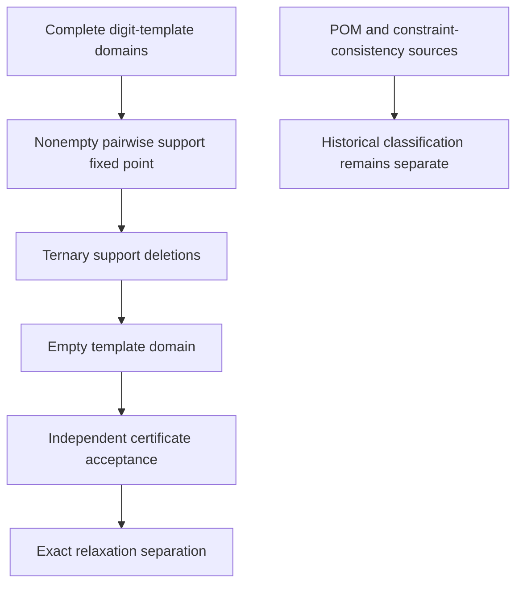

# Independent audit of joint digit templates and the stronger offline baseline

This work treats joint digit-template filtering as **established template/POM and constraint-consistency reasoning**. A checked separation between two explicitly defined relaxations would be a useful experimental result. It would not establish a new mathematical principle or historical priority. The twenty-cell Mith515 case remains a known-method benchmark.




## Theorem and exact meaning of a two-versus-three separation

For an effective candidate state `D`, let `T_d` contain every permitted nine-cell placement of digit `d`.
Each placement uses one cell per native row, column, and box.
Every selected cell allows `d`, and every cell with singleton domain `{d}` is included. Every Sudoku completion respecting `D` selects one member of each `T_d`. Templates for different digits are compatible exactly when their **cell sets are disjoint**; sharing a row, column or box is allowed and necessary.

A template `t ∈ T_d` can be deleted if, for one other digit `e`, every active template in `T_e` intersects `t`. A second rule uses two distinct partner digits `e,f`.
Template `t` needs active templates `u ∈ T_e` and `v ∈ T_f` such that `t,u,v` are pairwise disjoint.
If no such pair exists, `t` can be deleted. An empty digit-template domain refutes the effective candidate state. To prove a placement or elimination, apply this to the opposite literal of the conclusion.

Proof: induct on the deletion sequence. Initially each completion's digit placements are retained by the definition of `T_d`. If a template selected by a completion were deleted, the completion's placements of the partner digits would supply the missing disjoint support, a contradiction. Thus every completion's templates survive every event. An empty domain leaves no completion. This argument uses neither uniqueness nor floating-point optimization.

The proposed separation certificate is local to this model.
First, unary-partner deletions reach a fixed point with nine nonempty digit domains.
At that checkpoint, **every active template has disjoint support in each of the eight other digit domains**. A subsequent two-partner deletion sequence produces an empty domain. This proves that the exact state survives full pairwise template arc consistency but fails the specified ternary-support filter. It does not prove global minimality of a constraint core, separation from all forcing, or absence of another known deduction.

Independent acceptance reconstructs the full template universe by recursive row selection with column and box bit masks. The searcher instead filters nine-column permutations. Neither a supplied list nor a searcher's template count is trusted. Acceptance binds the effective domains and target assumption to the fixture.

It replays ordered deletions against the current active sets and checks the complete pairwise checkpoint.
The final state must have an empty digit domain. A missing template, incompatible alleged support, altered target, incorrect checkpoint or unsupported deletion must fail acceptance.

`joint_audit_verify.py --self-test` accepts both stable known controls. Mith515 needs seven pair-support events removing twenty templates. The Monhard113 control has a nonempty, fully checked pairwise checkpoint after seven events, with counts `[9,3,2,9,11,2,3,5,4]`; four subsequent ternary events refute it. In total, twenty-eight corrupted certificates are rejected, including attempts to delete a template that still has actual support. Independent blank-board enumeration returns exactly46,656 templates. These are negative-novelty controls, not newly discovered families.

The previously accepted full-template LP witness applies to the original opposite snapshot. Some of its terms are removed before the pairwise checkpoint, so it does **not** certify LP feasibility over the pairwise-pruned template domains. That stronger joint separation requires a new exact primal witness.

The optional bulk check `joint_audit_corpus.py --traces` accepts sixteen retained controls: eight pair refutations and eight pairwise-fixed-point/ternary refutations from eight distinct givens strings. It independently counts each host's unique completion, reconstructs the initial masks and replays the base and opposite-assumption closure traces. These results are recorded with source/proof hashes in `joint_audit_corpus_results.json`. The bulk files stay under `target`; their absence does not weaken the two stable controls. This audit does not independently replay every one of the searcher's1,200 queries, and eight distinct puzzles do not establish eight structurally different obstruction families.

## Fixed-point obligations for the offline baseline

The baseline must publish the precise enabled rule menu, input state and resource bounds. A stall means that every enabled phase completed and the final state is a fixed point of their combined iteration. After any phase changes a domain, affected phases must run again; restarting the full menu is a simple sufficient policy. Timeout, node exhaustion, incomplete catalog scan and truncated branch menus are **inconclusive**, never a stall.

Every detected impossible-pattern guardian clause is a persistent logical consequence of the state where it was established. Domain shrinkage can remove its literals or satisfy it, but cannot invalidate the clause. A satisfied clause has a true guardian.
An unsatisfied clause without a live literal is a contradiction.

Exactly one live literal forces that candidate. Clauses established under a branch assumption must remain inside that branch unless separately justified at its parent. A later strict-pattern scan finding no occurrence cannot erase an earlier valid clause.

`joint_audit_relations.py --self-test` independently verifies the known EL12c38 unit clause at the base and closed opposite snapshots, and its contradiction if the sole guardian is removed. It validates origin hashes, ancestor-domain inclusion, exact native maps, the non-three-colorability premise, immutable guardian lists and signed implication-edge semantics. Its complete-coverage check **recomputes** the strict catalog scan instead of trusting a supplied completion flag, and rejects a deleted persistent clause. A separate, nonvacuous native-pair control checks a five-edge forcing path; a native-house binary OR edge is checked too. Eight corruptions are rejected. This checks relation and step soundness; it does not certify completion of the full forcing kernel.

Current source audit of `strong_baseline_core.py` found explicit monotone restarts, cutoff propagation, all-live-candidate outer scope by default, exact split coverage, and declared weaker inner profiles. Setting `forcing_targets` restricts the endpoint menu: a resulting fixed point applies only to that focus list. Disabling forcing similarly changes the baseline definition. These source properties and selected accepted inferences do not substitute for a checked complete run of the configured union with the older engine.

The imported direct pattern checker, `joint_audit_patterns.py`, proves selected instances without rerunning a large detector. For Junior Exocet, each actual base digit must occur in each of three cross-lines, but its S-support has no three pairwise nonpeer cells. At least one occurrence therefore lies in the base band; cells seeing both bases are unavailable to that actual base digit, leaving the two targets. The two distinct actual base digits fill those targets.

For rectangular MSLS, homogeneous house covers bound each digit's occupancy of the selected live cells. Equality between the sum of these bounds and the number of selected cells saturates every minimum cover house. A candidate seeing every possible selected occurrence in such a house is false. Both synthetic controls have a respecting completed grid, and twelve corrupted premises/conclusions are rejected.

For an exhaustive cell split, the children must cover exactly all current values of that cell. The parent is contradictory only if every child is checked contradictory. A depth or time limit on any child makes that attempted refutation inconclusive. Any declared complete failed-literal phase must try the entire stated endpoint menu, and repeat after deductions until quiescence. A bounded depth-two baseline is a meaningful named comparison; it is not equivalent to every form of established forcing.

## Primary-source classification

[Andrew Stuart's Pattern Overlay page](https://www.sudokuwiki.org/Pattern_Overlay) distinguishes isolated single-digit support filtering from cross-digit pruning followed by support filtering.
The displayed page dates are 12 April 2008 and 17 July 2024.
These dates do not date every paragraph. His author reply dated December 8, 2025 describes maintaining patterns for all digits and pruning them using other digits. The pairwise principle is established POM Rule 2/template filtering.
The informal implementation description does not prove complete arc consistency in every version.

[Andries E. Brouwer's digit-pattern discussion](https://homepages.cwi.nl/~aeb/games/sudoku/solving28.html) describes choosing one placement pattern per digit to form a Sudoku.
The source credits Myth Jellies for POM. It provides the same underlying digit-template constraint model. Brouwer's [December2006 article](https://www.nieuwarchief.nl/serie5/pdf/naw5-2006-07-4-258.pdf) supplies an independently dated early reference to pattern reasoning. These sources preclude calling the general joint-template model original.

The consistency hierarchy is also classical. [Mackworth, Consistency in Networks of Relations (1977)](https://www.cs.ubc.ca/~mack/Publications/AI77.pdf) studies arc and path consistency. [Dechter and van Beek, Local and Global Relational Consistency (1997)](https://ics.uci.edu/~dechter/publications/r41-local-global-rel-consistency.pdf) generalizes local support reasoning over relations. The operation needs an exact quantified definition.
Deleting one template through a ternary join is not automatically equivalent to maintaining every binary relation by full path consistency.

[Eppstein, Solving Single-digit Sudoku Subproblems (2012)](https://arxiv.org/abs/1202.5074) addresses the one-digit/Nishio subproblem. Moving to compatible placements of multiple digits changes that relaxation, but does not make template overlay new. Multi-digit fish, Exocet and forcing may provide shorter explanations of particular deductions. A generic joint-template certificate does not exclude those named patterns.
An Exocet classification also needs the actual Exocet geometry and premises.

[Stuart's Exocet notes](https://www.sudokuwiki.org/Exocet) describe two bases, two targets, and S-cell covers.
They credit David P Bird and earlier work by Allan Barker. [Barker's Basic Principles](https://sudoku.allanbarker.com/sweb/general.htm) supplies the native truth/cover saturation context of rank-zero counting. `exocet_msls_report.md` defines the limited profiles and source-retrieval constraints.
This audit checks selected instances.
It does not cover every Exocet variant or every meaning of MSLS.

A proposed new family needs structurally different unique givens-only hosts, completed stronger-baseline comparisons, exact certificates, and independent replay.
It also needs a separate source and pattern audit. Repeated embeddings of a known pattern, two-versus-three support separation alone, or an unfinished baseline phase are insufficient.

Stable independent checks:

```sh
python3 research/global_obstructions/joint_audit_verify.py --self-test
python3 research/global_obstructions/joint_audit_relations.py --self-test
python3 research/global_obstructions/joint_audit_patterns.py --self-test
```
