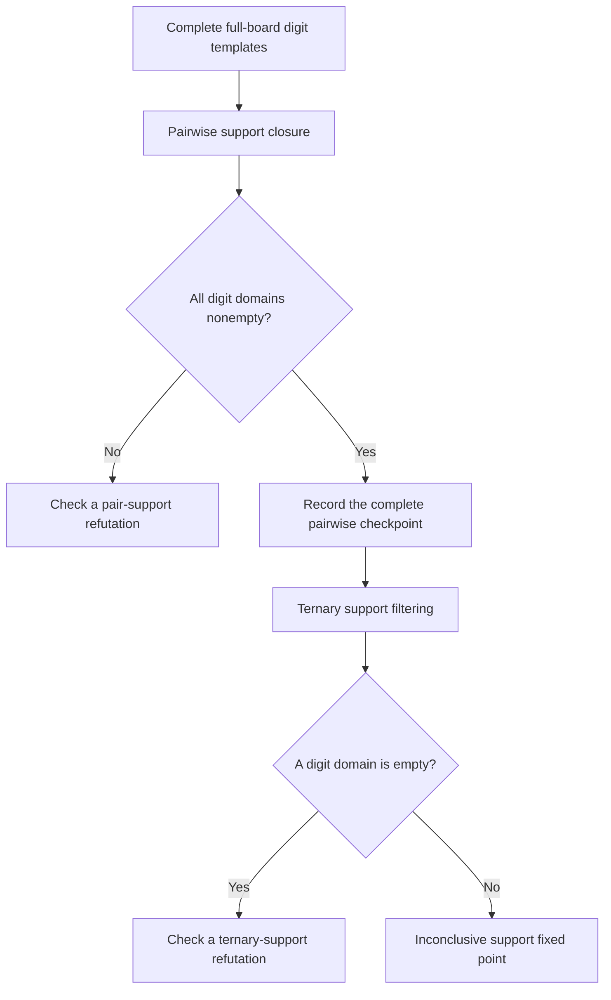

# Exact compatibility filtering between digit templates

This implementation supplies **checked two-/three-digit template-CSP proof machinery and known-method controls**. It establishes no new mathematical principle or obstruction family. No candidate has been promoted as surviving the actual strengthened combined baseline.




## Model and soundness

For each digit, enumerate every legal nine-cell placement: one cell in each native row, column and box. The blank classic grid has46,656 such templates. Filter them by the effective candidate masks and require every singleton of that digit to be included. A valid full solution selects one surviving template for each digit. Different digits' templates are compatible when their **cell sets are disjoint**; they are allowed to share rows, columns and boxes.

Nine pairwise disjoint nine-cell templates cover all 81 cells and give a Sudoku completion. Thus this full template CSP is an exact reformulation of the original masked Sudoku problem. The implemented local support filters are deliberately incomplete approximations to that full CSP:

- A template can be deleted when one other digit has no disjoint active template.
- It can also be deleted when two other digits have no active pair that is mutually disjoint and disjoint from it.

Every deletion preserves every full Sudoku completion: its placements of the partner digit(s) would supply the allegedly absent support. Induction over the ordered deletion sequence therefore proves that an empty digit-template domain refutes the state. Applying this to the opposite target literal proves the corresponding placement or elimination. The proof does not require uniqueness; independent uniqueness checks establish the separate real-puzzle benchmark claim.

A ternary-separation certificate first reaches a nonempty pairwise arc-consistent fixed point. It checks **all nine digit domains, every surviving template and each of the eight partner digits**, then records the checkpoint. Subsequent two-partner support deletions empty a domain. This proves a strict separation from pairwise template arc consistency on that exact snapshot. It is not full path consistency: the implementation does not maintain and prune all binary template-pair relations. It is not a minimum over all Sudoku proofs, all forcing procedures or all versions of POM.

All templates traverse all three bands and stacks. This does not prove that a known control needs all three bands and stacks for its essential obstruction.
That claim needs a separate support and minimality audit.

## Finite certificates and independent acceptance

`joint_templates_search.py` enumerates templates by nine-column permutations and tests exact bit-mask intersections. It uses only the standard library. Ordered events name the source digit, one/two distinct partner digits, and the complete nine-cell templates being removed. Initial, checkpoint and final template counts and hashes are bound to the exact effective masks and signed target assumption.

A hash is an integrity binding, not a substitute for checking absence of support. The independent [`joint_audit_verify.py`](joint_audit_verify.py) reconstructs templates by row-by-row column/box recursion.
It replays each deletion and exhaustively checks the relevant pair or triple join.
It also checks the entire pairwise checkpoint and the empty final domain. Cutoffs are rejected as proofs. Thirteen mutations of the pair control and fifteen of the ternary control are rejected.

Two stable controls are bound by [`joint_templates_controls.json`](joint_templates_controls.json):

| Known control | Initial templates by digit | Accepted result |
| --- | --- | --- |
| Mith515, assume r1c8=3 | `[2,1,9,13,1,2,2,7,2]` | Seven pair-support events remove20 templates and empty digit8. |
| Monhard113, assume r9c2≠5 | `[12,4,2,16,14,2,3,5,4]` | Seven pair events reach checkpoint `[9,3,2,9,11,2,3,5,4]`; four ternary events then empty digit3. |

The existing exact full-board single-digit-template primals are feasible for the **original closed opposite snapshots**. The Monhard primal uses two digit5 templates removed before the pairwise checkpoint. It therefore does **not** prove LP feasibility after pair pruning. No separation from a combined pairwise-AC-plus-restricted-LP baseline is asserted.

Both controls already have established forcing/tridagon-composition explanations. The new artifact is a portable exact proof in an explicitly defined known reasoning model, not a new family. Event counts and production coloring/forcing tree-node counts use different calculi and are not directly comparable.

## Two explicitly separated corpus epochs

The legacy eight-snapshot run examined every live-candidate endpoint in the public [`discovery_pipeline_inputs.json`](discovery_pipeline_inputs.json), using the independently unique full completion to choose the opposite conclusion. Exact Hall/all 81 crossing-three-house propagation ran under each target assumption before template filtering.

| Input epoch | Hosts | Opposites | Local refutations | Pair-support refutations | Pairwise checkpoint then ternary refutations | Order3 fixed points |
| --- | ---: | ---: | ---: | ---: | ---: | ---: |
| Legacy recorded old snapshots | 8 | 1,200 | 15 | 458 | 639 | 88 |
| Corrected retained-candidate old dispatcher fixed points | 4 | 631 | 1 | 199 | 343 | 88 |

Both endpoint menus completed without query or campaign cutoffs, in 150.717 and 83.329 seconds respectively. These are repeated endpoint outcomes, not distinct puzzles, logical rules or obstruction families. An order-three support fixed point is inconclusive: it is neither a Sudoku solution nor evidence that another proof cannot refute the assumption.

The corrected retained-candidate dispatcher solves four of the original eight sources before the stronger kernel. Only the four remaining Monhard snapshots enter the second row. Their masks and appended givens-to-state traces are reconstructed from the public [`discovery_pipeline_retained_results.json`](discovery_pipeline_retained_results.json); no target-directory input is required for manifest acceptance. This distinction prevents an older implementation's candidate-reset behavior from being presented as a retained-candidate stall.

Every endpoint is preserved in [`joint_templates_corpus_trials.jsonl`](joint_templates_corpus_trials.jsonl) or [`joint_templates_retained_trials.jsonl`](joint_templates_retained_trials.jsonl). The matching result manifests bind counts, source masks, raw-opposite hashes, closure hashes, initial template counts, resource limits and explicit outcome categories. The manifest verifier reconstructs raw targets from the public input state, checks complete endpoint coverage, and replays source traces. Optional closure replay checks the indicated number of opposite snapshots. These bookkeeping checks do not accept all 1,200/631 proposed refutation proofs.

Independent checks accepted sixteen representative controls from the first epoch.
Each unique host supplies one pair control and one ternary control.
The checks include original givens, base traces, and assumption traces. The independent results are in [`joint_audit_corpus_results.json`](joint_audit_corpus_results.json). The other endpoint outcomes remain discovery records unless separately replayed; there is no assertion that every raw proof is committed or independently accepted.

The stronger catalog/guardian/OR/local kernel solves all four corrected old fixed points after a separately recorded larger-budget catalog rerun. Thus all eight original hosts are solved controls. Twelve fresh author-corpus puzzles also solve under the candidate-preserving older ladder. No post-strengthened-baseline live input was available for joint-template promotion. The [combined report](joint_research_report.md) records the final outcome and acceptance requirements.

## Known mathematics and next research boundary

[Andrew Stuart's author-written Pattern Overlay description](https://www.sudokuwiki.org/Pattern_Overlay) distinguishes isolated one-digit template support from cross-digit pruning. [Andries Brouwer's digit-pattern account](https://homepages.cwi.nl/~aeb/games/sudoku/solving28.html) describes selecting mutually fitting digit placements. These primary sources already contain the joint-template model. The precise arc/relational-consistency comparison and additional primary references are in the [independent audit report](joint_audit_report.md).

The next experiment needs unique, fully audited live states after the declared combined baseline.
Pairwise arc consistency and a new exact LP witness must support the retained template domains.
Ternary joins can then test for stronger eliminations. Retaining/pruning binary template-pair relations is a further classical consistency tier. None of these algorithmic choices supplies historical novelty by itself.

## Reproduce

```sh
python3 -S research/global_obstructions/joint_templates_search.py research/global_obstructions/different_lead.json --output target/joint-lead.json
python3 -S research/global_obstructions/joint_templates_search.py research/global_obstructions/different_control.json --output target/joint-control.json
python3 -S research/global_obstructions/joint_audit_verify.py --self-test
python3 -S research/global_obstructions/joint_templates_manifest.py verify --count --replay-closures 8
python3 -S research/global_obstructions/joint_templates_manifest.py verify --retained --count --replay-closures 4
python3 -S research/global_obstructions/joint_templates_corpus.py --inputs research/global_obstructions/discovery_pipeline_inputs.json --seconds 180 --query-seconds 3 --output-dir target/joint-reproduced
```

The search returns `refuted`, `support-fixed-point`, or `cutoff`.
The standalone query defaults are:

| Limit | Default |
| --- | ---: |
| Templates per digit | 2,000 |
| Pair-mask comparisons | 20 million |
| Support checks | 20 million |
| Time per query | 30 seconds |

Corpus queries used three seconds each.
The two campaign limits were 180 and 150 seconds.
A cutoff is inconclusive.
Wall-time limits can change the completed work on another machine.
Only a completed endpoint menu justifies a full-coverage claim.
