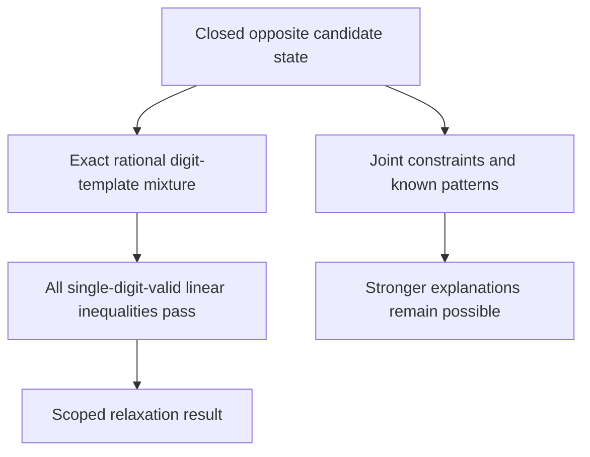

# Exact template relaxation audit: a separation criterion, not a new rule

This audit independently checks the full-board single-digit-template relaxation
and its evidence. Its positive benchmark is a published Monhard puzzle with a
known tridagon obstruction. **The mathematical principles and the obstruction
family are established.** The useful result is an exact, reproducible separation
from specified engine/local/linear baselines.




## Precise relaxation and sound separation theorem

Fix ordinary 9x9 Sudoku and the recorded opposite-assumption candidate snapshot
`D`. For digit `d`, let `T_d` contain the legal nine-cell placements.
Each placement uses one cell in every native row, column, and box.
Every selected cell must allow `d`.

Every cell forced to `d` is included. There are 46,656 templates before
candidate filtering. Define nonnegative rational variables `lambda[d,t]` with:

```text
sum(t in T_d) lambda[d,t] = 1                  for each digit d
sum(d) sum(t in T_d containing c) lambda[d,t] = 1   for each cell c.
```

There are 9 digit-distribution equations and 81 cell-coverage equations. Define
`x[c,d]=sum(t containing c) lambda[d,t]`. Every valid template has one occurrence
in each native house. Therefore the projected `x` satisfies all 324 native
exactly-one equations, nonnegativity, candidate masks, givens and the target
assumption.

More strongly, suppose `w` is **any** real cell-weight vector and the inequality
`sum(c) w[c] z[c] <= b` holds for every admissible complete placement `z` of one
digit. Multiplying each template instance by its nonnegative `lambda` and
summing gives exactly that inequality for `x[:,d]`. Thus the checked template mixture satisfies **every valid linear inequality of each single-digit placement polytope**.
This includes weighted stable-set, rank, odd-hole, and hyperhole inequalities on arbitrary selected cells. Adding such
single-digit inequalities to the native equations cannot refute this point.
This argument is an elementary convex-combination proof; it is not a new
theorem of graph theory.

Singleton filtering is equivalent in this relaxation even when the snapshot's `values` entry is zero.
A singleton cell can receive coverage only from its digit.
That digit's distribution has mass 1.
Thus every positive template term must include the cell. The search and negative-certificate enumeration filter
all effective singletons. The positive checker explicitly includes placed
values and independently checks the equations, which imply the remaining
singleton requirements.

This criterion is stronger than a fractional chromatic-number bound on a small
selected core: it requires actual full-board templates extending throughout
the recorded domains. It is **not** the joint multidigit integer hull. It does
not include all multidigit MSLS/rank cuts, correlations between different
digits' templates, every hybrid propagation schedule, or an unbounded forcing
procedure. A feasible mixture is not a valid completed Sudoku.

## Independent checker and trust boundary

`nonrank_audit_template.py` uses only the Python standard library. It does not
import numerical search, SciPy, `nonrank_templates.py` or `linear_witness.py`.
It independently reconstructs the snapshot and opposite target, and hashes the
canonical JSON payload:

```text
{schema:"native-template-lp-source-v1", values:[81],
 domains:[81 effective masks AFTER target restriction], target:{cell,digit,assumed}}
```

For each positive rational term it checks unique sorted cells, native template
legality, domains, placed values and duplicate rejection. It checks all 90
equations with exact `Fraction` arithmetic, then redundantly checks the 324
projected native equations and the target probability. No floating residual
or optimizer status is accepted as evidence. Positive checking requires no
claim that search enumerated every possible column: the listed valid mixture
alone proves feasibility of the full relaxation.

For a negative certificate it separately reconstructs all 46,656 native
templates, filters domains/singletons, and checks every surviving column's
coefficient. This enumeration is necessary for a Farkas proof; a certificate
valid only on a restricted set of generated columns would be insufficient.

Candidate domains and their provenance are distinct obligations. This checker binds the exact supplied snapshot.
It does not authenticate the domain derivation, count solutions, replay closure traces, or confirm an older solver's fixed point. Those are separate checks in the
fixture replay/old-engine suite.

Likewise, the native list-coloring refutation
checker proves impossibility under an assumption, while a base-support witness
rejects a vacuous local contradiction. Neither operation establishes historical
novelty. The current graph proof is a finite failed-literal/CSP certificate.

Commands:

```sh
python3 research/global_obstructions/nonrank_audit_template.py --self-test
python3 research/global_obstructions/nonrank_audit_template.py research/global_obstructions/nonrank_full_old_stall.json research/global_obstructions/nonrank_template_primal.json
python3 research/global_obstructions/nonrank_audit_template.py --negative research/global_obstructions/structural_four_digit_13.json research/global_obstructions/nonrank_audit_template_negative_13.json
```

Python `-O` is rejected. The self-test checks 12 corruptions per positive control
(hash, schema, target, digit, rational, cell, duplicate, omitted term and changed
mass). It also checks the exact stored graph bijections to three published
tridagon controls using native coordinates, without NetworkX.

## Exact positive and negative controls

| Input under its recorded opposite assumption | Exact result |
| --- | --- |
| Two-grid fractional infrastructure control | feasible, 18 half-weight terms |
| Published established `real_4401.json` | feasible, 32 terms, maximum stored denominator 19 |
| Published established `real_4662.json` | feasible, 30 terms, maximum stored denominator 28 |
| Published established `real_Loki.json` | feasible, 34 terms, maximum stored denominator 42 |
| `nonrank_full_old_stall.json`, Monhard source line 1 | feasible, 33 terms, maximum stored denominator 112 |
| Old13-cell four-digit hyperhole | exactly infeasible, rational Farkas RHS−1 |

The first three real primal witnesses are preserved as
`nonrank_audit_template_real_4401.json`, `...real_4662.json`, and `...real_Loki.json`.
These established tridagons already pass this stronger separation screen;
passing it is not evidence that a new mathematical family has been discovered.

For the old 13-cell core `S`, give each of the four palette-digit mass rows weight +3.
Give each of the 13 cell-coverage rows in `S` weight −1. Other row weights
are zero. The RHS is `4*3-13=-1`.

Every allowed palette template meets `S` at
most three times; other digits meet it zero times. Hence every allowed column
has nonnegative coefficient. The independent checker exhaustively confirms
this certificate, rejecting the old hyperhole even though its original native
324-equation LP was feasible. The negative witness is
`nonrank_audit_template_negative_13.json`.

## The modern positive is explicitly an established tridagon

The source is Hendrik Monhard's 2023 collection, maintained/classified by Denis
Berthier in [Sudoku-classif at pinned commit 15c9d217](https://github.com/denis-berthier/Sudoku-classif/tree/15c9d217b08d2d3ebf0f147d4f7c0beb5c2fcdb2).
The exact [source file](https://raw.githubusercontent.com/denis-berthier/Sudoku-classif/15c9d217b08d2d3ebf0f147d4f7c0beb5c2fcdb2/Monhard-until-2023-08-15-TE23/TE3/puzzles.txt)
line 1 is the plain givens puzzle. Its source SER is 11.7. Corpus provenance is
separately reproducible with `expanded_modern_corpus.py --fetch-sources`.

The new deduction is r4c9=9. Under r4c9!=9, the exact template-primal checker
passes all 33 terms and the snapshot hash. The recorded opposite-assumption
closure has six events. The sixteen-cell native graph refutation has 169
postorder nodes; the independent graph checker accepted it and rejected ten
mutations. Replay and fixture base snapshots were compared for exact equality.

After that assumption and closure, these twelve cells have exactly `{4,7,8}`:

```text
r4c6 r4c9 r5c5 r5c8 r6c4 r6c7
r7c5 r7c7 r8c6 r8c9 r9c4 r9c8
```

They occupy boxes 5,6,8,9, three per box. Their native graph has 24 edges, all
degrees 4. Exact graph bijections to **all three existing published tridagon
controls** are stored in `nonrank_audit_first_candidate_results.json`. For
example, the map to `real_4662.json`, written new board index→reference index,
is:

```text
32→31,35→34,40→39,43→42,48→50,51→53,
75→59,79→60,68→67,71→70,58→75,60→80.
```

Before the assumption there are two extras: 9r4c9 and 6r9c8. The col9 Hall step
under r4c9!=9 forces r7c9=6, removing6r9c8 from box9. Thus this benchmark has a
concrete **known tridagon plus guardian forcing** explanation. The graph
certificate's four additional cells accommodate these surrounding restrictions;
they do not create a historically new obstruction family.

The separate fixture checks confirm uniqueness and the recorded full older-engine fixed point.
They replay 20 base closure events and six branch closure events.
They also confirm an assignment for each conjunction of three native houses. This audit's independent positive result is
the exact template mixture and its native graph/replay identity, not a second
independent run of the complete uniqueness/closure suite.

## Primary related work and novelty limits

* [David Eppstein, *Solving Single-digit Sudoku Subproblems*, immutable arXiv 1202.5074v2, 4 March 2012](https://arxiv.org/pdf/1202.5074v2), section 2.
  This source formalizes complete single-digit placements, Nishio support filtering, and the 46,656-pattern universe. The algorithm establishes earlier exact single-digit reasoning.
  Its NP-hardness result concerns generalized sizes, not the fixed finite 9×9 board.
* [Andries Brouwer's author-maintained digit-pattern exposition](https://homepages.cwi.nl/~aeb/games/sudoku/solving28.html) describes selecting compatible patterns across digits and attributes POM to Myth Jellies. Its cross-pattern compatibility is stronger than merely choosing fractional marginal distributions.
* [Andrew Stuart's Pattern Overlay documentation](https://www.sudokuwiki.org/Pattern_Overlay) credits Myth Jellies and states the 46,656 count. The page displays creation 12 April 2008 and update 17 July 2024; those dates do not date every paragraph.
* [Dantzig and Wolfe, *Decomposition Principle for Linear Programs*, 1960](https://doi.org/10.1287/opre.8.1.101) establishes column-based convex-combination/decomposition principles. The template master has a mathematical correspondence with Dantzig–Wolfe convexification.
  This correspondence does not imply that the paper discusses Sudoku.
* [Mehrotra and Trick, *A Column Generation Approach for Graph Coloring*, 1996](https://doi.org/10.1287/ijoc.8.4.344) uses one column per independent set with LP and branching. [Lucci, Nasini and Severín's list-coloring branch-and-price paper](https://arxiv.org/abs/1812.00040) extends this established framework to lists. Fractional versus integral coloring is therefore an established distinction, not evidence of a new Sudoku principle.
* [Published tridagon source and proof traces, pinned CSP-Rules-Examples](https://github.com/denis-berthier/CSP-Rules-Examples/tree/fd9207f8dc1eb6e2e655048ba3b327d423900e1b/Sudoku-a/Tridagons) supply direct pattern prior art. The stored exact vertex maps are stronger evidence than naming similarity.

Searches used: `Sudoku template linear programming relaxation pattern overlay fractional`;
`Sudoku single digit templates46656 pattern overlay linear programming`;
`Sudoku fractional template polytope Dantzig Wolfe decomposition`;
`"Sudoku" "Dantzig"`; `"Sudoku" "template" "linear programming"`;
`"Pattern Overlay" "linear" "Sudoku"`;
`"Sudoku" "set partitioning" "patterns" linear`;
`"Sudoku" "Dantzig-Wolfe" template`;
`Mehrotra Trick1996 column generation graph coloring author pdf`;
`"fractional coloring" "list" "integrality gap" Kneser`.

These searches did not establish priority for the exact 90-row Sudoku template
master formulation. No originality claim follows from that search gap. The benchmark passes every single-digit weighted counting inequality at the recorded snapshot.
An established tridagon explains its contradiction.
The engine certifies the deduction with a replayable list-coloring proof.

## Additional rejected discovery control: 27-cell graph gap

The separate 27-cell discovery has an exact selected-graph fractional cover of
weight 4 while requiring 5 integral colors. It nevertheless **fails** the full
Sudoku acceptance filters. `nonrank_audit_27_raw_state.json` records the exact
raw domains under guardian 5=false. The independent native LP Farkas check
accepts `nonrank_audit_27_native_farkas.json` (237 nonzero weights, RHS−1).

Aggregating native row/column/box weights into digit-mass weights gives
`nonrank_audit_27_template_farkas.json` (61 nonzero weights, RHS−1). The independent
template checker enumerates all 46,656 templates and checks every admissible
column, proving full template LP infeasibility. Both controls run in
`nonrank_audit_template.py --self-test`, preserving the 60 positive mutations.

`nonrank_audit_27_screen.json` records an exact earlier local rejection after eleven house-GAC events in the first raw opposite-assumption pass.
Box 2 has six cells `[3,5,12,13,14,22]` restricted to five digits `{3,5,6,7,9}`.
No three-house propagation is needed. A different order that first closes the
unforced base may instead report row 6 (sector 5); these are different propagation
prefixes, not conflicting claims.

An independent check confirms a full completion of the unforced state.
Thus this negative discovery control has a consistent base. The selected-graph gap alone does not imply
a full-board Sudoku relaxation gap.

## Distinct synthetic 27-cell positive with full-template acceptance

The later `nonrank_graph_native27_candidate.json` is a different synthetic
candidate and must not be confused with the rejected 27-cell control. On its closed
opposite-assumption snapshot, `nonrank_audit_native27_template_primal.json`
provides 49 exact rational terms (maximum stored denominator 117294). The
independent checker accepts every template, all 90 equations, all 324 projected
native equations, the state hash and guardian r5c6!=1. Twelve further witness
mutations are rejected; the full self-test now rejects 72 positive mutations.
`nonrank_audit_native27_template_check.json` records this audit; the search
status file omits the duplicate primal data.

Together with the separately checked selected-graph non-four-colorability,
this supplies a synthetic research separation beyond the full per-digit
placement relaxation. This result is a synthetic state, not an authored unique-givens puzzle or a historical priority result.
Its 27-cell support exceeded the then-current 24-cell search limit.
The later explicit 32-cell proof API certifies this support; the automatic search limit remains 24.
The [realization audit](realization27_report.md) excludes the exact unique outside-clue host. The existing Monhard benchmark
and all its stable artifacts are unchanged.
