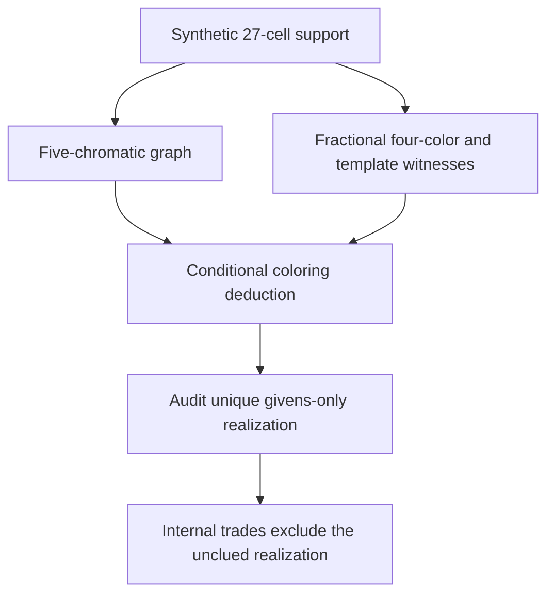

# Native coloring gaps beyond weighted rank

Subsequent [realization and integration audit](realization27_report.md): a
complete trade classification rules out unique outside-only givens for this
exact support, even with nonuniform lists. The explicit production proof API
now accepts the 27-cell case, with unchanged automatic-search bounds. Statements
below about the earlier production cap and pending realization describe the
original discovery stage.

The bounded search found a **synthetic 27-cell native graph with chromatic number five and fractional chromatic number four**.
The artifacts include a respecting completed Sudoku, a live guardian, and exact Hall/all-81-crossing closure traces.
An exact feasible point satisfies all 324 native linear equations after the rejected guardian assumption. This achieves the selected-graph separation sought in this search.

The artifact is a synthetic state and establishes no historically new Sudoku
family. The stronger full single-digit-template relaxation also passes an
independent exact audit, using 49 rational terms. Native-equation feasibility
alone would not establish that result.




## Stronger retained synthetic candidate

[`nonrank_graph_native27_candidate.json`](nonrank_graph_native27_candidate.json)
records the exact domains, both closure traces, target, and respecting complete
Sudoku. Its palette is `{2,3,5,9}`; the guardian is **r5c6=1**. Its zero-based
selected cells are:

```text
0,2,3,8,9,14,15,16,31,33,34,38,40,41,44,45,50,52,58,63,65,66,69,74,75,78,79
```

The graph has 27 vertices, 86 native peer edges, and independence number seven.
An independent complete four-color search, with neither memoization nor color
symmetry pruning, refutes it in **16,745 nodes**, including 2,016 explicit empty
domain leaves. The respecting Sudoku uses the four palette digits and the
guardian's extra digit on the support, establishing the matching five-color
upper bound.

An actual finite exhaustive research certificate is retained in
[`nonrank_graph_native27_tree.json`](nonrank_graph_native27_tree.json). Its
separate search order uses 11,081 nodes. The standard-library checker [`nonrank_graph_certificate.py`](nonrank_graph_certificate.py) reconstructs native peers and binds the exact premises and target.
It checks the base witness, every permitted branch, and every empty-domain leaf.

It rejects cycles, unreachable nodes, and twelve malformed certificate mutations. This does not require trusting a reported search count. Every
one-vertex deletion is four-colorable, so no subset of these 27 selected cells
provides the same uniform-four-color contradiction.

[`nonrank_graph_native27_proof.json`](nonrank_graph_native27_proof.json)
contains an exact fractional cover by twelve independent sets with quarter or
half weights. Its total is four and each selected vertex receives coverage
exactly one. A native four-clique supplies the lower bound, so the fractional
chromatic number is exactly four.

**Why this excludes every nonnegative weighted capacity proof on the selected
graph.** For arbitrary nonnegative vertex weights w, every independent set has
weight at most alpha_w. Summing its fractional cover gives
`sum_v w_v <= 4*alpha_w`. Therefore no choice of such weights can prove the
strict inequality needed to refute four colors. This also excludes a
five-chromatic hyperhole subgraph, since hyperhole chromatic obstructions have
a weighted-capacity explanation. It does not rule out a known larger coloring
family or a proof using other Sudoku cells.

The base state reaches Hall/all-81-crossing closure in 13 recorded events and
keeps the guardian live. Removing its extra candidate reaches another fixed
point in four events. An exact binary role witness t has four ones in every
native house. Assigning `t(c)/4` to each palette digit and `(1-t(c))/5` to each
other digit gives an exact feasible native point. The verifier checks all
324 equalities, nonnegativity, every closed-domain restriction, and the actual
opposite target assumption with `Fraction` arithmetic.

All **2,925 selections of three native houses** are feasible under the closed
opposite state, checked independently by direct CSP witness search. This
enforces the three selected constraints, not all other native peer edges on
their union. The full-board legal single-digit-template LP has a separately
verified 49-term rational primal witness, with maximum denominator 117,294,
in [`nonrank_audit_native27_template_primal.json`](nonrank_audit_native27_template_primal.json).
That checker validates all 90 template equations and all 324 projected native
equations, domains and the actual target assumption. Thus it certifies the
stronger feasibility claim involving full-board per-digit placements as well.

The current production certificate accepts at most 24 selected cells;
this example exceeds that bound. It is a research candidate, not a promise
that the default detector finds it. No arbitrary increase or special-case
production rule was made in this search.

## First graph gap: explicitly rejected by global Sudoku constraints

[`nonrank_graph_27_proof.json`](nonrank_graph_27_proof.json) preserves an earlier
27-vertex/88-edge graph with chromatic number five, fractional chromatic number
four, and an eight-set half-weight cover. Its independent full branch
refutation has 5,081 nodes. Its guardian is r6c6=5 with palette `{1,2,4,8}`.

That selected-graph result is valid, but it **fails the requested Sudoku
separation**. Closing the unforced full state already places its guardian after
15 local events. Independently, the raw guardian-false state reaches a box-2
Hall contradiction after eleven individual-house events. The audit track
retains exact native-equation and full-template Farkas certificates in
[`nonrank_audit_27_screen.json`](nonrank_audit_27_screen.json),
[`nonrank_audit_27_native_farkas.json`](nonrank_audit_27_native_farkas.json), and
[`nonrank_audit_27_template_farkas.json`](nonrank_audit_27_template_farkas.json).
Different closure orders must not be confused: raw-assumption house-only
propagation fails in box 2; the earlier close-base-first experiment reported
row 6. The decisive rejection is exact, not a numerical solver status.

This is a useful control: an exact fractional coloring on a selected support
does not establish feasibility of the full board's linear or template models.

## Known modern benchmark classification

The separate Monhard TE3 line-1 benchmark found by the parent search is a valid
full-old-engine-stall benchmark, but its pattern is a known composition. Its
original 16-cell graph has an explicit proper four-coloring. Thus it does not
meet the pure five-chromatic-graph criterion above.

Assume r4c9 is not 9. Column-9 cells r2c9, r4c9, and r8c9 form a tight
`{4,7,8}` triple, forcing r7c9, whose domain is `{6,7}`, to be 6. This removes
the extra 6 at r9c8 in box 9. Twelve remaining cells in boxes 5,6,8,9 form the
known `{4,7,8}` tridagon. An explicit graph isomorphism to the recorded Loki
tridagon is preserved in
[`nonrank_graph_modern_classification.json`](nonrank_graph_modern_classification.json).

The combined contradiction needs 14 of the original selected cells. Every one
of the 560 thirteen-cell subsets is colorable, while the retained fourteen-cell
subset is not. This proves minimum cardinality **within that particular
16-cell support**, not across Sudoku or the whole candidate board. The
independent verifier reconstructs those witnesses and checks their digest.

## Bounded search coverage

- Rectangle search: one million seeded presentations with four cells in each
  of boxes 1,2,4,5; 1,990 duplicates; 380,070 house-capacity rejections;
  617,940 survivors. Of these, 617,792 were four-colorable and 148 failed
  fractional-four feasibility. Those 148 LP negatives are discovery screens;
  eight saved controls additionally have exact weighted-rank witnesses, all
  with lower bound 13/3. No desired gap was found in this restricted family.
- Known-tridagon extensions: all 1,296 choices adding one cell per box were
  four-colorable. Of 50,625 choices adding two per box, 2,682 violated the
  five-cell house bound and all 47,943 valid graphs were five-colorable.
  These are finite extensions of one known control, not all native motifs.
- Randomized critical-subgraph search: eighteen prior large supports were
  revisited with thirty vertex-deletion orders each. New completion/guardian
  presentations then used two further completed source grids. The final filtered run tested 123,535 new presentations and 3,192 critical subgraphs.
It produced 176 graph fingerprints.

  Of these, 158 had exact weighted-rank witnesses, and 18 had exact fractional chromatic number four. Seventeen
  pure gaps failed the floating native-role LP screen; the retained candidate
  passed that screen and then exact rational verification. These counters
  include repeated subgraphs and are not global isomorphism counts. The
  filtered run repeats the initial unfiltered run; their counts must not be
  added as independent coverage.

The successful completion is from Norvig top95 puzzle 76. Its use supplies a
respecting unforced solution, not an authored solving trace or proof of
historical originality. Graph fingerprint deduplication can skip WL-hash
collisions; that can reduce discovery coverage but cannot make an accepted
certificate unsound. No claim of complete classification follows.

## Reproduce

Standard-library independent proof audit, approximately 0.3 seconds:

```sh
python3 research/global_obstructions/nonrank_graph_verify.py
python3 research/global_obstructions/nonrank_graph_certificate.py --self-test
```

Discovery uses optional NumPy, SciPy and NetworkX, with one search worker and
BLAS threads fixed to one:

```sh
python3 research/global_obstructions/nonrank_graph_search.py \
  --q 4 --samples 1000000 --seconds 540 --seed 219404
python3 research/global_obstructions/nonrank_graph_critical_search.py \
  --seconds 220 --orders 30 --seed 219440 --require-native-lp \
  --output research/global_obstructions/nonrank_graph_board_filtered_results.json
```

The successful filtered run stopped on its first native-LP-positive pure gap
after approximately 144 seconds. Fractional LP solutions and graph-search
statuses are later checked with exact arithmetic. The next required steps are givens-only realization, independent uniqueness,
and joint full-older-engine/local fixed point. Until those pass, the synthetic
example must not be reported as the requested unique new-family puzzle. The
full single-digit-template audit is already positive.
