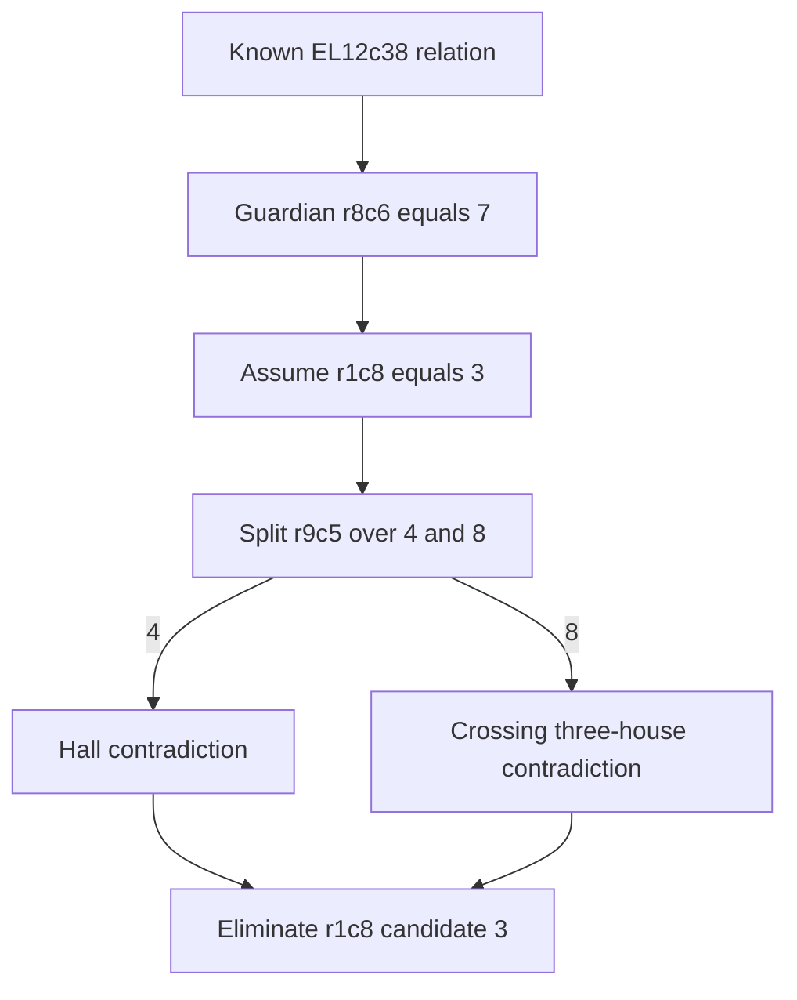

# Expanded novelty audit of the 20-cell deduction

**The known EL12c38 tridagon followed by one cell-value split explains r1c8≠3.**
Its exact engine certificate and unique-puzzle benchmark remain valid, but the
case does not demonstrate a new solving principle. This audit checks the
catalog, Exocet/MSLS and forcing separately; it does not infer historical
originality from any detector's no-hit.

The source is the unchanged [Mith515 fixture](different_lead.json), SHA-256
`45d6f8e79f9dfb859ba6827dadb3934a1cc5c1b1ada822537b5346b926941358`.
All checks preserve that candidate-state premise. The [earlier audit](different_report.md) checks independent uniqueness, the exact givens derivation, an 85-node production certificate, and local closure.
It also checks all 2,925 arbitrary-house triples and an exact 18-term full-board digit-template primal.




## A complete short explanation of the target

Assume r1c8=3 and replay the ten recorded local closure events. Then:

| Complete first split | Complete second split after local propagation | Contradiction |
| --- | --- | --- |
| r6c2=6 | r2c1=3 or 8 | Neither branch admits a compatible assignment to row 8, column 1 and box 7. |
| r6c2=9 | r9c5=4 | Two cells in row 2 require digit 3. |
| r6c2=9 | r9c5=8 | No compatible assignment to row 1, column 4 and box 2. |

The first split covers {6,9}; its children cover {3,8} and {4,8}. All branch
values are exhausted, proving r1c8≠3. The [seven-node certificate](deeper_forcing_certificate.json)
has three splits, four leaves and 74 sound propagation events. One leaf has an
explicit Hall deficiency. Seven Hall-subset blockers establish the other three
leaves by covering all 1,260 admissible crossing-house boundary signatures.
No exception string, uniqueness premise or named-pattern oracle proves a leaf.

For every one of the 32 eligible full-board pivot cells in the closed opposite
state, the checker also verifies one candidate whose local closure survives.
Consequently the minimum *additional complete-cell-split depth* is exactly two
for this particular Hall/all-81 propagation calculus. Counting the initial
target assumption, a deepest branch has three nested hypotheses from the base.
This is not a classic T&E rating, a minimum over all named rules, or a lower
bound for algorithms that learn eliminations between sibling branches.

The independently checked proof rejects 42 corruptions of bindings, branches,
edits, leaves, indices and lower-bound witnesses. See the
[forcing report](deeper_forcing_report.md) for exact semantics and reproduction.

The frozen older engine's configured forcing is weaker than this calculus:
`propagate_full` omits recursive forcing and three-house/arithmetic search
inside assumptions. Its live stall therefore remains consistent with the
short proof. A stall of that implementation is not a separation from all
previously known forcing methods.

## The 630-pattern catalog

The primary author's implementation publishes **592 generated geometries**.
Its manual explicitly excludes **38 no-free-cell patterns**, giving the full
630 named IDs. The audit records every ID, per-file hash and the pinned source
commit; it does not mislabel a 592-file parse as 630 parsed geometries.

Under the implementation's strict premises, every selected pattern cell must
contain all three palette candidates; additional candidates become guardians
in an OR relation. The 38 excluded no-free-cell geometries cannot occur under
those premises in a unique givens puzzle. A given palette digit would exclude
that candidate from a seeing pattern cell, while a unique puzzle has at least
eight distinct given digits. This exclusion concerns native Sudoku geometry
and the strict rule model. It does not supply the missing geometries for an
arbitrary sparse-list or abstract-embedding extension.

The complete scan of the 592 published native geometries finds:

| Snapshot and scope | Guarded occurrences |
| --- | ---: |
| Selected 20 cells, before local closure | 0 |
| Selected 20 cells, closed opposite | 0 |
| Full base state | 1 |
| Full raw opposite | 1 |
| Full closed opposite | 0 |

The full-board hit is the known **EL12c38 tridagon**, palette {3,4,8}, on cells
`[2,3,9,13,19,23,54,57,64,68,74,76]`. Its sole guardian is **r8c6=7**.
The checker verifies the coordinate mapping, native geometry, palette premises
and sole-guardian conclusion. It is an established deduction on this board;
its presence alone is not a proof of the different target r1c8≠3.

The [chained exact certificate](deeper_forcing_catalogue_chain.json) supplies
that missing implication. First derive r8c6=7 on the full base state using the
verified EL12c38 occurrence. Six local propagation events leave r1c8=3 still
available. Assuming that target and replaying eleven more events leaves
r9c5={4,8}. Its value 4 gives the row-2 Hall deficiency; value 8 gives the
row-1/column-4/box-2 contradiction. Thus the catalog deduction plus one
complete cell split proves the **actual target elimination**.

The local part has three nodes and two leaves; the catalog lemma is checked
separately, not hidden in that node count. The checker binds the base occurrence and source hash.
It checks all candidates and the sole guardian, then independently proves that the pattern graph has no three-coloring.
It also replays both assumption orders to the same state. Fourteen corruptions are rejected. This strengthens
the standalone seven-node explanation without changing its local-only depth
lower bound: the shorter chain uses an additional known lemma.

Losing a strict all-three-candidate match after propagation does not invalidate
the OR relation already derived on the broader base state. Likewise omitting
the known pattern from a selected proof support does not remove its full-board
explanation. The detailed catalog report states the strict-model coverage
and the limits for sparse lists and OR-chain compositions.

The [catalogue report](catalog630_report.md) records the exact native map and
primary-source semantics. The offline verifier checks all 592 graph
refutations and repeats all five complete scans. The optional source-cache
check additionally re-parses every original rule and verifies its recorded
hash. The 38 exclusions rely on the author's documented no-free-cell premise;
they are not silently represented as parsed geometries.

A separate [84-witness certificate](novelty20_triplets.json) checks every
three-digit palette on **all** native cells whose actual closed-opposite lists
are contained in that palette: 1,461 explicit cell assignments. Any subset of
a properly list-colored graph is properly list-colorable. Therefore no direct
three-digit impossible pattern, in this catalog or elsewhere, can refute this
snapshot with those contained lists. This does not exclude guarded patterns,
their OR relations, or further conditional reasoning.

## Exocet and MSLS

The [scoped Exocet/MSLS audit](exocet_msls_report.md) gives two exact negative
results for the target, rather than equating all similarly named methods:

- The retained fractional point has x(r1c8,3)=1 and satisfies all native
  cell-truth and house-digit-cover equations. A direct rank-zero MSLS proof
  using those truths and covers would be a linear consequence of these
  equations and nonnegativity. It therefore cannot eliminate that candidate
  or refute this opposite state, for any such layout.
- Basic Junior Exocet ER1 also follows from inequalities valid for separate
  native digit templates. For a base digit d, its target occupancy T_d is at
  least its base occupancy B_d. Summing over base digits fills the two targets
  and excludes nonbase target digits. The exact template primal precludes
  this direct explanation of the target elimination.

The finite reference scans additionally find zero rank-zero configurations
among 74,601 rectangular MSLS shapes per snapshot. All 58 relaxed basic Junior
Exocet structural layouts across the unforced and closed-opposite full boards
have explicit three-cell nonpeer S-packings violating the required capacity.
The 19 stricter basic layouts are included in those 58. Selected-support scans
are also retained. The independent checker re-enumerates the structural
layouts and verifies every packing witness.

These statements do not exclude Senior, Weak, Double, Complex, correlated or
conditional Exocet/MSLS extensions, or arbitrary derived-set rank arguments.
The source-author C# library was inspected, not executed. Retrieval limits for
Bird's original forum documents are recorded, alongside accessible primary
definitions. The positive nested-forcing proof remains a separate explanation.

## Verify

All retained acceptance checks use Python's standard library:

```sh
python3 -S research/global_obstructions/deeper_forcing_verify.py --mutations
python3 -S research/global_obstructions/exocet_msls_verify.py
python3 -S research/global_obstructions/novelty20_triplets.py
python3 -S research/global_obstructions/catalog630_verify.py --rescan
python3 -S research/global_obstructions/deeper_forcing_catalogue_chain.py --mutations
```

The exact catalog source parser, matcher, coverage manifest and verifier are
retained alongside those checks. Fetching pinned source files is optional;
the original third-party implementation is not vendored into production.
CI checks the evidence without a numerical solver, SAT oracle or network fetch.

The exact incidence's historical first appearance remains unproved. The deduction has ordinary nested-forcing and checked published-pattern-plus-forcing derivations.
It therefore establishes neither a new primitive Sudoku method nor a separation from deeper forcing.
