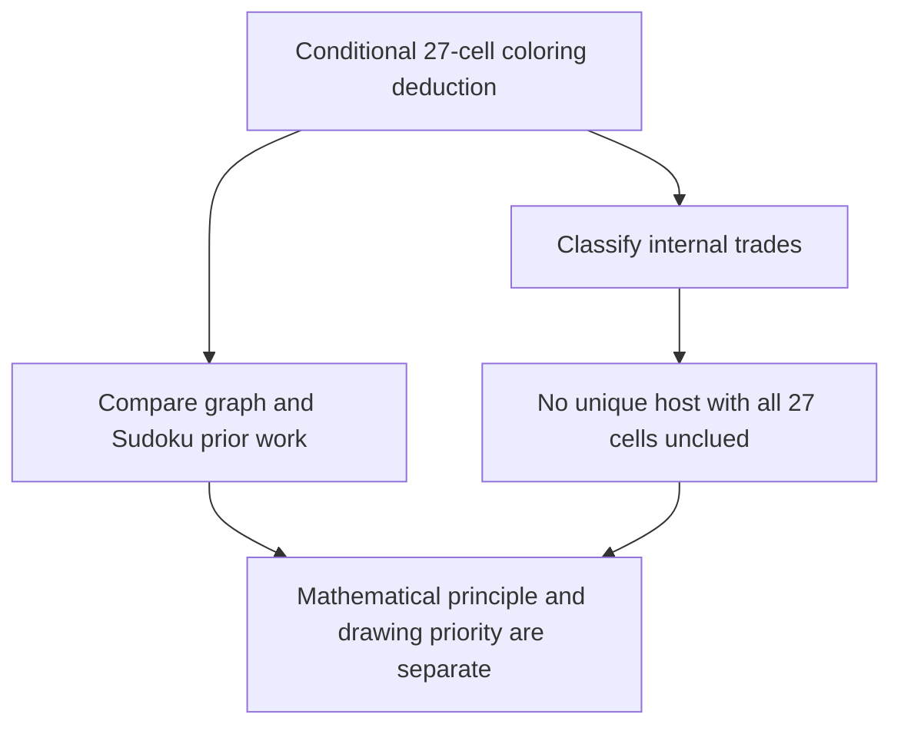

# Native 27-cell obstruction: independent classification and prior-art audit

Audited 2026-10-20. This report concerns `nonrank_graph_native27_candidate.json`,
the **86-edge** positive control, not the earlier rejected 88-edge graph.
No historical originality claim is established.

The exact graph is a vertex-critical five-chromatic native Sudoku peer graph
with a four-color fractional coloring. Its single-guardian deduction is sound,
and its production certificate checks. A unique givens-only realization with all
27 support cells initially unplaced is impossible: an independently enumerated
trade exists in every compatible completion. These are separate conclusions.




## Identity and measured separation

Support, zero-based board indices:

```
0 2 3 8 9 14 15 16 31 33 34 38 40 41 44 45 50 52 58 63 65 66 69 74 75 78 79
```

Every non-guardian support cell has palette `{2,3,5,9}`; guardian 41 (`r5c6`)
additionally permits `1`. Removing `1` gives the uniform four-color obstruction.
Native edges mean exactly shared row, column or box. Reproducible invariants are
in `realization27_prior_art_invariants.py/.json`:

| Invariant | Exact result |
| --- | --- |
| Vertices / native edges | 27 / 86 |
| Degree histogram | one degree 4, fourteen degree 6, twelve degree 7 |
| Clique / independence number | 4 / 7 |
| Native K4 count | 11 |
| Chromatic / fractional chromatic number | 5 / 4 |
| Vertex deletion | every deletion has an explicit four-coloring |
| Automorphism group order / vertex connectivity | 1 / 4 |
| Induced claws / true-twin pairs | 124 / 0 |

The exact 12-term stable-set cover has total weight 4 and covers each vertex
once. A K4 proves the matching lower bound. This establishes `chi_f=4`, not just
a floating estimate. The canonical binary SHA256 is
`a46ab0287ee696f00c5ff1c1ecbdb929a2fa714216cbbcacefea2ac6b9825cc2`;
the JSON records its full individualization/refinement convention and vertex
mapping. It is not a nauty canonical label or a graph-catalog match.

The stronger **full-board** single-digit-template LP also has an independently
checked rational primal: `nonrank_audit_native27_template_primal.json`, 49
positive terms, maximum denominator 117294. It obeys all nine digit masses, 81
cell coverages, target restriction and all 324 projected native equalities.
Thus this particular opposite-target state survives every valid linear
inequality separately imposed on each digit's complete-placement polytope.
This does **not** cover all multi-digit MSLS, joint-template compatibility,
forcing nets, or arbitrary mixed-digit cuts.

## What known methods already explain

**Guardian principle and exhaustive list-color proof: established.** Allan
Barker's author-maintained [Dark Logic](https://sudoku.allanbarker.com/sweb/gen2/blacklog.htm)
explains impossible cores, extra guardians and the lone-guardian assignment.
This graph uses the same guardian implication.
Without the guardian's extra digit, all 27 cells would need a forbidden four-coloring.

The page's original publication date was not independently recovered.
Generic exact list-coloring search is also established; see Lucci, Nasini and
Severin, [arXiv:1812.00040v1](https://arxiv.org/abs/1812.00040v1), submitted
2018-11-30, including stable-set-column relaxations and branching. Neither
the guardian implication nor branch exhaustion should be presented as new.

**A stronger distinction from the old hyperhole is proved.** For a hyperhole H,
the known formula is `chi(H)=max(omega(H),ceil(|H|/alpha(H)))`; see Maffray,
Penev and Vuskovic, [Coloring Rings, Lemma 1.1](https://arxiv.org/pdf/1907.11905v1),
submitted 2019-07-27. If a hyperhole subgraph of this graph required five colors,
its clique number would be at most four, so `|H|/alpha(H)>4`. That contradicts
the restriction to H of the exact weight-four fractional coloring, since every
fractional coloring has weight at least `|H|/alpha(H)`.

Therefore **no
five-chromatic hyperhole subgraph** supplies this obstruction. The same paper's
ring theorem excludes identity with its ring class. This is a mathematical
separation from the earlier 13-cell hyperhole/rank example, not a historical
priority result.

**Tridagon and named Sudoku families.** An ordinary three-digit tridagon is a
non-three-colorable core; it does not by itself forbid four colors. No exact
older 27-vertex/86-edge drawing or checkable vertex isomorphism was recovered
from the inspected sources. This does not exclude a conditional tridagon,
multi-digit MSLS, SK-loop, Exocet, or forcing derivation after assumptions.

Author-maintained [SK-loop documentation](https://www.sudokuwiki.org/SK_Loops)
specifies the familiar eight-pair construction in four boxes; its raw template
is not an identity with this 27-cell graph. The author's
[Exocet documentation](https://www.sudokuwiki.org/Exocet) concerns additional
base/target and candidate-occurrence premises, not only peer-graph isomorphism.
Those distinctions do not prove that no sequence of the known rules applies.
Graph size alone does not identify a pattern.

Ruud's [SudoCue guide](https://www.sudocue.net/sudocueguide.php) describes braid analysis on a 27-cell *single band or stack*.
This support spans every band and stack. Gurth's [symmetrical-placement theorem](https://www.sudokuwiki.org/Gurths_Theorem)
(author article created 2019-09-28, referring to 2007 discussion) requires
clue symmetry and uniqueness. Our guardian proof needs neither premise.

The graph's trivial automorphism group alone is not a test of every possible
Gurth-compatible full puzzle.

**Template/POM boundary.** Eppstein's [Solving Single-digit Sudoku
Subproblems](https://arxiv.org/pdf/1202.5074v2) (2012) and
Brouwer's [digit-pattern discussion](https://homepages.cwi.nl/~aeb/games/sudoku/solving28.html)
cover single-digit placements and compatibility of overlays. A feasible mixture
of individual templates is weaker than selecting nine mutually compatible
integer templates. Consequently this example is not a separation from full
POM, full solving, or every use of Nishio.

**Graph catalogs do not settle priority.** McKay's author-maintained
[graph data](https://users.cecs.anu.edu.au/~bdm/data/graphs.html) lists
edge-critical graphs, including five-critical graphs through 13 vertices;
that is not a complete catalog of 27-vertex vertex-critical graphs. Its lack
of a matching entry cannot establish novelty. No exact catalog match is
claimed. The general phenomenon `chi > chi_f` is classical.

## Compact proof and production audit

`realization27_prior_art_compact_proof.json` records a research-only case proof:
normalize the native K4 `[31,40,41,50]` to abstract colors `[0,1,2,3]`, then
record every forced singleton and every remaining branch. The independently
replayed tree has 105 nodes, 53 conflict leaves, 451 forced assignments and at
most seven branching decisions. Normalization applies because *all* opposite-state support domains use the same four-color palette.
Every K4 coloring uses all four colors.

A global color permutation produces the fixed ordering.
This is a shorter computer-assisted presentation, not a new human one-line
argument. It is not part of production's certificate grammar.

Production uses no normalization or hidden propagation shortcut. The standard-library checker `realization27_audit_export.py` rebuilt every native edge and traversed the actual Rust replay `replay_native27.json`.
The replay contains 16,745 nodes: 2,016 conflict leaves and 14,729 split nodes.
Of the splits, 12,720 are singleton splits.

The maximum assignment depth is 26. Exact fixture/state/target polarity binding, a respecting full completion,
and all branch coverages passed; twelve corruptions were rejected. Output
`realization27_audit_export.json` records source hashes. These checks establish the explicit API replay on synthetic domains.

They do not establish automatic discovery within the unchanged 24-cell limit or superiority over every older forcing rule.

## Why the requested exact unique realization cannot exist

Independent enumeration in `realization27_audit_trades.py` uses no color anchor
and imports neither production nor another enumerator. Deleting guardian 41
gives exactly 1320 labeled four-colorings, 55 orbits under global color
permutations. Grouping by all 27 native-house color masks gives 408 signatures.
There are 192 buckets of size 2 and 96 of size 3.
There are also 72 buckets of size 5 and 48 of size 6. No bucket is a singleton.

Take **any** full completion respecting the palette on the 26 non-guardian
cells and palette-plus-extra on the guardian. Non-four-colorability forces
the extra digit at the guardian. Its other 26 colors have a second coloring
with exactly the same color mask in every house. Replace them by that coloring
and leave all other cells unchanged.

Every row, column and box retains its
digits, producing a different full completion. The JSON constructs and checks
an explicit pair. Hence any givens confined outside the 27 support cells admit
at least two completions whenever they admit one completion of this form.
Adding sound candidate deductions cannot remove one of those solutions.

This is precisely the established unavoidable-set/trade argument, rather than
a new uniqueness principle. See McGuire, Tugemann and Civario,
[arXiv:1201.0749v2, section 5.1](https://arxiv.org/abs/1201.0749v2), revised
2013-09-01: a unique puzzle's clue set must hit every unavoidable set. The
finite universal classification here is an exact result for this support.
The result does not exclude a different house incidence, an altered motif, internal givens, or multiple guardians.
Extra candidate restrictions need separate validity proofs.

## Search scope and remaining uncertainty

The literal query log is `realization27_prior_art_queries.json`. Broad and
domain-restricted searches inspected primary author sources for chromatic
patterns, four-digit impossible patterns, quadragons, guardians, Gurth,
templates and graph-critical catalogs. The attempted
`forum.enjoysudoku.com/chromatic-patterns-t39885-71.html` was inaccessible in
this environment; indexed author snippets discuss chromatic cores in general
but supply no checked match to this graph. Relevant forum discussions can be
unindexed, renamed or missing. Exact abstract-graph first appearance, first
native Sudoku embedding, and first solver packaging therefore remain
**unresolved**. A fresh derivation or an unsuccessful search is not evidence
of 100% originality.
