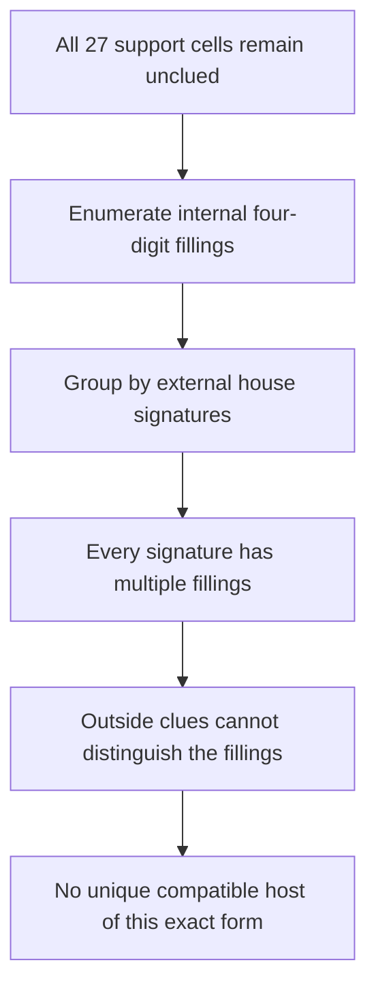

# The 27-cell support has no unique outside-clue realization

**The requested realization is impossible for the retained 27-cell embedding
with all 27 cells unclued.** A complete, independently checked coloring
classification proves that every compatible Sudoku completion has a second
completion agreeing on all 54 outside cells. This holds even if the support's
candidate lists are smaller than the original uniform palette.

The conditional synthetic deduction is nevertheless valid without uniqueness.
It is now integrated through the engine's explicit proof API, with an actual
27-cell, 16,745-node native replay proving **r5c6=1**. Automatic hint-search
limits are unchanged. No unique-puzzle or historical originality claim is made.




## Why the requested puzzle cannot exist

Let `S` be the recorded support, `t=r5c6` its guardian, `P={2,3,5,9}` its
palette and `g=1` the extra digit. A compatible completed Sudoku places `g` at
`t` and palette digits at the other 26 selected cells. Suppose every given lies
outside `S`, as required for all 27 pattern cells to remain unclued.

There are two exact obstructions to uniqueness:

1. **Full candidate masks.** The support touches all nine boxes. Any palette
   given therefore sees a selected cell in its box and deletes a required
   palette candidate. Preserving the full masks forbids all palette givens.
   Every permutation of the four palette digits then fixes the givens, giving
   at least 24 distinct completed boards. Earlier sound candidate removals
   cannot restore a digit already excluded by a given.
2. **Even allowing smaller lists.** Remove the guardian vertex and enumerate
   every proper four-coloring of the remaining native graph. There are 55
   colorings after fixing the colors of a native four-clique, or **1,320
   labelled colorings**. Record, for each coloring, the palette colors used in
   each of the 27 native houses. The 408 signatures have these multiplicities:

| Colorings sharing a signature | Number of signatures |
| ---: | ---: |
| 2 | 192 |
| 3 | 96 |
| 5 | 72 |
| 6 | 48 |

There is no singleton signature. Consequently the palette coloring induced by
any compatible completion has a different coloring with the same palette set
in every house. Replace just those selected palette values, keeping the
guardian and all outside values fixed. Each row, column, and box retains its original digit set.
Thus the changed board is another valid completion for every possible outside-only clue subset.

This is a finite, exhaustive result for the exact retained support and every
native Sudoku symmetry of it, independent of the reference completion. It does
not classify other graph embeddings or prove that no related obstruction can
occur in a unique puzzle. Putting a given inside the support changes the
requested all-unclued premise and can distinguish the two completions.

The [structural report](realization27_structure_report.md),
[classification certificate](realization27_structure_proof.json) and
[independent verifier](realization27_structure_verify.py) retain the complete
evidence and an explicit completion pair. A second
[independent exhaustive enumerator](realization27_audit_trades.py), importing
neither the discovery code nor the structural verifier, confirms the entire
1,320-coloring classification without color normalization. The separate prior-art audit checks
the connection with established unavoidable sets and Sudoku trades in
[`realization27_prior_art_report.md`](realization27_prior_art_report.md).
The generic coloring, guardian and trade principles are established. Neither
the exact 27-cell drawing's first publication nor historical mathematical
novelty is established by this work.

## Search and older-engine comparison

The completion search supports the theorem; it is not the proof.
It sampled 4,999 distinct compatible complete boards.
Every maximal 54-outside-given puzzle had multiple completions, without an enumeration cutoff.
The original completion also has a nonunique outside-clue realization retaining
the full palette. The search stopped when the exhaustive classification proved
the target impossible.

Allowing an internal support given changes that premise. Of 26 possible single
anchors added to all outside clues, four give unique 55-given boards; all are
solved by local propagation. A bounded 40-restart deletion search tested 2,160
clue removals and retained independently unique **24- and 21-given controls**,
with no cutoff and no live-guardian endpoint. Their initial support lists
include extra nonpalette candidates. Palette containment is achieved only
after local propagation has already placed r5c6=1.

These are negative controls, not live examples of the synthetic obstruction.
[`realization27_selected_controls.json`](realization27_selected_controls.json)
gives an exact proper coloring of each raw selected graph under r5c6!=1. Thus
those selected cells alone cannot prove the guardian from the initial masks;
the explicit constructor correctly returns no certificate. The completion
counts, full premise traces and older-engine diagnostics are retained in the
[search notes](realization27_results_notes.md) and checked independently.

There is **no eligible unique realization of the live pattern to compare with
the full older engine**. Neither a solved board, a nonunique board nor a timeout is reported as
a forcing-inclusive unique-puzzle stall. The earlier Monhard benchmark remains
a separate unique puzzle and known tridagon composition; it does not realize
this 27-cell support.

The complete frozen older dispatcher also ran **directly from both ordinary initial givens states**.
This comparison used neither external local closure nor singleton promotion. It solves the 24-given board with naked/hidden singles;
it solves the 21-given board with singles, naked pairs/triples and pointing
pairs. All endpoints and full traces are checked against the independent sole
completion. Its forcing-inclusive call returns no hint only on the already
solved board. Those direct comparisons are retained in
[`realization27_results_raw_old.json`](realization27_results_raw_old.json).

## Exact engine integration

`GlobalColoringProof::from_cells` now accepts explicit supports of at most
**32 cells and 32,768 proof nodes**, with a shared 50,000-visit search bound.
The checker reconstructs native peers and checks every branch exactly as
before. Its proof grammar, state digest and version are unchanged. The 32-cell
cap matches the internal assignment bitset; a regression exercises its highest
bit and rejects a 33-cell support before any shift.

Automatic search still uses **24 cells, 8,192 visits per pattern and its existing
shared budget**. The public options struct is unchanged. The larger explicit
constructor supports this verified deduction without increasing the normal
hint-search workload or adding a named-pattern shortcut.

The actual Rust export is
[`replay_native27.json`](replay_native27.json), generated from
[`realization27_proof_request.json`](realization27_proof_request.json). It has
16,745 postorder nodes, 2,016 conflicts and a maximum assignment depth of 26.
The stored JSON is compacted losslessly; no proof data or branches are omitted.
An independent standard-library checker binds the exact source snapshot,
reconstructs every current candidate branch and rejects 12 corruptions.
The general production export checker rejects ten further corruptions. Rust
regressions check construction, verification, serialization, atomic application,
stale rejection, the 32-cell boundary and unchanged automatic bounds.

Candidate domains are premises; the certificate proves the conditional
deduction, not their derivation from a unique givens puzzle. The stored valid
completion establishes the synthetic base's satisfiability. Uniqueness is not
used by the coloring proof.

## Reproduce

```sh
python3 -S research/global_obstructions/realization27_structure_verify.py
python3 -S research/global_obstructions/realization27_audit_trades.py
python3 -S research/global_obstructions/realization27_audit_export.py
python3 -S research/global_obstructions/realization27_results_verify.py --recount-sample 10
python3 -S research/global_obstructions/realization27_verify.py
python3 -S research/global_obstructions/audit_global_certificates.py
cargo test explicit_large_supports --locked
cargo test --test global_coloring --locked
cargo run --release --locked --example global_coloring -- --explicit research/global_obstructions/realization27_proof_request.json
```

The exact classification and export checks run in CI. The earlier fractional template witness and integral contradiction remain independently verified.
Passing those filters does not establish a unique givens-only realization.

All 222 Rust tests pass locally. Production coverage is 96.31%, and Global
Coloring coverage is 99.25%. Required Clippy, the changed export example,
formatting and WASM compilation pass. A broader optional all-target Clippy run
reports pre-existing lint findings in legacy tests; no unrelated lint cleanup
is included.
