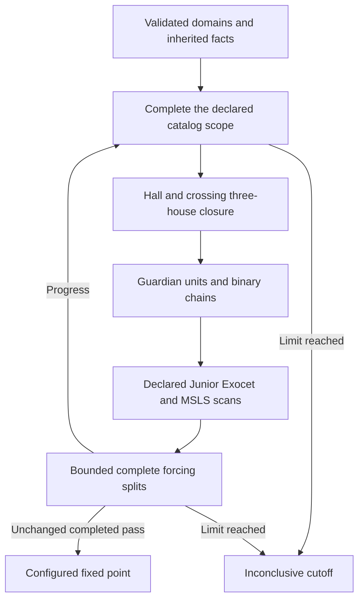

# Candidate-preserving offline discovery baseline

**All eight current unique-puzzle hosts are solved controls under the combined
comparison. No eligible live state remains for a separation or originality
claim.** This adds offline research infrastructure and exact proof acceptance;
it changes no production Rust solver behavior.

The input catalog is
[`discovery_pipeline_inputs.json`](discovery_pipeline_inputs.json). The separate
candidate-preserving frozen older-engine comparison solves four inputs and
retains four live configured fixed points. The stronger phases solve the other
four when their historical catalog scans complete. Their conclusions concern
the actual configured profiles, not every known Sudoku method.




## API and declared profile

[`strong_baseline_core.py`](strong_baseline_core.py) exports:

```python
close_state(domains, inherited_relations=None, options=Options())
```

The result contains `input_domains`, `domains`, chronological `trace`,
`input_relations`, persistent `relations`, `status`, `error`, `phase_results`,
`options`, `history_scope`, and `forcing_profile`. The status is one of:

- `complete`: all cells are placed consistently with the native houses.
- `refuted`: an exact recorded contradiction proves this premise state empty.
- `fixedpoint`: an unchanged complete round of every enabled configured phase
  found no further inference.
- `cutoff`: a time, node, storage, or round bound prevented completion. This is
  inconclusive and never a configured fixed point.

The default root profile enables these phases:

- Native-house perfect-matching GAC and all 81 crossing three-house GAC checks.
- The 592 public strict impossible-pattern catalog rules.
- Guardian unit propagation and signed binary implication reachability.
- The specified basic and relaxed Junior Exocet scans.
- Rectangular rank-zero MSLS.
- Candidate forcing with two additional complete split levels.

Forcing starts by assuming one live candidate true and refuting it. Its inner
profile includes fresh strict catalog discovery, inherited guardian
unit/binary consequences, and Hall/all 81 closure. Basic/relaxed Junior and MSLS
inside hypotheses are disabled by default and explicitly reported; enable them
with `--inner-je-msls` or `Options(forcing_inner_je_msls=True)`. Complete guardian
OR case splits of width at most six and ordinary complete cell-value splits are
available.

All branch values must be refuted. The depth bound counts additional
splits below the candidate assumption, so a longest depth-two path can contain
three nested value hypotheses. It is not a classic Sudoku T&E rating.

This native implication graph and guardian unit engine is **a subset of
CSP-Rules ORk-whips/forcing-whips, not their full implementation**. Wider
guardian case splits, arbitrary OR resolution, and broader Exocet/MSLS variants
are not silently included. A focused `forcing_targets` profile or disabled
phases can yield only that explicitly configured fixed point.

## Persistent facts and history

`relations` stores a context ID, pinned catalog hash, origin-domain snapshots,
immutable guardian clauses, and scan coverage records. A clause contains its
origin hash, source catalog ID, actual palette, native geometry map, and the
complete original guardian OR. Current masks must remain subsets of every
retained origin. New puzzles reset this context. Branch-derived facts stay in
their branch proof; they are not lifted unconditionally to the parent.

Clauses persist after palette candidates disappear. A later strict matcher
might no longer recognize their original premises, but a valid earlier OR
continues to hold on every monotone descendant. The checker independently
rechecks its original occurrence and derives current satisfied, false, unit,
or open status from the current masks. It never replaces the original guardian
list with an unproved smaller one.

A complete strict scan at a looser origin covers every later strict occurrence.
A cell that retains all three palette candidates after deletions already contained those candidates before deletions. The original OR, with now-false guardians
filtered during inference, remains sufficient. If that earlier scan cuts off,
a complete final-state scan does not certify the missing historical scope.

Supply exact earlier snapshots via `history_snapshots`, normally including the
original givens-derived domains. Without them, `history_scope` explicitly says
only the supplied starting snapshot was searched. The API cannot authenticate a supplied snapshot as the puzzle's original givens state.
The caller must check that binding and the preceding trace.

## Exact acceptance and CI controls

[`strong_baseline_verify.py`](strong_baseline_verify.py) chronologically replays
every accepted positive step. It uses the independent `joint_audit_relations`
and `joint_audit_patterns` theorem checkers. It verifies native support edits,
source/native guardian premises, signed implication paths, exact Junior/MSLS
premises, and every branch of forcing proofs. Local contradiction leaves carry
Hall deficiencies or boundary-signature Hall blocker covers, not trusted error
messages. Conditional catalog facts enter only when their discovery snapshot
is established by the preceding trace.

Claimed complete catalog coverage is independently rescanned, including
checking that no persistent occurrence was dropped. For a live fixed-point
result, acceptance also repeats the complete configured menu on the same state.
Disabled or focused profiles cannot be reported as the mandatory strong
profile. `strong_separation_candidate` remains false: verified original-history
and same-state corrected-old union bindings are separate caller obligations.

The committed [`strong_baseline_controls.json`](strong_baseline_controls.json) contains four controls:

- A refutation of the known 20-cell opposite.
- A focused forcing proof with complete split coverage.
- An origin catalog clause retained after palette deletion.
- A branch refuted by that retained clause.
The focused and disabled profiles are intentional negative classification
controls. The self-test rejects fourteen malformed branch, clause, guardian,
origin, status, coverage, and output certificates.

```sh
python3 -S research/global_obstructions/strong_baseline_verify.py --self-test
python3 -S research/global_obstructions/joint_audit_relations.py --self-test
python3 -S research/global_obstructions/joint_audit_patterns.py --self-test
```

These acceptance commands use the Python standard library. Full discovery
profiles are offline and may be expensive; no interactive hint performance
claim is made.

## Bounded campaign and retained evidence

The first run used 60 seconds per host, with ten seconds and 100,000 embedding
nodes per catalog scan. It produced **six complete solved outputs and two
explicit historical-scan cutoffs** in 25.57 seconds. One cutoff was an already
solved Mith515 input; the other was the 48-cell live Monhard1244 input. Neither
was called a fixed point.

A separate rerun raised catalog limits to one million nodes and 60 seconds,
with a 120-second overall per-host limit. Both scans completed: Mith515 in
6.932 seconds and Monhard1244 in 10.020 seconds. Monhard1244 then solved. The
original cutoffs are retained; their results were not overwritten.

- [`strong_baseline_campaign_results.json`](strong_baseline_campaign_results.json)
  records the original eight runs.
- [`strong_baseline_expanded_results.json`](strong_baseline_expanded_results.json)
  records the two separate higher-budget runs.
- [`strong_baseline_verification_results.json`](strong_baseline_verification_results.json)
  binds and independently accepts **all ten run outputs**: eight complete solved
  outputs and two sound partial cutoffs, representing eight distinct puzzles.

Exact bulk traces and clause stores stay under `target/strong-baseline-corpus`
and `target/strong-baseline-expanded`; public summaries bind their hashes.
All accepted final candidate masks retain the independently counted unique
completion. The stronger trace acceptance independently verifies the actual
logical inferences, rather than relying on that completion-preservation test.

After reproducing the separate retained-old input comparison, run:

```sh
python3 -S research/global_obstructions/strong_baseline_campaign.py --seconds 60
python3 -S research/global_obstructions/strong_baseline_campaign.py \
  --seconds 120 --catalogue-seconds 60 --catalogue-nodes 1000000 \
  --only modern-monhard-te3-001244 modern-mith-minimals-000515 \
  --output target/strong-baseline-expanded \
  --summary research/global_obstructions/strong_baseline_expanded_results.json
```

For one existing fixture, the CLI accepts `--opposite`, `--history`,
`--no-forcing`, `--inner-je-msls`, and explicit time/output arguments. Its
current-state-only default makes no claim to an unavailable earlier history.
The known 20-cell benchmark remains a rejection control, not a novel candidate.
