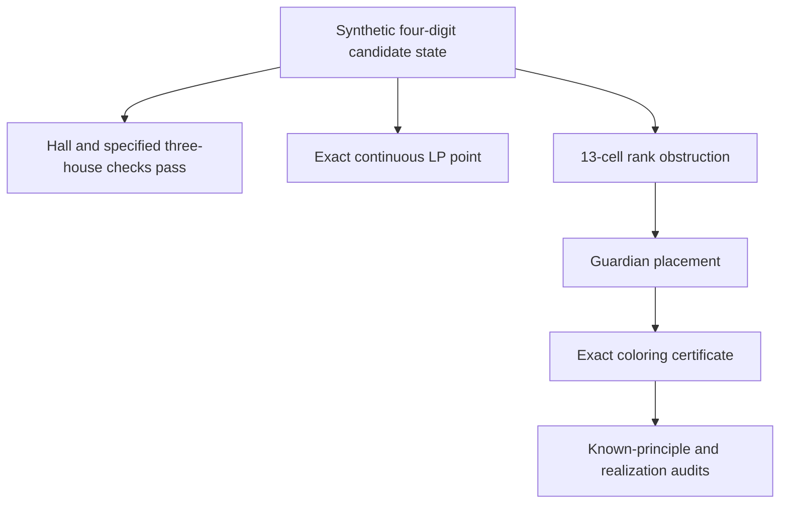

# A verified four-digit global packing obstruction

The retained synthetic state forces **r2c8=1**. Its contradiction uses 13
native cells and four candidate digits. It survives individual-house matching
propagation, every crossing row/column/box check, every conjunction of three
native houses, and the full continuous relaxation of all 324 native equations.
An independent complete Sudoku respects the unforced state.

This is a verified engine-coverage and proof-certificate example. It is **not
established new mathematics**. Its short proof is a classical stable-set rank
inequality. The exact historical status of this native 13-cell motif has not
been established. In particular, a lack of matching search results does not
prove priority or that higher chromatic Sudoku patterns are under-examined.

The [prior-art audit](prior_art_13_report.md) identifies the necessary obstruction as a spanning seven-hyperhole with six extra native edges.
It maps the assumed-state logic to established grouped Nice Loops.
Those exact equivalences explain the proof without a new mathematical rule.




## Exact fixture and proof

[`structural_four_digit_13.json`](structural_four_digit_13.json) records the
complete candidate state, a respecting completed Sudoku, the rejected target
assumption, strict closure results, and discovery provenance. The palette is
`{4,6,7,8}`. The selected cells are:

```text
r2c1 r2c7 r2c8 r2c9
                    r3c8
r4c1                r4c8
r5c1                r5c8
     r6c2 r6c3 r6c7      r6c9
```

More precisely their zero-based indices are
`[9,15,16,17,25,27,34,36,43,46,47,51,53]`.
Every selected cell has exactly the four palette candidates, except r2c8,
which additionally permits 1. Removing that 1 leaves all 13 cells restricted
to the four-digit palette.

Let G be the graph on these cells.
An edge joins two cells exactly when they share a native row, column, or box. The independent verifier reconstructs all edges
from the coordinates; supplied graph edges are not trusted. G has 35 edges,
eight vertices of degree five, and five of degree six. No house contains more
than four selected cells.

**Proposition.** Every Sudoku respecting the unforced candidate state has
r2c8=1.

**Proof.** The support lies in boxes 1, 3, 4, and 6. Four independent cells would
need one cell from each box. Box 1 contains only r2c1, so that cell must be
selected.

In box 3, its row eliminates r2c7, r2c8, and r2c9, forcing r3c8.
In box 4, its column eliminates r4c1 and r5c1, leaving r6c2 or r6c3. The forced
r3c8 eliminates r4c8 and r5c8 from box 6, leaving r6c7 or r6c9. Both remaining
box choices are in row 6, so they cannot both be selected.

Thus four independent
cells are impossible.

Independent triples exist, so the independence number of G is exactly three.
Consequently, any one digit can occupy at most three selected cells. If r2c8
were not 1, only the four palette digits would be available, with total capacity
at most `4*3=12` cells. All 13 cells require a value, a contradiction. ∎

The verifier explicitly checks this hand argument and, independently, checks
every one of the `C(13,4)=715` subsets for a native peer pair.

There are 13 independent singletons, 43 independent pairs, 32 independent
triples, and no independent four-set. The respecting complete Sudoku uses five
digits on this support, so its graph has chromatic number exactly five. The
verifier also constructs a four-coloring after deleting each individual vertex.
Thus this support is vertex-critical for non-four-colorability; no assertion
of global minimum support size or unique geometry is made.

The argument does not require a unique Sudoku solution, modular arithmetic,
or the validity of a uniqueness technique. Recorded candidate deletions remain
premises. The independent complete solution checks that these particular
premises are jointly satisfiable.

## What the baselines establish

Both the unforced and assumed states were closed to a fixed point under all 27
individual-house matching propagators and all 81 exact crossing-three-house
propagators. The first closure made 13 domain updates; the second made 26.
Each reached its fixed point after two passes. The verifier independently
rechecks the final fixed points rather than trusting those update counts.

The stronger three-house baseline checks **all 2,925 choices of three native
all-different constraints**, including triples not centered on a cell. For each
choice, the checker constructs and validates a candidate-respecting assignment
to their union. The edges used for this baseline are exactly the edges imposed
by those three selected constraints. This does not claim feasibility of the
stronger subproblem that additionally enforces every unselected native peer
edge between cells in the same union.

The construction uses the recorded binary role witness t. Every house has
four cells with `t=1` and five with `t=0`. On the selected three-house graph,
the induced graph of each role admits a perfect elimination ordering, which
the checker reconstructs and verifies directly. Greedy coloring in reverse
order uses four palette digits for role 1 and the other five digits for role 0.
Each result is checked against the actual domains and selected houses. All
2,925 assignments pass; their reproducible digest is in
[`structural_results.json`](structural_results.json).

The assumed domains are palette-only, complement-only, or all nine digits.
For every cell c and digit d, define the exact fractional assignment

```text
x(c,d) = 1/4  if t(c)=1 and d is in {4,6,7,8}
x(c,d) = 1/5  if t(c)=0 and d is outside {4,6,7,8}
x(c,d) = 0    otherwise.
```

This has 369 nonzero variables. Exact `Fraction` checks verify nonnegativity,
every domain restriction, all 81 cell equations, and all 243 house/digit
equations. It respects r2c8≠1. Thus an exact feasible point exists for the **full native continuous relaxation** after the rejected assumption.

The check includes every equation and uses exact arithmetic. Each palette digit has
fractional mass `13/4` on the core, exceeding the valid integer bound three.
That is precisely the missing stable-set rank inequality.

## Existing engine comparison

[`structural_compare_engine.py`](structural_compare_engine.py) instruments a
temporary source copy and tests the exact stored masks. The public hint API
must not be used for this comparison if it recalculates candidates.

On the **unforced base state**:

- None of the 34 explicitly listed older non-forcing, uniqueness-independent
  detectors returns a finding.
- Default Arithmetic Counting returns no hint after 24,166 combinations. Its
  beam was pruned and its combination budget was not exhausted.
- The exact three-house search checks all 81 crossings and returns no hint.

On the assumed fixed point, Franken Fish and Mutant Fish do find further
steps; the other listed handlers return none. Default arithmetic still returns
no hint after 22,238 combinations with beam pruning, and all 81 crossing
checks return no hint. The assumed state is therefore **not** a fixed point of every older detector.
This result also does not exclude a forcing-chain proof.

Search failure is not a completeness
theorem. Uniqueness methods, the new Global Coloring feature, forcing chains,
backtracking, optional residue APIs, external solvers, and unimplemented named
rules are outside this comparison. Exact results and the source fingerprint
are in [`structural_engine_comparison.json`](structural_engine_comparison.json).

## Discovery scope and rejected control

The state is synthetic. Its complete Sudoku was taken from the solution of
Norvig top95 puzzle 20, already recorded with a verified source in the earlier
real-game corpus. The candidate restrictions were constructed for this
experiment. This does **not** claim that this exact candidate state occurs in
the solving trace of that puzzle or of another authored givens-only puzzle.

The bounded search chooses four digit classes from a complete Sudoku.
It adds a guardian whose solution value lies outside that palette.
It then removes one palette cell from each guardian house. This guarantees a respecting unforced
solution and at most four restricted cells in every house. It tests 126
palettes, six seeded guardian choices per palette, and 64 ordered removal
choices. These are candidate presentations, not necessarily distinct graphs.

With the standard cyclic completed Sudoku, all 48,384 presentations were
four-colorable. With the recorded non-cyclic completion, the first retained
LP-feasible obstruction appeared at presentation 45,091. Nine presentations
before and including that one were not four-colorable; floating-point LP
screening rejected the first eight. The positive 34-cell support reduced by
greedy vertex deletion to the retained 13-cell vertex-critical graph. The
positive retained fixture is later checked with exact arithmetic;
floating-point discovery is not its proof.

An earlier 21-cell five-chromatic candidate was explicitly rejected because
the full native LP was infeasible. The independent linear track retains an exact Farkas certificate for the rejected candidate.
Its 35 native equations have integer ±1 weights and right-hand side −1.
Every resulting coefficient on an available candidate is nonnegative. Its coloring contradiction therefore fails the requested LP
separation test. This negative control prevents an attractive higher-color
example from being misreported as a stronger result.

## Relation to known methods and practical detection

The standard 12-cell, three-digit tridagon/Thor's Hammer is a known
non-three-colorability pattern. The retained graph has 13 vertices and
chromatic number five, so it is not a relabeled copy of that graph. Its cells
have four live palette candidates, so a direct three-digit tridagon template
does not instantiate on these original lists. This does not exclude a more
general chromatic pattern, generalized subset method, MSLS/rank argument,
pattern-overlay argument, or another historical explanation.

In integer-programming terminology the proof uses the classical valid
inequality `sum(c in S) x(c,d) <= alpha(G[S])`, once per digit. Calling this
stable-set rank reasoning is a precise prior-art mapping. It is not merely a
new name for ordinary one-house Hall counting, but neither is the inequality
new mathematics. The absence of a matching exact motif in the bounded search
for prior art does not establish historical novelty.

A bounded detector can inspect components within a selected three- or four-digit palette.
One guardian with an extra candidate can join the selected cells. It must preserve all list restrictions and native peer
edges, report cell/node budgets, and return no deduction when search is
incomplete. A general refutation tree is useful because many non-colorable
list instances have no short independence-capacity explanation.

For this example the independent MRV/degree search checks every permitted
branch, with no color-symmetry skipping or memoization. It visits 1,121 nodes
including 192 explicit empty-domain leaves. The exploratory count of 929
omitted those leaf calls. Counts from another certificate representation must
state their convention. The production proof remains a generic exhaustive
list-coloring certificate; no special trusted name, graph topology, or alpha
bound is needed. The separate 715-subset capacity proof supplies an independent
and shorter human explanation.

## Reproduce

Standard-library verification, approximately 1.3 seconds on the development
machine:

```sh
python3 research/global_obstructions/structural_verify.py \
  --output research/global_obstructions/structural_results.json
```

It checks the complete solution, alpha and chromatic claims, vertex-deletion
colorings, exact 324-equation LP witness, both Hall/crossing fixed points, and
all 2,925 selected-house triples. Do not use Python's `-O` flag.

Manual comparison with current older engine handlers requires Cargo:

```sh
python3 research/global_obstructions/structural_compare_engine.py \
  --output research/global_obstructions/structural_engine_comparison.json
```

Optional discovery reproduction needs NumPy and SciPy and takes approximately
20 seconds per run on the development machine. Solver screening results remain
untrusted until the independent exact verifier accepts the retained state:

```sh
python3 research/global_obstructions/structural_discover.py --cyclic
python3 research/global_obstructions/structural_discover.py --output /tmp/q4-discovery.json
```

## Primary references

- [Herzberg and Murty, *Sudoku Squares and Chromatic Polynomials* (2007)](https://people.math.sc.edu/girardi/sudoku/ChromaticPoly.pdf)
  explicitly formulates Sudoku as native graph precoloring extension. Graph
  coloring is established Sudoku mathematics.
- [Letchford, Rossi and Smriglio, *The stable set problem: Clique and nodal inequalities revisited* (2020), §2.1](https://www.lancaster.ac.uk/staff/letchfoa/articles/2020-nodal.pdf).
  The paper states the clique and rank inequalities, including the alpha inequality used here.
  The paper attributes rank inequalities to Nemhauser and Trotter (1974).
- [Sewell and Trotter, *Stability critical graphs and ranks facets of the stable set polytope* (1995)](https://www.sciencedirect.com/science/article/pii/0012365X9400168I)
  provides older direct research on rank inequalities and critical graphs.
- [SudokuWiki's author-maintained Tridagons description](https://www.sudokuwiki.org/Tridagons)
  describes the known three-digit, four-box pattern and guardians. Its name
  must not be repackaged as a new solving principle.
- [Norvig's author-hosted top95 corpus](https://www.norvig.com/top95.txt)
  is the source of the completed-puzzle anchor, not the author of this synthetic
  candidate construction. Individual puzzle authorship is unspecified there.

Further useful searches include `Sudoku four-digit non-colourable pattern`,
`Sudoku independence number rank inequality`, `Sudoku thirteen-cell chromatic
pattern`, `Sudoku generalized subset principle`, and `MSLS rank noncolorable
four digits`. A surviving motif still needs broader historical review before
any mathematical priority claim.
