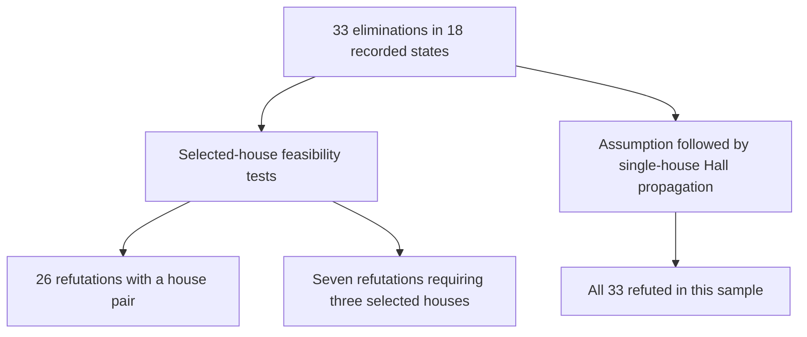

# Classification of the retained three-house sample

The three-house machinery finds deductions missed by the engine's bounded
detectors, but this sample establishes **no new mathematical solving principle**.
In particular, the headline fixture `three-house-847.json` has an ordinary
ALS-XZ proof involving a seven-cell ALS. The existing ALS enumerator stops at
five cells. Exact three-house certificates provide another bounded way to cover
such deductions and independently verify their premises.




## Universe and reproducible counts

[`three_house_classification_corpus.json`](three_house_classification_corpus.json)
contains all 18 states with eliminations retained from the earlier seeded
experiment: seed 83920, 1,000 completion-preserving synthetic states, and 1,080
cluster evaluations. Each retained state records all 81 domains, its target
eliminations, and the number of compatible unforced signatures. The standard
cyclic complete Sudoku respects every recorded state; the classifier checks
this directly.

This is a **classification of those 33 recorded eliminations**, not of all
three-house obstructions, all Sudoku candidate states, or real generated games.
The original sampling was biased toward one selected crossing. Its incidence
figures are not prevalence estimates. Real-game traces are a separate corpus
and are not included in the following counts.

For every target, restrict its domain to the assumed digit. A target is
three-house irreducible here precisely when the selected row/column/box
conjunction is infeasible but every proper subset of those three houses remains
feasible. This definition concerns the selected-house relaxation, not the
minimum number of constraints in the complete Sudoku proof.

| Result on the retained sample | Count |
| --- | ---: |
| States | 18 |
| Eliminations | 33 |
| Already refuted by a single selected house | 0 |
| Refuted by some selected house pair | 26 |
| Require all three selected houses | 7 |
| Refuted by ordinary conditional Hall/GAC propagation | 33 |
| Have a direct standard disjoint ALS-XZ explanation, ALS sizes 1–8 | 8 |

All 33 assumptions fail after one or two passes of individual-house
generalized arc consistency, visiting row, column, then box. Nine fail in the
first pass and 24 in the second. Adding ordinary locked-candidate propagation
changes none of the refutable/not-refutable outcomes. Therefore this sample
does **not** separate exact three-house joins from singleton GAC. It also does
not establish a separation from general forcing chains, MSLS, 3D Sue de Coq,
generalized ALS chains, or constraint programming.

The seven irreducible targets are:

| Trial | Target excluded | Direct ALS-XZ with native-house ALSes of size at most 8 |
| --- | --- | --- |
| 416 | r4c1=4 | None found by exhaustive search of this one rule |
| 416 | r9c1=4 | None found by exhaustive search of this one rule |
| 442 | r1c5=1 | None found by exhaustive search of this one rule |
| 847 | r1c4=1 | Yes: sizes 7 and 2, RCC 2 |
| 847 | r1c4=3 | None found by exhaustive search of this one rule |
| 847 | r1c6=3 | None found by exhaustive search of this one rule |
| 847 | r1c9=3 | None found by exhaustive search of this one rule |

The independent factorial oracle enumerates all `9!` assignments for each
selected house for every one of these seven cases. It joins actual ordered
shared-cell values and confirms that each pair has support while the triple
join is empty. It does not share the matching DP used by the classifier.

Across all 33 targets, eight have a direct disjoint ALS-XZ witness.
The minimum possible maximum ALS size is 5 for one target, 6 for two, 7 for two, and 8 for three. The other 25 have no witness in this precisely defined two-ALS rule.
These negative searches say nothing about ALS chains or other known rules.

The seven irreducible cases have distinct canonical fingerprints under a specified **local relaxation** equivalence.
This equivalence permits arbitrary digit renaming, row/column transposition, and cell relabeling within each membership atom.
The target cell and digit remain distinguished. The classifier exhausts all `8!`
renamings after sending the target digit to 1. Within-atom relabeling need not
extend to a geometric symmetry of the full Sudoku grid, so these are not
whole-board Sudoku equivalence classes. Canonical forms classify the complete
recorded domains; they are not a classification of minimal proof cores.

## Fixture 847 is a known ALS-XZ instance

Let

```text
P = {r1c2,r1c3}
Q = {r1c1,r2c1,r3c1,r5c1,r6c1,r7c1,r9c1}.
```

The original, unmodified fixture has these properties:

1. P consists of two cells in row 1 with candidate union `{1,2,3}`.
2. Q consists of seven cells in column 1 with candidate union
   `{1,2,3,4,5,7,8,9}`.
3. Every possible 2 in P sees every possible 2 in Q. The 2-cells in Q are
   r1c1, r2c1, and r3c1, all in box 1.
4. Target r1c4 sees every possible 1 in both sets. The only 1-cell in Q is r1c1.

Thus P and Q are disjoint ALSes, with restricted common candidate 2 and
elimination digit 1. They cannot both use 2. Whichever ALS omits 2 must use
every remaining digit in its candidate union, including 1. Target r1c4 sees
every possible location of that 1, so r1c4 cannot contain 1. This is the
standard ALS-XZ argument; uniqueness is unnecessary.

`als_xz_explanation` explicitly checks every premise against the original
domains. It exhausts every 1–8-cell native-house ALS and every eligible
disjoint pair. The minimum maximum ALS size for this target is seven.
[`src/solver/als_engine.rs`](../../src/solver/als_engine.rs) documents and
implements a size-five cap in `enumerate_als` (`empty.len().min(5)`).
Consequently, the original gap is explained by a bounded implementation of
an established method, rather than mathematical novelty.

## A smaller sufficient premise set

Two deterministic greedy minimizations, visiting cells/digits in ascending and
descending order, yield the same weakened premise set. All unlisted domains
can be restored to all nine digits, including the target's domain:

```text
r1c1 = 12345789
r1c2 = 123              r1c3 = 123
r2c1 = 2345789          r3c1 = 2345789
r5c1 = 345789           r6c1 = 345789
r7c1 = 345789           r9c1 = 345789
```

There are nine restricted cells and 29 excluded candidate edges. The classifier
checks that restoring any one excluded edge makes the selected-house
relaxation feasible under r1c4=1. Thus the set is **1-minimal under these
individual premise relaxations**. It is not proved globally minimum in number
of cells, excluded edges, digits, or proof length. Restoration support is local
to the selected houses and does not assert a complete Sudoku with the target.

A short Hall proof is now visible. Assume r1c4=1. Cells r1c2 and r1c3 occupy
2 and 3. The seven column cells Q then have only `{3,4,5,7,8,9}` in their combined domains.

The first three Q cells cannot contain 2 or 3.
All seven already exclude 6, and only the center previously allowed 1. Seven distinct cells cannot
use only six digits. The same two-ALS-XZ proof above also applies.

## Certificate and implementation recommendations

Use the exact selected-house membership atoms, of sizes `1,2,2,6,6,4`.
A signature consists of a center digit and disjoint two-digit sets for the
row/box and column/box arms. There are at most `9*C(8,2)*C(6,2)=3,780`
signatures. A candidate-respecting matching within each atom and disjoint
sets inside every house are necessary and sufficient for this relaxation.
Atom matchings glue because atom cells have identical membership in all
selected constraints. This is a matching/constraint decomposition theorem,
not a new general solving principle.

A production certificate must bind to the exact candidate state and target.
The checker must reconstruct the native layout.
Every permitted signature under the rejected target assumption needs a valid Hall-deficient atom subset. The checker
should recompute neighbor unions and strict cardinality inequalities and check
complete coverage independently of the search DP. An explicit unforced local
assignment is a useful consistency guard, but certifies neither full Sudoku
satisfiability nor earlier eliminations. Placed values must become singleton
domains; stored masks must not be silently recalculated during replay.

The current `ThreeHouseProof` layout was reviewed read-only: its fixed
`(atom,digit-set,cell-subset)` blockers, reconstructed signature coverage,
state hash, and explicit base witness are consistent with this theorem.
There are at most `2*C(9,2)+2*C(9,6)+C(9,4)=366` possible blocker keys.
This review is not a substitute for production tests or formal verification.

An optional future compact format can omit each blocker's fixed digit set and
record only `(atom,cell-subset)`. Recompute
`neighbors = union(recorded domains of subset) & signature_digit_set`, then
test `popcount(neighbors) < popcount(subset)`. There are at most
`3+3+63+63+15=147` nonempty subsets in atoms 1–5. A deterministic greedy cover
for fixture 847 needs only five such blockers, covering all 2,100 signatures
allowed by its center domain. Their `(atom,local-cell-bitmask)` pairs are
`(1,3),(3,1),(2,1),(2,3),(4,46)`. This is a checked size experiment, not a
minimum-cover claim or a request to change the current sound format.

## Run and verify

Fast CI command, approximately 0.4 seconds on the development machine:

```sh
python3 research/nonmodular/three_house_classification.py --no-canonical
```

The command checks the recorded complete solutions and all 33 exact atom deductions.
It checks the 26/7 split, conditional Hall propagation, exhaustive direct ALS-XZ explanations, and the seven-cell ALS-XZ proof.
It also checks Hall-deficiency coverage of every fixture-847 signature. Expected corpus aggregates are asserted, not merely printed.

Full reproduction additionally recomputes canonical classes, both greedy
premise reductions, and independent factorial joins for all seven irreducible
cases. It is comfortably below five minutes; the saved result includes each
case, witness, and canonical fingerprint:

```sh
python3 research/nonmodular/three_house_classification.py \
  --minimize --permutation-check \
  --output research/nonmodular/three_house_classification_results.json
```

The scripts use Python's standard library. Do not use `-O`; assertions are
part of these finite research checks. This command classifies the 18 retained exact states.
It does not regenerate the complete sample of 1,000 states.
The corpus records the sampling provenance.

## Primary prior art and remaining questions

- [Régin, *A filtering algorithm for constraints of difference in CSPs* (1994)](https://cse.unl.edu/~choueiry/Documents/ReginAAAI-1994.pdf)
  supplies matching-based generalized arc consistency for all-different.
- [Simonis, *Sudoku as a Constraint Problem* (2005)](https://ai.dmi.unibas.ch/_files/teaching/fs21/ai/material/ai26-simonis-cp2005ws.pdf)
  treats row/column matching, row/box value-set interactions, and flow methods.
- [Bessière et al., *Propagating Conjunctions of AllDifferent Constraints* (2010)](https://arxiv.org/abs/1004.2626)
  directly studies simultaneous matching and generalized Hall conditions.
- [Monfroy et al., *Overlapping Alldiff constraints: SAT versus CSP encoding application to the Sudoku* (2011)](https://academicjournals.org/journal/IJPS/article-abstract/7B3498125394)
  presents overlap and ring propagation and Sudoku encodings.
- [Demoen and Garcia de la Banda, *Redundant Sudoku Rules*](https://arxiv.org/abs/1207.5926)
  concerns entailment among native constraints. Semantic rule redundancy and
  propagation strength are different questions.
- [HoDoKu's author-maintained Sue de Coq documentation](https://hodoku.sourceforge.net/en/tech_misc.php)
  specifies basic and extended two-sector subset-counting forms. Broader named
  methods must be checked rather than assuming a three-house layout is novel.
- [The author-maintained Sudoku SDK](https://github.com/kyoyama-kazusa/Sudoku)
  explicitly lists 3D Sue de Coq, MSLS, ALS methods, and rank analysis. Its
  existence is relevant prior-art evidence; this work does not yet compare
  every implementation or prove a separation from those method families.

The open research target is a recurring, independently checked obstruction
family with an explicit strength or proof-size separation from a precisely
specified known baseline. This corpus offers useful certificates and engine
coverage examples, but its existing Hall/ALS explanations prevent a claim of
new mathematics. The six irreducible cases lacking a direct two-ALS-XZ witness
remain candidates for classification by other known methods, not discoveries.
