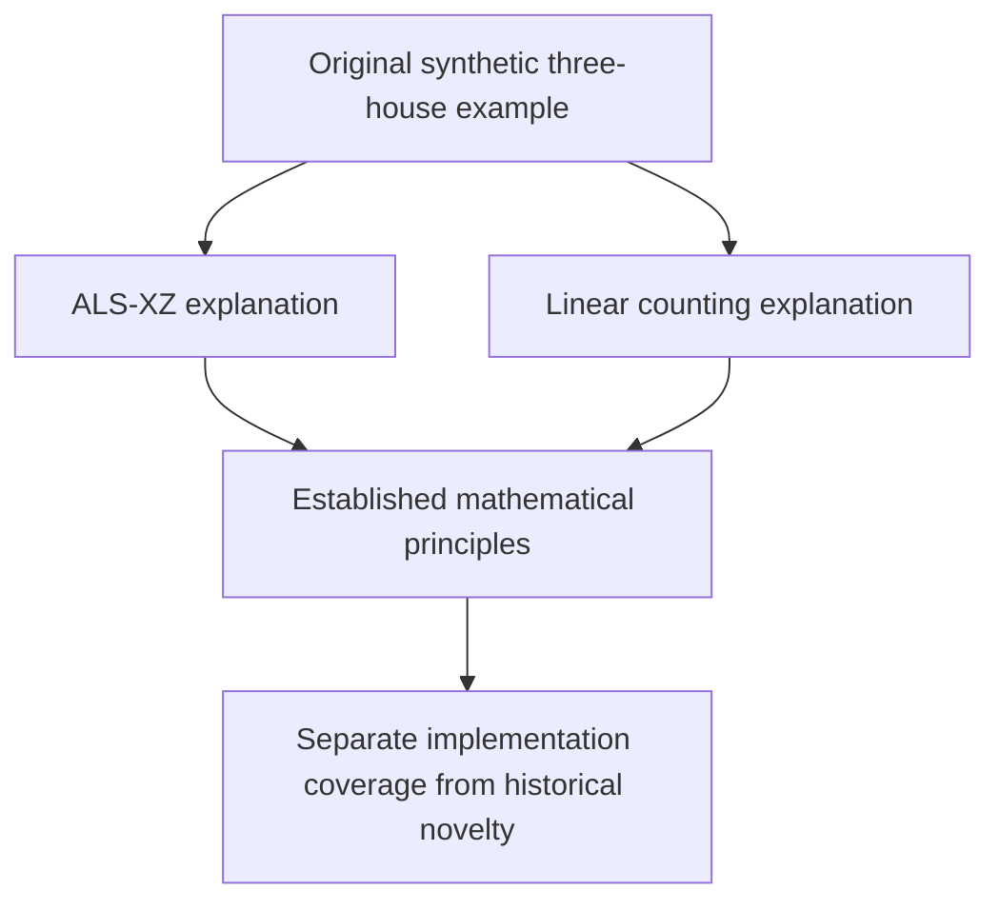

# Three-house certificates: independent audit and prior-art limits

This note accompanies the independently authored research checker
[`audit_three_house_independent.py`](audit_three_house_independent.py). It does
not establish historical novelty and does not audit production Rust code merely
by checking a similar research model. No external solver's claim is trusted by
the exact checks below.




## What trial 847 actually demonstrates

The stored candidate state has a respecting completion and an elimination
`r1c4 != 1`. Its three-house joint support test and Hall explanation are sound.
The individual and pairwise assignment counts in the original assumed domains
do **not** establish a separation from iterated propagation or general known
Sudoku methods.

Two additional, exact known-method comparisons hold:

1. Assume `r1c4=1`.
Repeatedly apply ordinary generalized arc consistency separately to row 1, column 1, and box 1.
Column 1 becomes inconsistent on pass 2. The audit computes candidate
   support using independent prefix/suffix matching dynamic programs. Thus a
   failed-literal procedure with ordinary allDifferent propagation can make
   the same deduction.
2. There is an eleven-source integer linear counting certificate, below. Thus
   trial 847 is **not** a separation from the continuous native linear
   relaxation or generalized rank/counting reasoning. The existing bounded
   arithmetic detector's failure is a search/format limit.

The recorded state is a synthetic candidate-state fixture, not a givens-only
puzzle or evidence of prevalence in actual games. Before making a real-game
claim, preserve the givens, every candidate-changing step, active rules, and
the exact reachable state. An independent exact solver must check both a
respecting completion and the impossibility of each eliminated candidate.

## Fixed eleven-source counting proof

Each native requirement below has right-hand side 1. Give weight -1 to:

- the cell requirements for `r1c2`, `r1c3`, and `r1c4`;
- column 1's digit requirements for 1, 2, and 6.

Give weight +1 to:

- the cell requirements for `r4c1` and `r8c1`;
- row 1's digit requirements for 1 and 3;
- box 1's digit requirement for 2.

The weighted right-hand side is `5 - 6 = -1`. On every recorded available
candidate, all resulting coefficients are nonnegative except `r1c4=4` and
`r1c4=6`, each of coefficient -1. Hence the equation implies

```text
x_(r1c4,4) + x_(r1c4,6) >= 1.
```

The cell requirement then excludes both 1 and 3 from `r1c4`. After assuming
`r1c4=1`, the weighted left-hand side is a sum of nonnegative terms but equals
-1, a contradiction. The audit reconstructs every coefficient over all 81
recorded domains using only integer arithmetic. No LP solver is needed for
verification. This is a generalized counting/rank-style certificate; it is not
being identified as one specific named MSLS layout without a formal mapping.

## Closest established work

| Established method | Primary source and precise relevance |
| --- | --- |
| Matching and generalized arc consistency for allDifferent | [Régin, AAAI 1994](https://cdn.aaai.org/AAAI/1994/AAAI94-055.pdf) gives matching-based filtering. Each membership atom's matching problem uses this established principle. |
| Sudoku constraint propagation | [Simonis, *Sudoku as a Constraint Problem*, 2005](https://ai.dmi.unibas.ch/_files/teaching/fs21/ai/material/ai26-simonis-cp2005ws.pdf) discusses established global constraints and interactions between Sudoku units. |
| Conjunctions of overlapping allDifferent | [Bessière et al., AAAI 2010, author-hosted paper](https://cquimper.github.io/publications/overlappingalldiff.pdf) characterizes simultaneous matchings with generalized Hall conditions. Its particular bounds-consistency algorithm concerns two constraints and ordered/convex-domain structure; the general overlap problem is direct prior art for the proposed scope. |
| Sue de Coq | [HoDoKu's author-maintained technique guide](https://hodoku.sourceforge.net/en/tech_misc.php) explains basic and extended two-sector subset-counting patterns. Same structural neighborhood does not prove trial 847 meets its precise pattern definition; no such identity is claimed. |
| 3-dimensional Sue de Coq and rank logic | [The solver author's technique catalogue](https://github.com/kyoyama-kazusa/Sudoku/blob/main/README.md) explicitly lists 3-Dimensional Sue de Coq, MSLS, and rank logic. This establishes named prior art requiring comparison, not that this external implementation was run successfully on trial 847. |
| Whips, braids, and forcing | [Berthier's implementation and publications](https://github.com/denis-berthier/CSP-Rules-V2.1) and [author-maintained examples](https://github.com/denis-berthier/CSP-Rules-Examples) provide precise rule families and executable comparisons. The audit establishes one-assumption GAC refutation, not a minimum whip length or a separation from any full whip/braid theory. |
| Per-pattern exhaustive proof checks | [The author's sudokUI implementation](https://github.com/AImenes/sudokUI) describes per-position tridagon impossibility and Exocet template checks. A local independent checker alone is not a new Sudoku principle. |

The original Sue de Coq discussion
[`two-sector-disjoint-subsets-t2033`](https://forum.enjoysudoku.com/two-sector-disjoint-subsets-t2033.html)
and the MSLS discussion
[`using-multi-sector-locked-sets-t31222`](https://forum.enjoysudoku.com/using-multi-sector-locked-sets-t31222.html)
were identified but could not be fetched during this audit. No unsupported
historical attribution or exact pattern equivalence is inferred from them.

## Certificate design audit

For the row, column, and box through a center, reconstruct the six membership
atoms from native topology. Their sizes are 1, 2, 2, 6, 6, and 4. A signature
selects a center digit and two disjoint two-digit intersection sets. The other
three atom digit sets are complements in their respective houses. There are at
most 3,780 signatures. Filtering the center by its effective domain leaves
2,100 signatures in trial 847 under the target assumption.

For each signature, an accepting rejection proof supplies a Hall-deficient
subset of some atom. The checker reconstructs the candidate union within the signature's required digit set.
The union must be smaller than the cell subset.
The checker also requires coverage of every deterministic signature. A separate
base assignment on all 21 cluster cells respects all three native houses and
the recorded domains and rejects the target value. This rejects an already
contradictory three-house relaxation; it does not certify full-grid or variant
satisfiability.

Required implementation checks:

- Bind full recorded values and candidate masks; use placed values as singleton
  effective domains. Require installed standard-rule provenance, independently
  of a variant name. Additional restricting variants preserve soundness of
  this native relaxation proof.
- Require an available, unplaced target inside the 21-cell union. Reconstruct
  atom cells and signature digit sets; do not accept custom caller topology.
- Restrict the target domain to its assumed digit before checking every Hall
  union. Reject empty or out-of-range subset bits and out-of-range digit bits.
- Cover every reconstructed signature. Search pruning, a partial search, or
  a budget cutoff cannot substitute for coverage.
- Check the base assignment's domains, all three houses, and opposite target
  endpoint. Label it as local relaxation support, not a full solution witness.
- Deduplicate and cap blockers. Verify state binding again before application;
  stale masks must not authorize an edit. Search/checker failure means no
  certified deduction, not a Sudoku completeness result.

The independent audit currently checks these logical mechanics and malformed
certificate mutations. Its synthetic design digest intentionally differs from the production digest.
It additionally reads the actual Rust-produced `three_house_example_replay.json`,
reconstructs its production digest including placed values, and independently
checks all Hall witnesses and signature coverage. Variant guards and
transactional application still require the separate Rust tests.

The abstract core in [`verification/three_house.rs`](../../verification/three_house.rs)
was checked with the pinned Verus release: three theorems verified, zero errors.
It proves injective-assignment cardinality, Hall-deficiency refutation, and
complete-signature-coverage refutation. It deliberately assumes the interface
from an actual respecting completion to its enumerated signature and assigned
digit sequence. It does not formally verify the production checker or replay.

## Remaining research claims

An exact, bounded three-house propagator with portable Hall certificates can be
a useful engine contribution. Its compression is an application of known
matching/CSP decomposition. Trial 847 supports neither a new mathematical
principle nor a separation from general linear or failed-literal reasoning.
Any later discovery must specify the exact established-method implementations,
budgets, reachable states, and general theorem against which it is compared.
